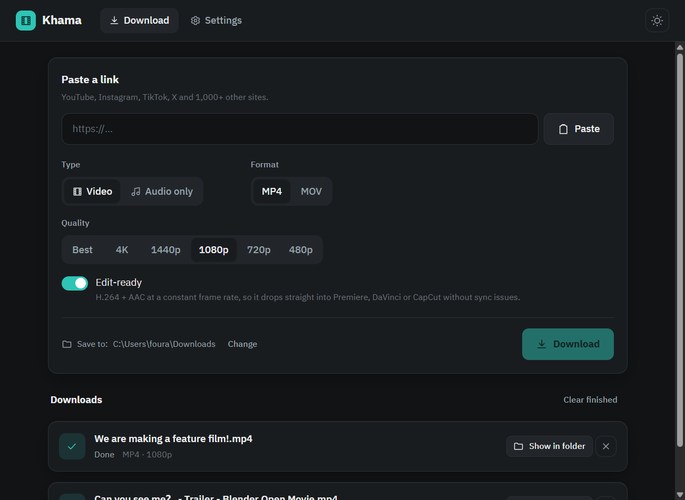
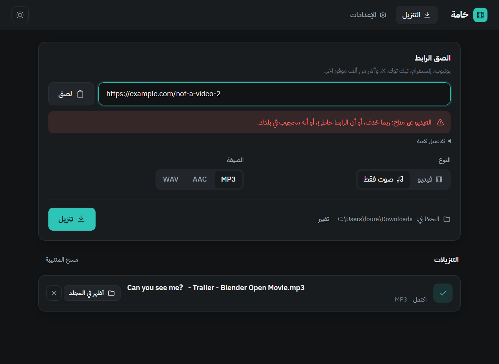

<div align="center">

# Khama · خامة

**Raw footage, timeline-ready.** A desktop media downloader built for video editors.
Paste a link, pick a format, and get a file that drops straight into Premiere, DaVinci Resolve or CapCut.

[English](#english) · [العربية](#العربية)



</div>

---

## English

### Features (phase 1)

- **Paste a link, download at the best quality**: YouTube and 1,000+ sites supported by [yt-dlp](https://github.com/yt-dlp/yt-dlp).
- **Video or audio**: MP4 / MOV, or MP3 / AAC (M4A) / WAV.
- **Quality**: Best, 4K, 1440p, 1080p, 720p, 480p. Options above what the video offers are disabled after the link preview loads.
- **Edit-ready** (on by default): the output is always **H.264 + AAC at a constant frame rate**. Khama picks native H.264 streams when available, and only re-encodes when it has to (for example 4K VP9/AV1).
- **Progress, speed and time left** for every download, plus **cancel**. Unfinished files never land in your folder.
- **Save folder** of your choice, remembered between sessions.
- **English or Arabic UI** (full RTL), dark or light theme. Errors are explained in plain language, with the raw technical details one click away.
- **Cookies** (optional): read from your browser, or paste/import a `cookies.txt`. Useful for age-restricted videos or YouTube's "are you a bot?" check.
- **Download only a part**: pick a start and end, and only that section is downloaded (frame-accurate).
- **Remove music or voice with AI**: keep only the dialogue (or only the music) of a download or any local file. The model (~140 MB) is downloaded once, on first use, and runs fully offline.
- **Update yt-dlp in one click**. Sites change often, and this is the usual fix when downloads start failing.
- **Private by design**: no analytics, no telemetry. Khama only contacts the sites you download from, plus GitHub to check for Khama updates at launch and when you press "Update yt-dlp".

### Converter

A built-in encoder for files already on your computer. Drag files in, pick what you want to *do* (not a codec), and go.

- **For editing**: Edit-ready H.264 (fixes phone VFR sync), ProRes Proxy/LT/422/HQ/4444, DNxHR LB/SQ/HQ/HQX (best for free DaVinci Resolve), light 540p proxies.
- **For publishing**: YouTube, Reels/TikTok/Shorts (auto 9:16 crop), small files for WhatsApp, H.265, AV1, WebM, GIF.
- **Audio**: WAV, MP3, AAC, FLAC, Opus, and AI music/voice removal.
- **Tools**: rewrap without re-encoding, grab a frame, PNG sequence, find scene cuts / black frames / silences, then split at those points.
- **Options**: trim, resize, crop to aspect, frame rate, speed, rotate/flip, deinterlace, denoise, HDR→SDR, 3D LUTs, burned-in subtitles (Arabic shaping supported), logo watermark, timecode, two-pass loudness normalization (−14/−16/−23 LUFS), replace or remove audio, merge several files.
- **Smart checks**: each file is inspected and flagged (variable frame rate, HDR, interlaced, 10-bit, heavy codecs), with a suggested preset.
- **Graphics card encoding** (NVIDIA NVENC, Intel QSV, AMD AMF, Apple VideoToolbox), detected by actually testing the hardware.
- **Queue, size estimate, time left, cancel**, and **watch folders** that convert new files automatically.

### Install

Grab the installer for your system from the [Releases](../../releases) page:

| System | File |
|---|---|
| Windows 10/11 | `Khama_x.y.z_x64-setup.exe` |
| macOS (Apple Silicon) | `Khama_x.y.z_aarch64.dmg` |
| macOS (Intel) | `Khama_x.y.z_x64.dmg` |
| Linux | `.AppImage`, `.deb` or `.rpm` |

Everything Khama needs (yt-dlp, FFmpeg, Deno) is bundled. There is nothing else to install.

#### macOS: opening an unsigned app

Khama isn't signed with an Apple Developer certificate yet, so macOS will warn you the first time:

1. Drag **Khama** into **Applications**, then try to open it once. macOS blocks it.
2. Open **System Settings → Privacy & Security**, scroll down, and click **Open Anyway** next to the Khama message.
3. Confirm with **Open**. You only need to do this once.

If macOS says the app "is damaged", run this once in Terminal:

```bash
xattr -dr com.apple.quarantine /Applications/Khama.app
```

### Build from source

Requirements: [Node.js](https://nodejs.org) 20+, [Rust](https://rustup.rs) (stable), and the [Tauri prerequisites](https://tauri.app/start/prerequisites/) for your OS.

```bash
npm install
npm run fetch-binaries      # downloads yt-dlp, FFmpeg, Deno and verifies their SHA-256
npm run tauri dev           # run in development
npm run tauri build         # build an installer for your system
```

Run the Rust unit tests:

```bash
cargo test --manifest-path src-tauri/Cargo.toml
```

Installers for all three platforms are built automatically by GitHub Actions (`.github/workflows/build.yml`). Run it manually from the **Actions** tab, or push a tag like `v0.1.0` to create a draft release.

### How it works

```
React UI (src/)  ──invoke──▶  Rust (src-tauri/src/)  ──spawns──▶  yt-dlp ──▶ FFmpeg
      ▲                              │
      └──── "job-update" events ─────┘   (progress, done, error)
```

| File | Role |
|---|---|
| `src-tauri/src/download.rs` | Builds the yt-dlp command, parses progress lines, cancels, checks codecs with ffprobe, converts for editing, moves the finished file |
| `src-tauri/src/tools.rs` | Locates bundled tools. Copies yt-dlp to a writable folder so it can self-update |
| `src-tauri/src/errors.rs` | Maps raw yt-dlp errors to error codes |
| `src-tauri/src/settings.rs` | Settings and cookies storage (local JSON) |
| `src/i18n.ts` | English and Arabic dictionaries, including every error message |
| `src/components/` | UI components |
| `scripts/fetch-binaries.mjs` | Downloads and verifies the bundled tools per platform |

### Responsible use

Khama is for **public content you have the right to use**. It does not bypass DRM, paywalls or logins. You are responsible for respecting copyright and each site's terms.

### License

MIT, see [LICENSE](LICENSE). The bundled yt-dlp and FFmpeg executables are GPL-licensed separate programs. See [THIRD_PARTY_NOTICES.md](THIRD_PARTY_NOTICES.md).

---

<div dir="rtl">

## العربية

<div align="center">

</div>

**خامة** أداة تنزيل وسائط على سطح المكتب، مصمّمة للممنتجين: الصق رابطًا، واختر الصيغة، فيصلك ملف جاهز للسحب مباشرة إلى Premiere أو DaVinci Resolve أو CapCut.

### المميزات (المرحلة الأولى)

- **الصق رابطًا وحمّله بأعلى جودة متاحة**، من يوتيوب وأكثر من ألف موقع يدعمها yt-dlp.
- **فيديو أو صوت**: MP4 / MOV، أو MP3 / AAC (M4A) / WAV.
- **اختيار الجودة**: الأفضل، 4K، 1440p، 1080p، 720p، 480p. تُعطَّل الدقات غير المتوفرة بعد ظهور معاينة الرابط.
- **«جاهز للمونتاج»** (مفعّل افتراضيًا): الناتج دائمًا **H.264 + AAC بمعدل إطارات ثابت**. تختار خامة ترميز H.264 الأصلي حين يتوفر، ولا تحوّل إلا عند الضرورة (مثل 4K بترميز VP9 أو AV1).
- **شريط تقدّم وسرعة ووقت متبقٍّ** لكل تنزيل، مع زر **إلغاء**. لا يصل إلى مجلدك أي ملف ناقص.
- **مجلد حفظ** تختاره أنت، ويُحفظ اختيارك.
- **واجهة بالإنجليزية أو العربية** (RTL كاملة)، بثيم داكن أو فاتح. رسائل الخطأ مفهومة، والتفاصيل التقنية متاحة بنقرة.
- **الكوكيز** (اختيارية): من متصفحك مباشرة، أو بلصق ملف `cookies.txt` أو استيراده. تفيد مع الفيديوهات المقيّدة بالعمر، أو حين يسأل يوتيوب «هل أنت روبوت؟».
- **تحميل جزء فقط**: حدّد البداية والنهاية، ويُحمَّل هذا الجزء وحده بدقة الإطار.
- **إزالة الموسيقى أو الصوت البشري بالذكاء الاصطناعي**: أبقِ الحوار وحده (أو الموسيقى وحدها) لأي تنزيل أو ملف على جهازك. النموذج (حوالي 140MB) يُنزَّل مرة واحدة عند أول استخدام، ويعمل بلا إنترنت بعدها.
- **تحديث yt-dlp بنقرة واحدة**: المواقع تتغيّر كثيرًا، وهذا غالبًا هو الحل حين يبدأ التنزيل بالفشل.
- **الخصوصية**: لا تحليلات ولا تتبّع. تتصل خامة فقط بالمواقع التي تنزّل منها، وبـ GitHub للبحث عن تحديثات خامة عند فتحها، وحين تضغط «تحديث yt-dlp».

### المحوّل

محوّل مدمج للملفات الموجودة على جهازك: اسحب الملفات، واختر **ماذا تريد أن تفعل** (لا الكودك)، وابدأ.

- **للمونتاج**: H.264 جاهز للمونتاج (يصلح تزامن فيديو الجوال)، وProRes بكل درجاته، وDNxHR (الأفضل لـ DaVinci Resolve المجاني)، وبروكسي خفيف.
- **للنشر**: يوتيوب، ريلز/تيك توك/شورتس (قص 9:16 تلقائي)، حجم صغير لواتساب، H.265، AV1، WebM، GIF.
- **صوت**: WAV وMP3 وAAC وFLAC وOpus، وإزالة الموسيقى أو الصوت بالذكاء الاصطناعي.
- **أدوات**: تغيير الحاوية بلا إعادة ترميز، التقاط إطار، سلسلة صور، كشف المشاهد والشاشات السوداء والصمت ثم التقسيم عندها.
- **خيارات**: قص، مقاس، قص لنسبة، معدل إطارات، سرعة، تدوير، إزالة التداخل، تقليل التشويش، HDR ← SDR، ملفات LUT، ترجمة مطبوعة (تدعم العربية)، شعار، تايم كود، توحيد مستوى الصوت، استبدال الصوت أو حذفه، ودمج عدة ملفات.
- **فحص ذكي** لكل ملف مع اقتراح الصيغة المناسبة، و**تسريع بكرت الشاشة**، وطابور وتقدير للحجم والوقت، و**مجلدات مراقَبة** تحوّل كل ملف جديد تلقائيًا.

### التثبيت

حمّل ملف التثبيت المناسب لنظامك من صفحة [الإصدارات](../../releases) (الجدول في القسم الإنجليزي أعلاه). كل الأدوات التي تحتاجها خامة (yt-dlp وFFmpeg وDeno) مضمّنة داخلها، فلا داعي لتثبيت أي شيء آخر.

#### macOS: فتح تطبيق غير موقّع

خامة ليست موقّعة بشهادة Apple بعد، لذلك سيحذّرك macOS في أول مرة:

1. اسحب **Khama** إلى مجلد **Applications**، ثم حاول فتحه مرة واحدة. سيمنعه النظام.
2. افتح **إعدادات النظام ← الخصوصية والأمان**، وانزل للأسفل، واضغط **افتح على أي حال** (Open Anyway) بجانب رسالة Khama.
3. أكّد بالضغط على **فتح**. تحتاج هذا مرة واحدة فقط.

إن قال macOS إن التطبيق «تالف»، شغّل هذا الأمر مرة واحدة في Terminal:

</div>

```bash
xattr -dr com.apple.quarantine /Applications/Khama.app
```

<div dir="rtl">

### البناء من الكود المصدري

المتطلبات: Node.js 20 أو أحدث، وRust (الإصدار المستقر)، و[متطلبات Tauri](https://tauri.app/start/prerequisites/) لنظامك.

</div>

```bash
npm install
npm run fetch-binaries      # ينزّل yt-dlp و FFmpeg و Deno ويتحقق من بصماتها
npm run tauri dev           # تشغيل للتطوير
npm run tauri build         # بناء ملف تثبيت لنظامك
```

<div dir="rtl">

ملفات التثبيت للأنظمة الثلاثة تُبنى تلقائيًا عبر GitHub Actions. شغّل البناء يدويًا من تبويب **Actions**، أو ارفع وسمًا مثل `v0.1.0` ليُنشأ إصدار تجريبي (مسودة).

### كيف تعمل؟

الواجهة (React) تطلب من المحرّك (Rust) بدء التنزيل. المحرّك يشغّل yt-dlp، ويقرأ أسطر التقدّم ويرسلها للواجهة كأحداث. بعد انتهاء التنزيل يفحص ffprobe الترميز، ويحوّله ffmpeg عند الحاجة، ثم يُنقل الملف إلى مجلدك. شرح كل ملف في جدول القسم الإنجليزي، والتعليقات داخل الكود مكتوبة بالعربية.

### الاستخدام المسؤول

خامة مخصّصة **للمحتوى العام الذي يحق لك استخدامه**. لا تتجاوز حماية DRM، ولا تتحايل على تسجيل الدخول أو المحتوى المدفوع. أنت مسؤول عن احترام حقوق النشر وشروط كل موقع.

### الرخصة

MIT، انظر [LICENSE](LICENSE). أداتا yt-dlp وFFmpeg المضمّنتان برنامجان مستقلان برخصة GPL، والتفاصيل في [THIRD_PARTY_NOTICES.md](THIRD_PARTY_NOTICES.md).

</div>
