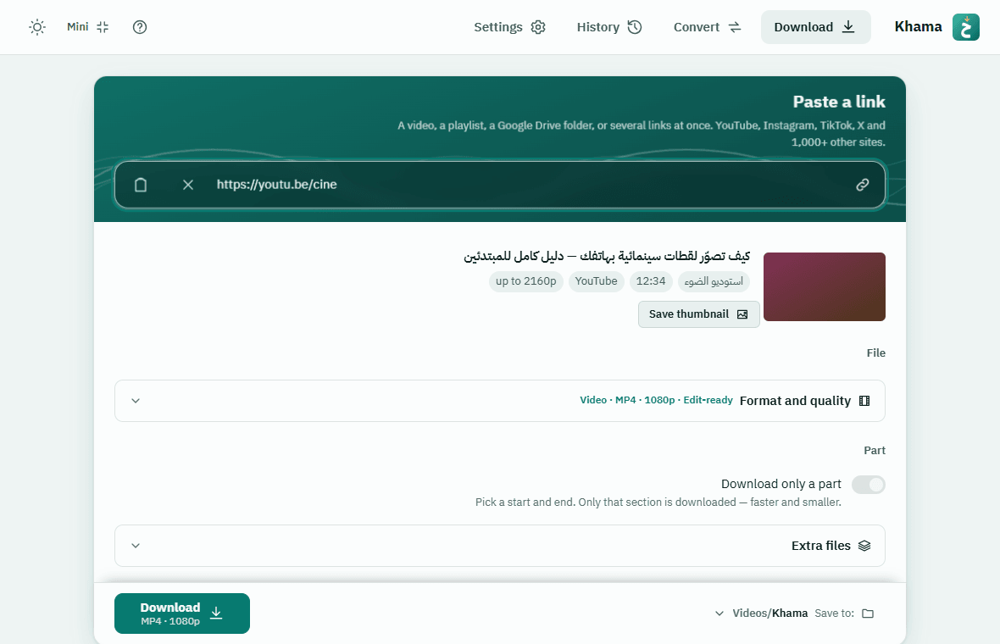
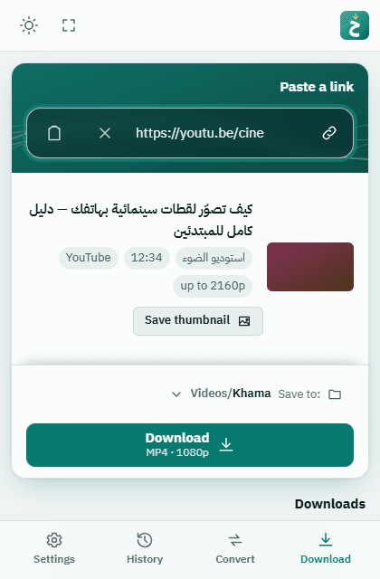
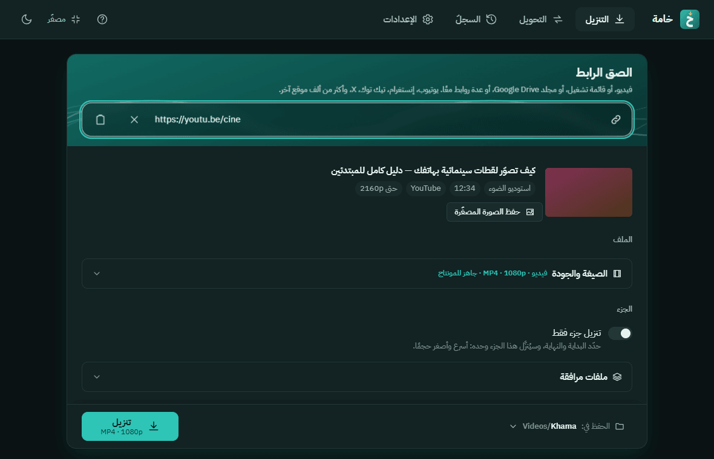
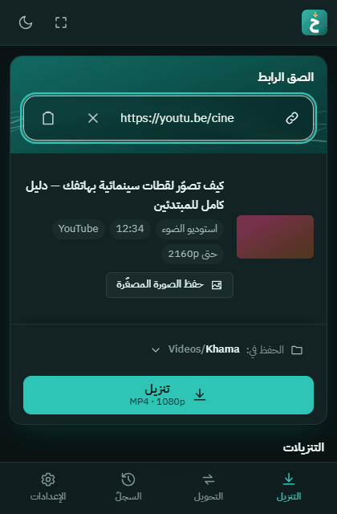

<div align="center">

# Khama · خامة

**Raw footage, timeline-ready.** A desktop media downloader built for video editors.
Paste a link, pick a format, and get a file that drops straight into Premiere, DaVinci Resolve or CapCut.
*Khama* (خامة) is Arabic for "raw material", the footage you start an edit with.

[English](#english) · [العربية](#العربية)



</div>

---

## English

### Downloading

- **Paste a link, download at the best quality**: YouTube and 1,000+ sites supported by [yt-dlp](https://github.com/yt-dlp/yt-dlp). Instagram, TikTok and X often need cookies (Settings → Cookies) and break more often when they change.
- **Video or audio**: MP4 / MOV, or MP3 / AAC (M4A) / WAV.
- **Quality**: Best, 4K, 1440p, 1080p, 720p, 480p. Options above what the video offers are disabled after the link preview loads.
- **Edit-ready** (on by default): the output is always **H.264 + AAC at a constant frame rate**. Khama picks native H.264 streams when available, and only re-encodes when it has to (for example 4K VP9/AV1).
- **Progress, speed and time left** for every download, plus **cancel**. Unfinished files never land in your folder.
- **Save folder** of your choice, remembered between sessions.
- **English or Arabic UI** (full RTL), dark or light theme. Errors are explained in plain language, with the raw technical details one click away.
- **Cookies** (optional): read from your browser, or paste/import a `cookies.txt`. Useful for age-restricted videos or YouTube's "are you a bot?" check.
- **Download only a part**: pick a start and end, and only that section is downloaded. Cuts are frame-accurate: the few seconds around each cut are re-encoded, which adds a little time.
- **AI clean-up (remove music or voice)**: keep only the dialogue (or only the music) of a download or any local file. The model (~140 MB) is downloaded once, on first use, and runs fully offline.
- **Update yt-dlp in one click**. Sites change often, and this is the usual fix when downloads start failing.
- **Private by design**: no analytics, no telemetry. Khama only contacts the sites you download from, plus GitHub (api.github.com) to check for Khama updates once per launch and when you press "Update yt-dlp". That check shows GitHub your IP address; you can turn it off in Settings → Background.
- **Not supported**: DRM-protected services (Netflix, Disney+, Shahid, paid courses, Spotify's own audio). Spotify links are matched to the same song on YouTube Music instead. Big shared Google Drive files can hit Google's "download quota exceeded" limit.

### Converter

A built-in encoder for files already on your computer. Drag files in, pick what you want to *do* (not a codec), and go. Sizes, speed and which editor reads each preset: [docs/PRESETS.md](docs/PRESETS.md).

- **For editing**: H.264 for editing (always re-encodes; fixes phone VFR sync), ProRes Proxy/LT/422/HQ/4444, DNxHR LB/SQ/HQ/HQX (best for free DaVinci Resolve), light 540p proxies.
- **For publishing**: YouTube, Reels/TikTok/Shorts (auto 9:16 crop), small files for WhatsApp, H.265, AV1, WebM, GIF.
- **Audio**: WAV, MP3, AAC, FLAC, Opus, and AI music/voice removal.
- **Tools**: rewrap without re-encoding, grab a frame, PNG sequence, find scene cuts / black frames / silences, then split at those points. **Find topics**: splits the speech (subtitles, or transcribed on the computer) into topics with their times, marks the ones that fit a Reel, shows each one's length before and after removing silences, and exports any topic as a clip. Also in the ⋯ menu of a finished download.
- **Options**: trim, resize, crop to aspect, frame rate, speed, rotate/flip, deinterlace, denoise, HDR→SDR, 3D LUTs, burned-in subtitles (Arabic shaping supported), logo watermark, timecode, two-pass loudness normalization (−14/−16/−23 LUFS), replace or remove audio, merge several files.
- **Smart checks**: each file is inspected and flagged (variable frame rate, HDR, interlaced, 10-bit, heavy codecs), with a suggested preset.
- **Graphics card encoding** (NVIDIA NVENC, Intel QSV, AMD AMF, Apple VideoToolbox), detected by actually testing the hardware.
- **Queue, size estimate, time left, cancel**, and **watch folders** that convert new files automatically.

### For editors (new in 0.2)

- **Drag a finished download straight into Premiere, DaVinci Resolve or CapCut**, from the downloads list or the history.
- **Subtitles as SRT**, cut to match the part you download. **Thumbnail as JPG** at full resolution. **Source info** (`.txt`) with the link, uploader and dates, for credits.
- **Several links at once**: paste a whole list and each one is queued. **Google Drive folders** download file by file, in their original format.
- **Preview the video while trimming**, with "set start here / set end here" buttons.
- **Stills** every 5 or 10 seconds, or at scene cuts, for moodboards. **Timeline XML** for clips saved separately, so they open laid out in Premiere or Resolve.
- **History** that survives restarts, with search, "show in folder" and "download again".
- **Projects**: a save folder plus download options per project, one click to switch. **File name templates** (`{n}_{site}_{title}`…) and a sub-folder per site.
- **Runs in the background** from the tray, with a **notification** when a download finishes. **Copied links are suggested** automatically (optional).
- **Speed limit**, **scheduled downloads** ("start at 2:00"), and a **mini window** that stays on top next to your editor.

### Install

Grab the installer for your system from the [Releases](../../releases) page:

| System | File |
|---|---|
| Windows 10/11 | `Khama_x.y.z_x64-setup.exe` |
| macOS (Apple Silicon) | `Khama_x.y.z_aarch64.dmg` |
| macOS (Intel) | `Khama_x.y.z_x64.dmg` |
| Linux | `.AppImage`, `.deb` or `.rpm` |
| Android (phone) | `Khama_x.y.z_android-arm64.apk` |

Everything Khama needs (yt-dlp, FFmpeg, Deno) is bundled. There is nothing else to install.

**Minimum systems**: Windows 10 (64-bit) or 11, macOS 10.13 or newer, a 64-bit Linux with WebKitGTK 4.1 (Ubuntu 22.04, Debian 12, Fedora 36 or newer), Android 7 (arm64). Khama draws its window with Microsoft Edge WebView2, which Windows 11 and updated Windows 10 already have. If it's missing, the installer downloads it from Microsoft (needs the internet once).

**Uninstalling**: on Windows, tick "Delete the application data" in the uninstaller to remove settings, history, the updated yt-dlp and the AI model (~140 MB) too. On other systems, delete the folders listed in [docs/DATA.md](docs/DATA.md).

**Linux**: the `.deb` is for Ubuntu, Debian and Mint, the `.rpm` for Fedora and openSUSE. The `.AppImage` runs anywhere without installing: make it executable (`chmod +x`) and open it.

**Android**: open the `.apk` on the phone. Android asks once to allow installs from your browser or file manager ("Install unknown apps"); allow it, then install. The phone version downloads, trims, converts and runs AI clean-up (slower than a computer). Desktop-only: choosing the save folder (files go to `Download/Khama`), dragging files out, the tray, watch folders and the mini window.

**Portable use**: Khama keeps its settings and history in your user folder (AppData on Windows, Application Support on macOS), not next to the app, so it doesn't run as a portable app from a USB stick.

**Updating yt-dlp** (Settings → Tools) is safe and takes seconds: it fetches the official release from GitHub. Do it whenever downloads from a site start failing, or about once a month.

#### macOS: opening an unsigned app

Khama isn't signed with an Apple Developer certificate yet, so macOS will warn you the first time:

1. Drag **Khama** into **Applications**, then try to open it once. macOS blocks it.
2. Open **System Settings → Privacy & Security**, scroll down, and click **Open Anyway** next to the Khama message.
3. Confirm with **Open**. You only need to do this once.

If macOS says the app "is damaged", run this once in Terminal. It removes the "downloaded from the internet" flag macOS put on Khama, and changes nothing else:

```bash
xattr -dr com.apple.quarantine /Applications/Khama.app
```

### Build from source

Requirements: [Node.js](https://nodejs.org) 22+, [Rust](https://rustup.rs) 1.88+, and the [Tauri prerequisites](https://tauri.app/start/prerequisites/) for your OS.
The toolchain is recent on purpose (TypeScript 6, Vite 8, React 19, Rust edition 2024); these minimums are the oldest versions CI builds with, and they are enforced: `engines` in `package.json`, `rust-version` in `Cargo.toml`, and `npm run dev` checks Node and missing packages first.
`@tauri-apps/api` and the Rust `tauri` crate are kept on the same minor version (`~2.12`) because the bridge between them must match.

```bash
npm ci
npm run fetch-binaries      # downloads yt-dlp, FFmpeg, Deno and verifies their SHA-256
npm run tauri dev           # run in development
npm run tauri build         # build an installer for your system
```

Run the Rust unit tests:

```bash
cargo test --manifest-path src-tauri/Cargo.toml
```

Installers for all three platforms are built automatically by GitHub Actions (`.github/workflows/build.yml`). Run it manually from the **Actions** tab, or push a tag like `v0.2.0` to create a draft release.

### How it works

```
React UI (src/)  ──invoke──▶  Rust (src-tauri/src/)  ──spawns──▶  yt-dlp ──▶ FFmpeg
      ▲                              │
      └──── "job-update" events ─────┘   (progress, done, error)
```

| File | Role |
|---|---|
| `src-tauri/src/download.rs` | Builds the yt-dlp command, parses progress lines, cancels, checks codecs with ffprobe, converts for editing, moves the finished file |
| `src-tauri/src/tools.rs` | Locates bundled tools. Copies yt-dlp to a writable folder so it can self-update |
| `src-tauri/src/errors.rs` | Maps raw yt-dlp errors to error codes |
| `src-tauri/src/settings.rs` | Settings and cookies storage (local JSON) |
| `src-tauri/src/history.rs` | Download history (local JSON) |
| `src-tauri/src/srt.rs` | Cuts subtitles to the downloaded part |
| `src-tauri/src/background.rs` | Tray icon, close-to-tray, clipboard watching, mini window |
| `src/i18n.ts` | English and Arabic dictionaries, including every error message |
| `src/components/` | UI components |
| `scripts/fetch-binaries.mjs` | Downloads and verifies the bundled tools per platform |

### Responsible use

Khama is for **public content you have the right to use**. It does not bypass DRM, paywalls or logins. You are responsible for respecting copyright and each site's terms.

### License

MIT, see [LICENSE](LICENSE). The bundled yt-dlp and FFmpeg executables are GPL-licensed separate programs. See [THIRD_PARTY_NOTICES.md](THIRD_PARTY_NOTICES.md).

### Mini mode

The **Mini** button in the top bar turns Khama into a small always-on-top window (420×640) that sits beside your editor: paste links and drop files without switching apps.

- **Kept**: the link field, the download button, the file and quality summary, the save folder, the Downloads list and the tab icons.
- **Hidden**: the app name, tab labels, descriptions, extra options, notices, the project picker and the guide button.
- Mini opens on Download; **Full** brings back the tab you were on.



---

<div dir="rtl">

## العربية

<div align="center">

</div>

**خامة** أداة تنزيل وسائط على سطح المكتب، مصمّمة لمحرّري الفيديو: الصق رابطًا، واختر الصيغة، فيصلك ملف جاهز للسحب مباشرة إلى Premiere أو DaVinci Resolve أو CapCut.

### التنزيل

- **الصق رابطًا ونزّله بأعلى جودة متاحة**، من يوتيوب وأكثر من ألف موقع يدعمها yt-dlp. إنستغرام وتيك توك وX تحتاج الكوكيز غالبًا، وتتعطّل أكثر حين تتغيّر.
- **فيديو أو صوت**: MP4 / MOV، أو MP3 / AAC (M4A) / WAV.
- **اختيار الجودة**: الأفضل، 4K، 1440p، 1080p، 720p، 480p. تُعطَّل الدقات غير المتوفرة بعد ظهور معاينة الرابط.
- **«جاهز للمونتاج»** (مفعّل افتراضيًا): الناتج دائمًا **H.264 + AAC بمعدل إطارات ثابت**. تختار خامة ترميز H.264 الأصلي حين يتوفر، ولا تحوّل إلا عند الضرورة (مثل 4K بترميز VP9 أو AV1).
- **شريط تقدّم وسرعة ووقت متبقٍّ** لكل تنزيل، مع زر **إلغاء**. لا يصل إلى مجلدك أي ملف ناقص.
- **مجلد حفظ** تختاره أنت، ويُحفظ اختيارك.
- **واجهة بالإنجليزية أو العربية** (RTL كاملة)، بثيم داكن أو فاتح. رسائل الخطأ مفهومة، والتفاصيل التقنية متاحة بنقرة.
- **الكوكيز** (اختيارية): من متصفحك مباشرة، أو بلصق ملف `cookies.txt` أو استيراده. تفيد مع الفيديوهات المقيّدة بالعمر، أو حين يسأل يوتيوب «هل أنت روبوت؟».
- **تنزيل جزء فقط**: حدّد البداية والنهاية، ويُنزَّل هذا الجزء وحده. القص دقيق بالإطار: الثواني القليلة حول كل قطع يُعاد ترميزها، فيأخذ وقتًا أطول قليلًا.
- **التنظيف بالذكاء الاصطناعي (إزالة الموسيقى أو الصوت البشري)**: أبقِ الحوار وحده (أو الموسيقى وحدها) لأي تنزيل أو ملف على جهازك. النموذج (حوالي 140MB) يُنزَّل مرة واحدة عند أول استخدام، ويعمل بلا إنترنت بعدها.
- **تحديث yt-dlp بنقرة واحدة**: المواقع تتغيّر كثيرًا، وهذا غالبًا هو الحل حين يبدأ التنزيل بالفشل.
- **الخصوصية**: لا تحليلات ولا تتبّع. تتصل خامة فقط بالمواقع التي تنزّل منها، وبـ GitHub (api.github.com) للبحث عن تحديثات خامة مرة عند كل فتح، وحين تضغط «تحديث yt-dlp». هذا الفحص يُري GitHub عنوان IP الخاص بك، ويمكنك إطفاؤه من الإعدادات ← الخلفية.
- **غير مدعوم**: الخدمات المحمية بـ DRM (نتفليكس وديزني+ وشاهد والدورات المدفوعة وصوت سبوتيفاي نفسه). روابط سبوتيفاي تُطابَق مع الأغنية نفسها على YouTube Music بدلًا من ذلك. وملفات Google Drive الكبيرة المشتركة قد تصطدم بحدّ Google «تجاوز حصة التنزيل».

### المحوّل

محوّل مدمج للملفات الموجودة على جهازك: اسحب الملفات، واختر **ماذا تريد أن تفعل** (لا الكودك)، وابدأ. الأحجام والسرعة وأي برنامج يقرأ كل صيغة: [docs/PRESETS.md](docs/PRESETS.md).

- **للمونتاج**: H.264 للمونتاج (يعيد الترميز دائمًا؛ يصلح تزامن فيديو الجوال)، وProRes بكل درجاته، وDNxHR (الأفضل لـ DaVinci Resolve المجاني)، وبروكسي خفيف.
- **للنشر**: يوتيوب، ريلز/تيك توك/شورتس (قص 9:16 تلقائي)، حجم صغير لواتساب، H.265، AV1، WebM، GIF.
- **صوت**: WAV وMP3 وAAC وFLAC وOpus، وإزالة الموسيقى أو الصوت بالذكاء الاصطناعي.
- **أدوات**: تغيير الحاوية بلا إعادة ترميز، التقاط إطار، سلسلة صور، كشف المشاهد والشاشات السوداء والصمت ثم التقسيم عندها. **استخراج المواضيع**: يقسّم الكلام (من الترجمة، أو بتفريغه على الجهاز) إلى مواضيع بأوقاتها، ويحدّد ما يصلح منها ريلًا، ويعرض مدة كل موضوع قبل حذف الصمت وبعده، ويصدّر أي موضوع مقطعًا. وموجود أيضًا في قائمة ⋯ لأي تنزيل مكتمل.
- **خيارات**: قص، مقاس، قص لنسبة، معدل إطارات، سرعة، تدوير، إزالة التداخل، تقليل التشويش، HDR ← SDR، ملفات LUT، ترجمة مطبوعة (تدعم العربية)، شعار، تايم كود، توحيد مستوى الصوت، استبدال الصوت أو حذفه، ودمج عدة ملفات.
- **فحص ذكي** لكل ملف مع اقتراح الصيغة المناسبة، و**تسريع بكرت الشاشة**، وطابور وتقدير للحجم والوقت، و**مجلدات مراقَبة** تحوّل كل ملف جديد تلقائيًا.

### لمحرّر الفيديو (جديد في 0.2)

- **اسحب التنزيل المكتمل مباشرة إلى Premiere أو DaVinci Resolve أو CapCut**، من قائمة التنزيلات أو من السجلّ.
- **الترجمة بصيغة SRT** مقصوصة على الجزء الذي تنزّله، و**الصورة المصغّرة JPG** بأعلى دقة، و**ملف معلومات المصدر** (‎.txt) فيه الرابط وصاحب المحتوى والتواريخ لذكر المصدر.
- **عدة روابط مرة واحدة**: الصق قائمة كاملة فيُنزَّل كل رابط بالترتيب. و**مجلدات Google Drive** تُنزَّل ملفًا ملفًا بصيغتها الأصلية.
- **معاينة الفيديو أثناء القص**، مع زرّي «البداية من هنا / النهاية هنا».
- **لقطات ثابتة** كل 5 أو 10 ثوانٍ أو عند تغيّر المشهد (للوحات المراجع)، و**ملف تايم لاين XML** للمقاطع المنفصلة يفتح مرتّبًا في Premiere أو Resolve.
- **سجلّ تنزيلات** يبقى بعد إغلاق التطبيق، فيه بحث و«أظهر في المجلد» و«نزّله مرة أخرى».
- **مشاريع**: لكل مشروع مجلد حفظ وخيارات تنزيل، والتبديل بنقرة. و**قوالب لأسماء الملفات** (`{n}_{site}_{title}`…) ومجلد فرعي لكل موقع.
- **العمل في الخلفية** من شريط المهام، مع **إشعار** عند انتهاء التنزيل، و**اقتراح الروابط المنسوخة** تلقائيًا (اختياري).
- **حدّ للسرعة**، و**تنزيل مجدول** («ابدأ الساعة 2:00»)، و**نافذة مصغّرة** تبقى فوق برنامج المونتاج.

### الوضع المصغّر

زر **مصغّر** في الشريط العلوي يحوّل خامة إلى نافذة صغيرة (420×640) تبقى فوق برنامج المونتاج: تلصق الروابط وتسحب الملفات دون التنقّل بين البرامج.

- **يبقى**: حقل الرابط وزر التنزيل وملخص الملف والجودة ومجلد الحفظ وقائمة التنزيلات وأيقونات التبويبات.
- **يختفي**: اسم التطبيق ونصوص التبويبات والأوصاف والخيارات الإضافية والإشعارات ومنتقي المشروع وزر الدليل.
- يفتح على التنزيل، و«كامل» يعيدك للتبويب الذي كنت فيه.

<div align="center"></div>

### التثبيت

نزّل ملف التثبيت المناسب لنظامك من صفحة [الإصدارات](../../releases) (الجدول في القسم الإنجليزي أعلاه). كل الأدوات التي تحتاجها خامة (yt-dlp وFFmpeg وDeno) مضمّنة داخلها، فلا داعي لتثبيت أي شيء آخر.

**الحد الأدنى للأنظمة**: Windows 10 (64 بت) أو 11، وmacOS 10.13 أو أحدث، وLinux 64 بت فيه WebKitGTK 4.1 (Ubuntu 22.04 وDebian 12 وFedora 36 أو أحدث)، وأندرويد 7 (arm64). ترسم خامة نافذتها بـ Microsoft Edge WebView2، وهو موجود في Windows 11 وWindows 10 المحدّث. إن لم يكن موجودًا ينزّله المثبّت من Microsoft (يحتاج الإنترنت مرة واحدة).

**الإزالة**: على Windows، فعّل «حذف بيانات التطبيق» في برنامج الإزالة ليحذف الإعدادات والسجلّ وyt-dlp المحدَّث ونموذج الذكاء الاصطناعي (نحو 140 MB) أيضًا. وعلى الأنظمة الأخرى احذف المجلدات المذكورة في [docs/DATA.md](docs/DATA.md).

**Linux**: ملف `.deb` لـ Ubuntu وDebian وMint، و`.rpm` لـ Fedora وopenSUSE. أما `.AppImage` فيعمل في أي توزيعة بلا تثبيت: اجعله قابلًا للتشغيل (`chmod +x`) ثم افتحه.

**أندرويد**: افتح ملف `Khama_x.y.z_android-arm64.apk` على الهاتف. سيطلب أندرويد مرة واحدة السماح بالتثبيت من المتصفح أو مدير الملفات («تثبيت التطبيقات غير المعروفة»)؛ اسمح ثم ثبّت. نسخة الهاتف تنزّل وتقص وتحوّل وتنظّف بالذكاء الاصطناعي (أبطأ من الكمبيوتر). على الكمبيوتر فقط: اختيار مجلد الحفظ (الملفات تذهب إلى `Download/Khama`)، وسحب الملفات للخارج، وشريط المهام، والمجلدات المراقَبة، والنافذة المصغّرة.

**الاستخدام المحمول**: تحفظ خامة إعداداتها وسجلّها في مجلد المستخدم (AppData على Windows وApplication Support على macOS) لا بجانب التطبيق، فلا تعمل كتطبيق محمول من ذاكرة USB.

**تحديث yt-dlp** (الإعدادات ← الأدوات) آمن ويأخذ ثوانٍ: يجلب الإصدار الرسمي من GitHub. افعله كلما بدأ التنزيل من موقع ما يفشل، أو مرة في الشهر تقريبًا.

#### macOS: فتح تطبيق غير موقّع

خامة ليست موقّعة بشهادة Apple بعد، لذلك سيحذّرك macOS في أول مرة:

1. اسحب **Khama** إلى مجلد **Applications**، ثم حاول فتحه مرة واحدة. سيمنعه النظام.
2. افتح **إعدادات النظام ← الخصوصية والأمان**، وانزل للأسفل، واضغط **افتح على أي حال** (Open Anyway) بجانب رسالة Khama.
3. أكّد بالضغط على **فتح**. تحتاج هذا مرة واحدة فقط.

إن قال macOS إن التطبيق «تالف»، شغّل هذا الأمر مرة واحدة في Terminal. هو يزيل علامة «نُزّل من الإنترنت» التي وضعها macOS على خامة، ولا يغيّر شيئًا آخر:

</div>

```bash
xattr -dr com.apple.quarantine /Applications/Khama.app
```

<div dir="rtl">

### البناء من الكود المصدري

المتطلبات: Node.js 22 أو أحدث، وRust 1.88 أو أحدث، و[متطلبات Tauri](https://tauri.app/start/prerequisites/) لنظامك. هذه أقدم نسخ يُبنى بها المشروع، ويفرضها `engines` و`rust-version`، و`npm run dev` يفحص نسخة Node والحزم الناقصة قبل التشغيل.

</div>

```bash
npm ci
npm run fetch-binaries      # ينزّل yt-dlp و FFmpeg و Deno ويتحقق من بصماتها
npm run tauri dev           # تشغيل للتطوير
npm run tauri build         # بناء ملف تثبيت لنظامك
```

<div dir="rtl">

ملفات التثبيت للأنظمة الثلاثة تُبنى تلقائيًا عبر GitHub Actions. شغّل البناء يدويًا من تبويب **Actions**، أو ارفع وسمًا مثل `v0.2.0` ليُنشأ إصدار تجريبي (مسودة).

### كيف تعمل؟

الواجهة (React) تطلب من المحرّك (Rust) بدء التنزيل. المحرّك يشغّل yt-dlp، ويقرأ أسطر التقدّم ويرسلها للواجهة كأحداث. بعد انتهاء التنزيل يفحص ffprobe الترميز، ويحوّله ffmpeg عند الحاجة، ثم يُنقل الملف إلى مجلدك. شرح كل ملف في جدول القسم الإنجليزي، والتعليقات داخل الكود مكتوبة بالعربية.

### الاستخدام المسؤول

خامة مخصّصة **للمحتوى العام الذي يحق لك استخدامه**. لا تتجاوز حماية DRM، ولا تتحايل على تسجيل الدخول أو المحتوى المدفوع. أنت مسؤول عن احترام حقوق النشر وشروط كل موقع.

### الرخصة

MIT، انظر [LICENSE](LICENSE). أداتا yt-dlp وFFmpeg المضمّنتان برنامجان مستقلان برخصة GPL، والتفاصيل في [THIRD_PARTY_NOTICES.md](THIRD_PARTY_NOTICES.md).

</div>
