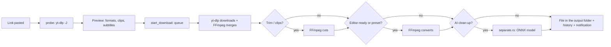
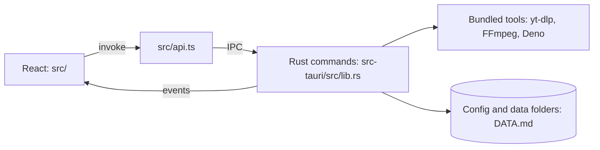

# Development · التطوير

## Setup · الإعداد

| Tool | Version | Why |
|---|---|---|
| Node.js | 22+ | Interface build. `npm run dev` checks it first. |
| Rust | 1.88+ (stable) | `rust-version` in `src-tauri/Cargo.toml`. |
| Linux only | `libwebkit2gtk-4.1-dev libappindicator3-dev librsvg2-dev patchelf` | The same list CI installs. |
| Windows only | WebView2 (already in Windows 11) and the MSVC build tools | [Tauri prerequisites](https://tauri.app/start/prerequisites/). |
| Android only | JDK 17, Android SDK + NDK, `rustup target add aarch64-linux-android` | See [ANDROID_RELEASE.md](ANDROID_RELEASE.md). |

```bash
npm ci
```

```bash
npm run fetch-binaries
```

```bash
npm run tauri dev
```

`npm ci` also points git at `.githooks/`, whose pre-commit hook runs Prettier on the staged files, `tsc` and `cargo fmt --check`. Skip it once with `git commit --no-verify` only when you know why.

These are the same commands CI runs before every release (`build.yml`: `npm ci`, `fetch-binaries`, then `tauri build` through tauri-action), so if the README steps drift, the release build breaks first.

## Interface without Rust · الواجهة بلا Rust

```bash
npm run dev
```

Opens the interface in a plain browser at `http://localhost:1430`. `src/main.tsx` loads `src/dev-mock.ts` in development only; it replaces every Tauri command with fake data:

- a link preview with formats and subtitles (paste any `https://` link),
- downloads and conversions that move through every state, one of them failing with an error code,
- history, scheduled items and tool versions.

Use it for design work and screenshots. It never ships: production builds don't include it. When you add a command, add its fake in `dev-mock.ts` too (`src/devMock.test.ts` fails if a Rust command has no fake).

Test edge cases there: very long titles, emoji, Arabic and English mixed, file names with characters Windows forbids (`<>:"/\|?*`).

## Where things go wrong · التصحيح

- **The log file**: `%LOCALAPPDATA%\com.jake750.khama\logs` on Windows, `~/Library/Logs/com.jake750.khama` on macOS, `~/.local/share/com.jake750.khama/logs` on Linux. It holds every yt-dlp and FFmpeg command line and their full error output. Replaced at 2 MB, one old file kept.
- **In `tauri dev`** the same lines print to the terminal.
- **In the app**, every error has "Technical details" with the raw tool output.
- **Interface**: right-click → Inspect in `tauri dev` opens the web inspector.
- **Run the tool by hand**: copy the yt-dlp command from the log and run it with the bundled binary in `src-tauri/binaries/` to see whether the problem is Khama's or yt-dlp's.

## How a download flows · مسار التنزيل



Every step sends `job-update` events ([IPC.md](IPC.md)), and a failure becomes an error code ([ERRORS.md](ERRORS.md)).



## Documents · الوثائق

| File | What's in it |
|---|---|
| [README.md](../README.md) | For users: features, install, privacy. |
| [CONTRIBUTING.md](../CONTRIBUTING.md) | How to report and send changes. |
| [IPC.md](IPC.md) | Every command and event between the interface and Rust. |
| [ERRORS.md](ERRORS.md) | Every error code and its message. |
| [DATA.md](DATA.md) | Files Khama writes, settings schema, uninstalling. |
| [DECISIONS.md](DECISIONS.md) | Why things are the way they are. |
| [STYLE.md](STYLE.md) | Interface text and terms. |
| [TESTING.md](TESTING.md) | What is tested, how, and the manual checklist. |
| [RELEASING.md](RELEASING.md) | Versions, releases, rollback. |
| [RISKS.md](RISKS.md) | What could break Khama and the plan for each. |
| [SECURITY.md](SECURITY.md) | Content policy and file-access limits. |
| [PRESETS.md](PRESETS.md) | Converter presets compared. |
| [DESIGN-SYSTEM.md](DESIGN-SYSTEM.md) | Colors, type, motion. |
| [DEPENDENCIES.md](DEPENDENCIES.md) | Every dependency and why. |
| [PERFORMANCE.md](PERFORMANCE.md) | Size budget and measurements. |
| [ANDROID_RELEASE.md](ANDROID_RELEASE.md) | Android signing and local builds. |

## Scripts · السكربتات

| Script | When |
|---|---|
| `npm run fetch-binaries` | After cloning, and after changing `scripts/binaries.lock.json`. |
| `npm run release` | Ship a new version ([RELEASING.md](RELEASING.md)). |
| `npm run size` | After `vite build`: fails if the interface grew past its budget. |
| `scripts/changelog.sh` | Rebuilds `CHANGELOG.md`; `release` runs it. |
| `scripts/android-adaptive-icon.py` | Only when the logo changes, after `tauri icon`. Needs Python 3 with `pip install pillow numpy`. Usage is in the file's first lines. |
