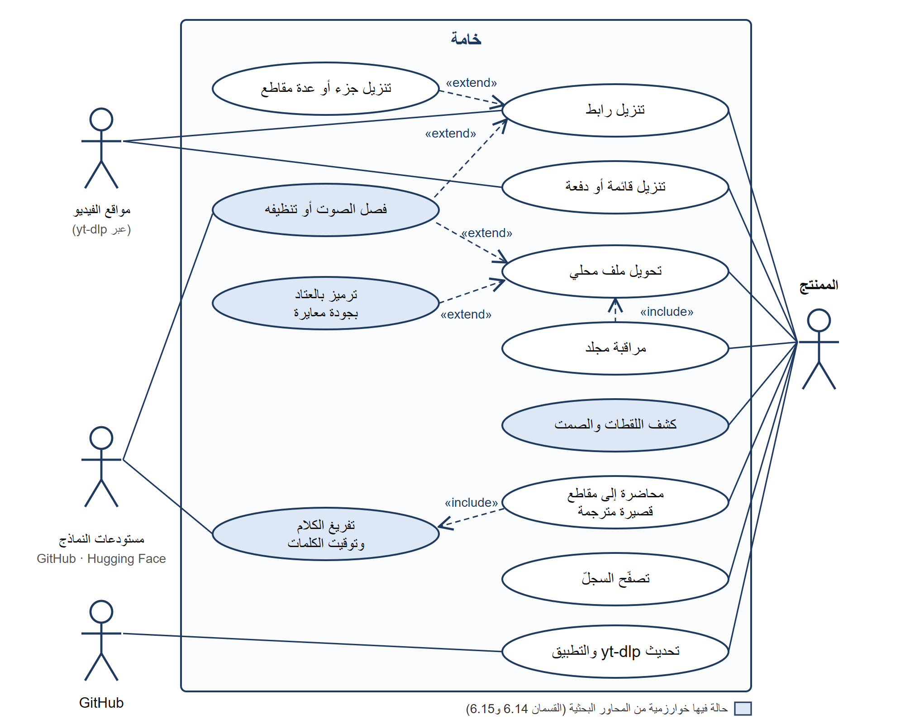

# الفصل 3: تحليل المتطلبات

## 3.1 الشخصيات (Personas)

**الجدول 3.1: شخصيات المستخدمين** (A-20)

| الشخصية | الوصف | ما يهمّه | ما يزعجه |
|---|---|---|---|
| **سارة، محرّرة مستقلة** | تعمل على Premiere وResolve لعملاء متعددين، تجمع 20–50 مرجعًا في المشروع | ملف يُسحب للتايم لاين دون تحويل، أسماء منظمة، مجلد لكل مشروع | انزياح الصوت، تنزيل ساعة لأخذ دقيقة |
| **عمر، صانع محتوى** | ينشر على يوتيوب وتيك توك من هاتفه وحاسوبه | السرعة، صيغ النشر الجاهزة (عمودي، صغير لواتساب) | الإعلانات في مواقع التنزيل، الواجهات الإنجليزية |
| **ليلى، طالبة إعلام** | جهاز متوسط، مساحة قليلة، تتعلّم المونتاج | الحجم، الشرح، أن تعمل الأداة مجانًا دون حساب | المصطلحات التقنية، رسائل الخطأ الخام |

## 3.2 المتطلبات الوظيفية

**الجدول 3.2: المتطلبات الوظيفية** (A-7، A-34، بأسلوب ISO/IEC/IEEE 29148 [21] المختصر: كل متطلب قابل للاختبار وله معيار قبول)

| # | المتطلب | الأولوية | معيار القبول |
|---|---|---|---|
| FR-1 | تنزيل رابط من أي موقع يدعمه yt-dlp بأعلى جودة متاحة | Must | رابط يوتيوب 1080p يُنزَّل بالدقة 1080p ويُفتح في مشغّل |
| FR-2 | اختيار الصيغة: فيديو (MP4، MOV) أو صوت (MP3، AAC، WAV، الأصل) | Must | كل صيغة تنتج ملفًا بالامتداد والترميز المطلوبين |
| FR-3 | اختيار الجودة: الأفضل، 2160p حتى 360p | Must | الدقة الناتجة ≤ المطلوبة وأعلى المتاح تحتها |
| FR-4 | تقدّم مرئي لكل تنزيل مع إمكانية الإلغاء | Must | النسبة والسرعة والمتبقي تتحدّث؛ الإلغاء يوقف العملية ويحذف الملفات الجزئية |
| FR-5 | اختيار مجلد الحفظ وتذكّره | Must | المجلد يبقى بعد إعادة التشغيل |
| FR-6 | واجهة عربية كاملة RTL ورسائل خطأ مفهومة | Must | كل نص مترجم؛ كل خطأ برسالة وخطوة تالية |
| FR-7 | قص قبل التنزيل (بداية ونهاية)، ومقاطع متعددة من الرابط نفسه | Must | الملف الناتج بطول المقطع ±1 ث |
| FR-8 | طابور لعدة روابط ودفعات وقوائم تشغيل | Must | 10 روابط تُنزَّل كلها، بحد التزامن المضبوط |
| FR-9 | ترجمة SRT عند توفرها | Should | ملف .srt بجانب الفيديو بنفس الاسم |
| FR-10 | الصورة المصغّرة بأعلى دقة JPG | Should | ملف JPG بجانب الفيديو |
| FR-11 | «جاهز للمونتاج»: H.264 بمعدل إطارات ثابت | Must | الملف H.264 yuv420p CFR؛ يُعاد الترميز فقط إن لم يكن كذلك |
| FR-12 | مجلدات Google Drive العامة كاملة | Could | مجلد عام من 5 ملفات يُنزَّل كاملًا |
| FR-13 | فصل الصوت البشري عن الموسيقى، اختياريًا، ينزَّل عند الطلب | Could | الملف الناتج صوت فقط أو موسيقى فقط؛ النموذج لا يُنزَّل إلا عند أول استعمال |
| FR-14 | العمل في الخلفية مع أيقونة وإشعار | Should | إغلاق النافذة يُبقي التنزيل؛ إشعار عند الانتهاء |
| FR-15 | سجلّ التنزيلات مع «افتح المجلد» | Should | كل تنزيل ناجح في السجلّ ويفتح مكانه |
| FR-16 | تحديث yt-dlp من داخل التطبيق | Must | زر واحد؛ ترجع النسخة القديمة إن فشل التحديث |
| FR-17 | محوّل للملفات المحلية بصيغ للمونتاج والنشر | Should (إضافة) | كل صيغة تنجح في اختبار `presets_real` |
| FR-18 | مجلدات مراقَبة تُحوَّل ملفاتها آليًا | Could (إضافة) | ملف جديد يُحوَّل مرة واحدة |
| FR-19 | نسخة أندرويد | Could (إضافة) | تنزيل وقص وتحويل على هاتف arm64 |
| FR-20 | كشف تغيّر اللقطات في الفيديو (لقطات الشاشة وتقسيم المشاهد) بكاشف خامة بدل عتبة FFmpeg | Should (المحور C) | F₁ ≥ 0.90 على مجموعة الاختبار، وفرق ≥ 0.15 عن أفضل عتبة لـ FFmpeg، وسرعة ≥ 0.75 من فلتره (H5) |
| FR-21 | ترميز H.264 وHEVC بالعتاد بجودة تعادل قيمة CRF المطلوبة | Should (المحور A) | خطأ VMAF الوسيط عن x264 بالقيمة نفسها ضمن ±0.5 خارج العيّنة (H6) |
| FR-22 | فصل الصوت بإعدادات مقيسة على مجموعة مرجعية | Should (المحور B) | لا إعداد بديل يرفع SDR الصوت أكثر من 0.1 dB بفرق دالّ بعد Holm على MUSDB18 (H7) |
| FR-23 | تقسيم محاضرة طويلة إلى مواضيع، وتصدير كل موضوع مقطعًا قصيرًا بلا صمت | Could (المحور D) | الحدود الأربعة في مجموعة الدروس الخمسة تُكشف في الأطوال الثلاثة (معيار كُتب بعد القياس) |
| FR-24 | ترجمة المقاطع القصيرة بتوقيت الكلمة وأسطر محدودة الطول | Could (المحور D) | خطأ بداية الكلمة بعد الوقفات أقل بـ 20% على الأقل للمصدرين، ولا تداخل ولا تجاوز للحد في الأسطر (H8) |

المتطلبات 1–16 من الكرّاس؛ 17–19 إضافات موثّقة في «سجلّ تغيّر المواصفات» في [PROJECT_BRIEF.md](../../PROJECT_BRIEF.md)؛ و20–24 متطلبات المحاور البحثية (§2.4)، كُتبت في المراجعة الثالثة بعد أن بُنيت الميزات. معايير FR-20 حتى FR-22 وFR-24 هي الفرضيات H5–H8 (§1.5)، أما FR-23 فلا فرضية له، فمعياره وصف لما قيس لا اختبار معلن قبل القياس.

## 3.3 المتطلبات غير الوظيفية

**الجدول 3.3: المتطلبات غير الوظيفية**

| # | المتطلب | معيار القبول | النتيجة |
|---|---|---|---|
| NFR-1 | يعمل على Windows وmacOS (Apple Silicon وIntel) وLinux | مثبّت لكل نظام يبنيه CI | ✓ §6.7 |
| NFR-2 | لا تثبيت يدوي لأي أداة | أول تنزيل ينجح بعد التثبيت مباشرة | ✓ الأدوات مضمّنة |
| NFR-3 | الخصوصية: لا جمع بيانات ولا تحليلات | لا اتصال إلا ما في جدول §3.6 | ✓ |
| NFR-4 | الأمان | الأدوات مفحوصة ببصمة SHA-256؛ CSP مقيّدة؛ الواجهة لا تفتح إلا ملفات خامة | ✓ §7.1 |
| NFR-5 | الأداء: نافذة سريعة | ظهور النافذة < 2 ث على جهاز متوسط | 0.75–1.6 ث بارد، 95 ms دافئ §6.7 |
| NFR-6 | الأخلاقيات: لا تجاوز DRM أو تسجيل دخول | لا كود لذلك؛ تنبيه المسؤولية في التطبيق | ✓ §7.2 |
| NFR-7 | الرخص: مفتوح المصدر متوافق مع رخص الأدوات | إشعارات الأطراف الأخرى ونصوص الرخص مرفقة | ✓ §7.3 |
| NFR-8 | الوصول | WCAG 2.2 AA للتباين ولوحة المفاتيح | جزئي §6.10 |
| NFR-9 | قابلية الصيانة | اختبارات آلية في CI؛ توثيق القرارات | 146 اختبار Rust + 120 للواجهة تعمل آليًا في 0.3.46 (§6.2) |
| NFR-10 | كلفة الخوارزميات الجديدة | الكاشف ≥ 0.75 من سرعة فلتر FFmpeg على الجهاز نفسه | 0.82 (802 مقابل 977 إطار/ث، §6.14.1) |
| NFR-11 | النماذج اختيارية ومفحوصة | لا نموذج داخل المثبّت؛ كل نموذج يُنزَّل عند أول استعمال ويُحذف إن لم تطابق بصمته SHA-256 | ✓ الجدول 6.7، §7.1 |
| NFR-12 | قابلية إعادة إنتاج النتائج | كل جدول في §6.14 و§6.15 يذكر ملف CSV أو سكربتًا يعيده | §6.14 كاملًا؛ §6.15 جزئيًا، لأن ملفاته الحقيقية لا تُنشر (الجدول 7.2؛ الملحق ط) |

## 3.4 حالات الاستخدام

الشكل 3.1 مخطط حالات استخدام بصيغة UML: الممثل الرئيسي الممنتج، والممثلون الثانويون أنظمة خارجية يتصل بها التطبيق (§3.6). «include» جزء تمرّ به الحالة دائمًا (مراقبة مجلد تحوّل كل ملف جديد)، و«extend» إضافة اختيارية (تنزيل جزء فقط امتداد لتنزيل الرابط). الحالات المظلّلة تعمل فيها خوارزميات المحاور البحثية.

**الشكل 3.1: مخطط حالات الاستخدام (UML)** (A-19؛ المصدر `figures/usecase.svg`)

**حالة الاستخدام الرئيسية: تنزيل جزء من فيديو جاهزًا للمونتاج**

| | |
|---|---|
| الممثل | الممنتج |
| الشرط المسبق | التطبيق مفتوح، اتصال بالإنترنت |
| المسار الأساسي | 1. يلصق الرابط. 2. تعرض خامة المعاينة (العنوان، المدة، الصيغ). 3. يحدد البداية والنهاية. 4. يضغط «تنزيل». 5. تنزّل خامة الجزء فقط، وتفحص الملف، وتحوّله إن لزم. 6. يظهر الملف في المجلد وفي السجلّ مع إشعار. 7. يسحبه من بطاقة التنزيل إلى برنامج المونتاج. |
| مسارات بديلة | 2أ. الرابط غير مدعوم أو خاص: رسالة بالسبب وزر مناسب (الكوكيز أو تحديث yt-dlp). 5أ. انقطاع الشبكة: رسالة «تعذّر الوصول» وزر «أعد المحاولة». 5ب. القرص ممتلئ: تحذير قبل البدء من المساحة الحرة. |
| الشرط اللاحق | ملف H.264 CFR بطول المقطع في مجلد الحفظ؛ سطر في السجلّ |

## 3.5 مصفوفة تتبّع المتطلبات

**الجدول 3.4: من المتطلب إلى الكود إلى الاختبار** (A-75)

| المتطلب | الكود | الاختبار | الدليل |
|---|---|---|---|
| FR-1، FR-3 | `download/args.rs` (`-S res:…`) | `video_1080_editor_ready_prefers_h264`، `video_best_without_editor_ready` | الجدول 6.2 (CI) |
| FR-2 | `download/args.rs`، `downloadPlan.ts` | `downloadPlan.test.ts` | الجدول 6.2 (CI) |
| FR-4 | `download/progress.rs`، `download/mod.rs` (الإلغاء بشجرة العمليات) | `parses_progress_line`، `parses_fragment_progress`، `kill_tree_ends_grandchildren_through_the_job_object` | الجدول 6.2 (CI) |
| FR-5 | `settings.rs` | `settings` (8 اختبارات) | الجدول 6.2 (CI) |
| FR-6 | `i18n.ts`، `errors.rs` | `i18nText.test.ts`، `rtl.test.ts`، `errorCodes.test.ts`، اختبارات `errors.rs` | الجدول 6.9 (دقة تصنيف الأخطاء)، §6.10 |
| FR-7 | `downloadPlan.ts` (`laneClips`)، `--download-sections` | `sections`، `multiple_clips`، `downloadPlan.test.ts` | الجدول 6.3 (تنزيل جزء مقابل الكامل) |
| FR-8 | `download/mod.rs` (`DownloadQueue`)، `playlist.rs` | `limit.test.ts`، اختبارات `playlist.rs` | الجدول 6.2 (CI) |
| FR-9، FR-10 | `download/extras.rs`، `srt.rs` | اختبارات `srt.rs` | الجدول 6.2 (CI) |
| FR-11 | `download/editready.rs` | `video_1080_editor_ready_prefers_h264`؛ يدويًا في Premiere وResolve | §6.4؛ H1 غير مختبرة |
| FR-12 | `download/commands.rs` (المجلد قائمة تشغيل، `original` لملفات Drive)، `download/args.rs` (صيغة `source`) | `downloadPlan.test.ts` («الملف الأصلي (Drive) بلا تحويل»)؛ المجلد كاملًا يدويًا | لا دليل مسجّل |
| FR-13 | `separate.rs` | `stft_roundtrip`، `separates_voice_from_music` (يدوي) | الجداول 6.4 و6.17 (`separation.csv`) |
| FR-14 | `background.rs` | يدويًا (TESTING.md) | لا دليل مسجّل |
| FR-15 | `history.rs`، `HistoryView.tsx` | اختبارات `history.rs` | الجدول 6.2 (CI) |
| FR-16 | `tools.rs` (`update_ytdlp` مع نسخة احتياطية) | يدويًا | لا دليل مسجّل |
| FR-17 | `convert/args.rs` (`build_plan`)، `presets.ts` | `presets_real` (26 حالة)، `presets.test.ts` | الجدول 6.5 (`presets_real`) |
| FR-18 | `convert/watcher.rs` | `watched_folder_converts_files_that_arrived_while_closed` | الجدول 6.2 (CI) |
| FR-19 | `mobile.rs`، `ToolsPlugin.kt` | clippy لأندرويد في CI؛ يدويًا على الهاتف | بناء الـ APK في CI؛ لا قياس على الهاتف |
| FR-20 | `scenes.rs` (`detect`) | `finds_a_hard_cut_and_ignores_motion`، `rejects_a_flash`، `finds_a_dissolve_as_one_gradual_transition` | الجدولان 6.13 و6.14 (`scenes_test.csv`، `scenes_ablation.csv`) |
| FR-21 | `convert/args.rs` (`calibrated_quality`) | `calibrated_quality_interpolates_and_falls_back` | الجدول 6.16 (`codecs_calibration.csv`) |
| FR-22 | `separate.rs` | `stft_roundtrip` | الجدول 6.17 (`separation.csv`، `separation_tracks.csv`) |
| FR-23 | `convert/silence.rs`، `convert/topics.rs`، `TopicPanel.tsx` | `auto_finds_pauses_in_noisy_room`، `splits_where_vocabulary_changes`، `reels.test.ts` (`planTopic`) | §6.15.1 (دون CSV) |
| FR-24 | `src/reels.ts` (`trimToSilences`، `wordsToLines`)، `convert/words.rs` | `reels.test.ts` (`trimToSilences`، `wordsToLines`) | الجدولان 6.19 و6.20 (دون CSV) |

## 3.6 المتطلب «لا اتصالات غير ضرورية»

**الجدول 3.5: كل اتصال شبكي يقوم به التطبيق** (A-77)

| الاتصال | الوجهة | متى | لماذا | يمكن إيقافه؟ |
|---|---|---|---|---|
| التنزيل والمعاينة | الموقع نفسه (عبر yt-dlp) | عند لصق رابط وتنزيله | هو عمل التطبيق | — |
| الصور المصغّرة في المعاينة | خوادم الموقع | عند المعاينة | عرض الصورة | — |
| فحص إصدار جديد من خامة | `api.github.com` | مرة عند كل فتح | إشعار التحديث | نعم، في الإعدادات |
| ملف التحديث | `github.com/jake750/khama/releases` | عند قبول التحديث | تنزيل التحديث الموقّع | — |
| تحديث yt-dlp | `github.com/yt-dlp` | عند الضغط على الزر فقط | إصلاح المواقع المتغيّرة | — |
| نموذج الذكاء الاصطناعي وONNX Runtime | `github.com` (ومرآتان على `huggingface.co`) | أول استعمال للفصل فقط | النموذج ليس مضمّنًا | — |
| نموذج KARA_2 لإسقاط المرددين | `github.com` (ومرآتان على `huggingface.co`) | أول تفعيل لهذا الطور | النموذج ليس مضمّنًا | — |
| برنامج whisper.cpp ونموذج small للتفريغ | `github.com/ggml-org` و`huggingface.co/ggerganov` | أول تفريغ (المقاطع القصيرة والمواضيع)، على Windows وLinux | 190 MB للنموذج، فلا يُضمَّن | — |
| نموذج RNNoise لإزالة الضجيج | `raw.githubusercontent.com` (التزام مثبّت) | أول استعمال لإزالة الضجيج | ملف صغير لا يحتاجه أغلب المستخدمين | — |
| روابط Spotify | `open.spotify.com/embed`، `music.youtube.com` | عند لصق رابط Spotify | قراءة القائمة والبحث عن الأغاني | — |

لا تحليلات، ولا تقارير أعطال، ولا حساب مستخدم.

## 3.7 بقية متطلبات الكرّاس

- **المتطلب 13: الفصل** (A-76). طلب الكرّاس أخف حل ممكن، وحجمه، وأثره على حجم التطبيق، وأن يكون اختياريًا يُنزَّل عند الطلب. الإجابة: نموذج MDX-Net واحد بصيغة ONNX (66.8 MB) مع ONNX Runtime. التنزيل الأول 139 MB على Windows (92 MB على macOS Apple Silicon، 75 MB على Linux) لأن ONNX Runtime يأتي في أرشيف، ويبقى منه على القرص 79 MB. لا يدخل شيء منه في المثبّت (أثره على حجم التطبيق صفر)، ويُنزَّل عند أول استعمال فقط ويُفحص ببصمته. الزمن والجودة في §6.5، وأسباب الاختيار في §4.6.
- **macOS دون توقيع** (A-78). README يشرح فتح التطبيق رغم التحذير (Open Anyway، أو إزالة علامة الحجر بـ `xattr`). هذا حل مؤقت يُضعف الأمان: المستخدم يتجاوز فحص Gatekeeper، فلا ضمان أن الملف لم يُعدَّل بعد نشره. الحل الدائم توقيع Apple وتوثيقها (notarization)، المخطط له حين تتوفر الشهادة (T-37).
- **«commit واضح بعد كل ميزة»** (A-79). لم يتحقق في الأسبوع الأول: أكبر التزامين 6,283 و4,593 سطرًا ويجمعان عدة ميزات. بعد المراجعة صار لكل تغيير التزام برموز الملاحظات التي يغلقها، والإصدار التزام منفصل. التفاصيل في §5.1 و[PROCESS.md](../PROCESS.md).
- **«اشرح لي بالعربية ما تفعله»** (A-80). الشرح موجود في ثلاثة أماكن: تعليقات الكود بالعربية (تشرح *لماذا*)، ورسائل الالتزامات، و[DECISIONS.md](../DECISIONS.md). **[يكتبه الطالب]** ما جمعته من هذا الشرح وما فهمته منه، وهو مادة §5.4.
- **الأسماء الخمسة** (A-81). **[يكتبه الطالب]** الأسماء الخمسة المقترحة وسبب اختيار «خامة». ما يمكن قوله من المستودع: الاسم من «المادة الخام» (raw footage) التي يجمعها الممنتج، قصير، عربي، ويُكتب بالإنجليزية Khama دون التباس.
