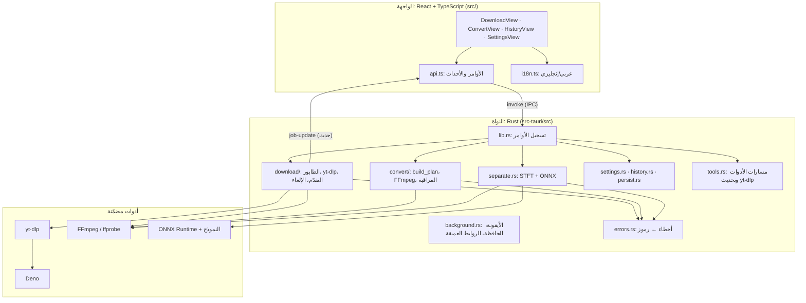
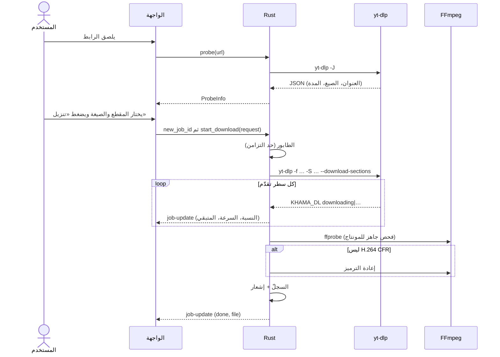
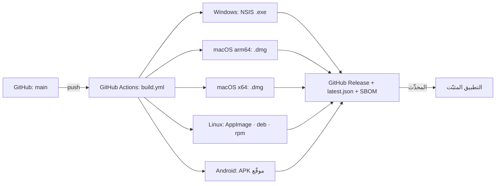
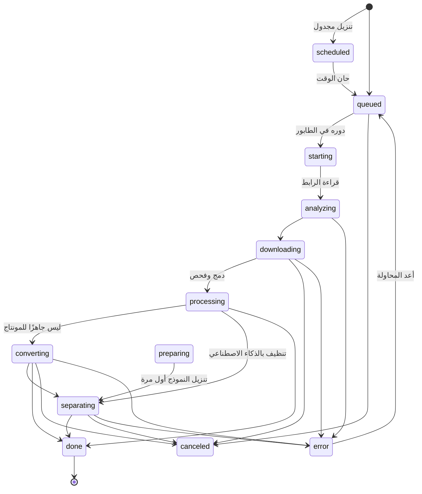
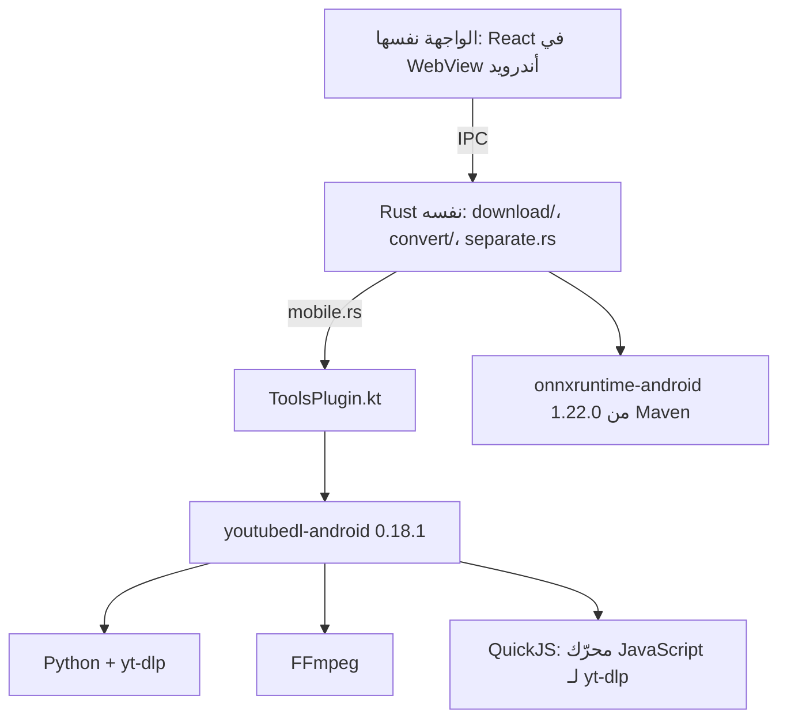
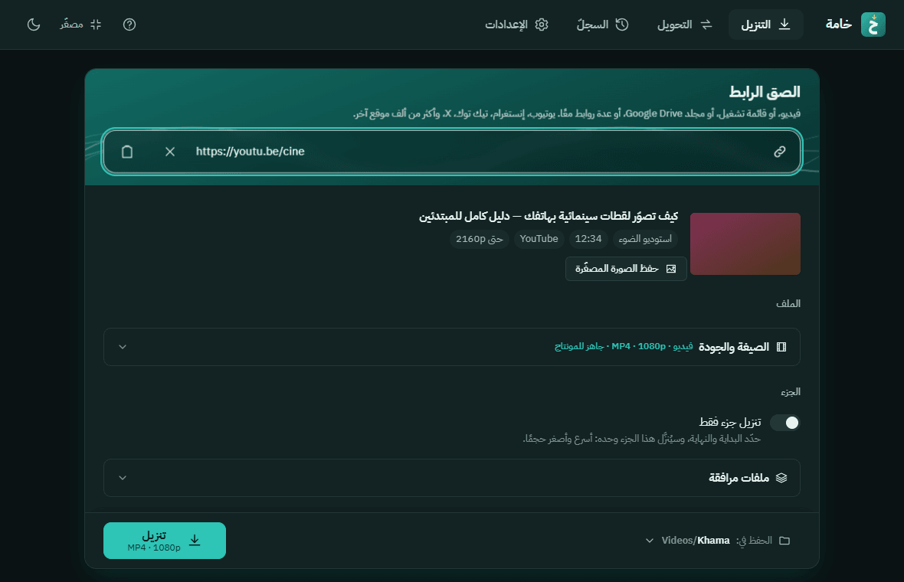
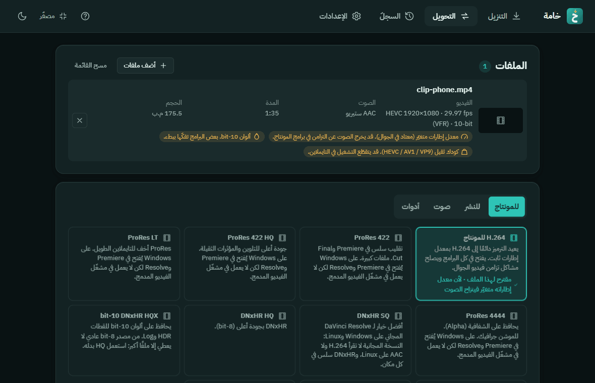

# الفصل 4: التصميم والمعمارية

## 4.1 اختيار التقنيات

**الجدول 4.1: مقارنة أطر سطح المكتب بمعايير موزونة** (A-24؛ الدرجات من 1 إلى 5، والأوزان من أولويات الكرّاس)

| المعيار | الوزن | Tauri 2 (Rust + WebView) | Electron (Node + Chromium) | Flutter | Qt (C++/Python) |
|---|---|---|---|---|---|
| حجم المثبّت دون الأدوات | 3 | 5 (بضعة MB) | 2 (Chromium مضمّن، ~80 MB+) | 4 | 3 |
| الذاكرة عند الخمول | 2 | 4 (WebView النظام) | 2 | 4 | 4 |
| المنصات المطلوبة (Win، macOS، Linux، ثم أندرويد) | 3 | 5 (أندرويد من Tauri 2) | 3 (لا هاتف) | 5 | 4 |
| واجهة RTL عربية ونصوص | 3 | 5 (HTML/CSS: `dir="rtl"` وخصائص منطقية) | 5 | 4 | 3 |
| تشغيل الأدوات الخارجية والتحكم بها بأمان | 3 | 5 (Rust: عمليات، إلغاء، أنواع) | 3 | 3 | 4 |
| منحنى التعلّم للطالب | 2 | 2 (Rust جديد) | 4 | 3 | 2 |
| نضج النظام البيئي | 1 | 3 | 5 | 4 | 5 |
| **المجموع الموزون** (من 85) | 17 | **75** | 56 | 66 | 59 |

اختير Tauri 2 مع React وTypeScript للواجهة وRust للمنطق ([DECISIONS.md](../DECISIONS.md) D1، D2). العيب الأكبر منحنى Rust، وعوّضه أن منطق تشغيل الأدوات وقراءة مخرجاتها وإلغائها يستفيد من نظام أنواع صارم.

**البدائل المرفوضة** (A-57):

- **Python + Qt**: أسهل في التعلّم، لكن توزيع Python مع التطبيق على ثلاثة أنظمة (PyInstaller) ينتج ملفات كبيرة تُعلَّم أحيانًا كفيروسات، والواجهة العربية في Qt تتطلب عناية أكثر من HTML.
- **تطبيق ويب**: يتطلب خادمًا ينزّل المقاطع نيابة عن المستخدم، أي تكاليف وحركة بيانات ومسؤولية قانونية على الخادم، ويخالف شرط «أداة أملكها» و«لا اتصالات غير ضرورية».
- **إضافة متصفح**: لا تستطيع تشغيل FFmpeg أو الكتابة في مجلد حر، ومتاجر الإضافات تمنع أدوات تنزيل يوتيوب.

### الضمّ مقابل التنزيل عند أول تشغيل

طلب الكرّاس مناقشة الخيارين (A-58):

**الجدول 4.2: ضمّ الأدوات مقابل تنزيلها**

| | الضمّ (المختار لـ yt-dlp وFFmpeg وDeno) | التنزيل عند أول تشغيل (المختار للنموذج) |
|---|---|---|
| أول تشغيل | يعمل فورًا، حتى دون إنترنت للمحوّل | ينتظر تنزيلًا، وقد يفشل خلف جدار ناري |
| الحجم | المثبّت 110 MB (Windows) | المثبّت صغير |
| الأمان | البصمات تُفحص وقت البناء في CI | البصمات تُفحص على جهاز المستخدم |
| التحديث | yt-dlp يُحدَّث داخل التطبيق رغم الضمّ | طبيعي |
| مناسب لـ | أدوات يحتاجها كل مستخدم في كل تنزيل | ميزة يستعملها بعض المستخدمين فقط وحجمها كبير |

## 4.2 المعمارية العامة

**الشكل 4.1: مخطط المكوّنات** (A-8)

الواجهة لا تصل إلى النظام مباشرة: كل شيء عبر أوامر Tauri المسجّلة في `lib.rs` (عقدها كاملًا في [IPC.md](../IPC.md))، وسياسة المحتوى تمنع أي سكربت خارجي ([SECURITY.md](../SECURITY.md)).

**الشكل 4.2: تسلسل تنزيل كامل**

**الشكل 4.3: مخطط النشر**

## 4.3 الوحدات

**الجدول 4.3: وحدات Rust** (A-21)

| الوحدة | المسؤولية | تعتمد على |
|---|---|---|
| `download/` | الطابور، بناء أوامر yt-dlp، قراءة التقدّم، الإلغاء، «جاهز للمونتاج»، الإضافات (ترجمة، صورة، ملف معلومات) | `tools`، `settings`، `history`، `errors` |
| `convert/` | تحليل الملف (ffprobe)، `build_plan` من الصيغة والخيارات، التشغيل، المجلدات المراقَبة، فحص مشفّرات كرت الشاشة | `tools`، `errors` |
| `separate.rs` | تنزيل النموذج وفحصه، STFT/iSTFT، تشغيل ONNX على قطع متداخلة | `tools`، `errors` |
| `playlist.rs` | قوائم التشغيل وSpotify | `tools` |
| `tools.rs` | مسارات yt-dlp وFFmpeg وDeno، تحديث yt-dlp مع نسخة احتياطية | — |
| `settings.rs`، `history.rs`، `persist.rs` | ملفات JSON بكتابة ذرّية، والترحيل | `errors` |
| `background.rs` | الأيقونة في شريط المهام، مراقبة الحافظة، روابط `khama://` | `settings` |
| `mobile.rs` | جسر أندرويد إلى youtubedl-android | `tools` |
| `errors.rs` | تحويل مخرجات الأدوات إلى رموز أخطاء | — |
| `srt.rs` | تحويل الترجمات إلى SRT | — |

## 4.4 حالات العملية

**الشكل 4.4: مخطط حالات العملية** (A-23، من `JobState` في `api.ts`)

العمليات الثقيلة (التحويل والفصل) لها حدّ مستقل عن حدّ التنزيل: ربع أنوية المعالج (`heavy_work_limit_is_a_quarter_of_the_cores`)، حتى لا يتجمّد الجهاز عند تنزيل قائمة طويلة جاهزة للمونتاج.

**الإلغاء**: yt-dlp يشغّل FFmpeg، وFFmpeg قد يشغّل عمليات أخرى. إيقاف العملية الأم وحدها يترك أبناءها تعمل وتكتب في الملف. على Windows توضع كل عملية في Job Object فيُغلق إنهاؤه الشجرة كلها، وعلى الأنظمة الأخرى مجموعة عمليات (process group) تُرسَل إليها الإشارة (الاختبار `kill_tree_ends_grandchildren_through_the_job_object`).

## 4.5 نموذج البيانات

كل بيانات خامة ملفات JSON محلية (A-22)، مشروحة حقلًا حقلًا في [DATA.md](../DATA.md):

- `settings.json`: الإعدادات والمشاريع، مع `schemaVersion` للترحيل بين الإصدارات.
- `history.json`: آخر 1000 عملية ناجحة (الرابط، العنوان، الملف، الصيغة، التاريخ).
- `scheduled.json`، `counters.json`، `watch-scans.json`، `cookies.txt`.

كل كتابة ذرّية: إلى ملف `.tmp` ثم إعادة تسمية، فلا يبقى ملف نصف مكتوب بعد انقطاع الكهرباء، والملف التالف يُعزل ويُستبدل بالقيم الافتراضية (`read_json_missing_ok_and_corrupt`).

## 4.6 فصل الصوت

### اختيار النموذج

**الجدول 4.4: نماذج فصل المصادر المرشّحة** (A-26؛ الأرقام من الأوراق والمستودعات الرسمية [7]–[10]، وتُراجَع قبل التسليم)

| النموذج | الحجم | يعمل بلا Python | الجودة المعلنة للصوت | ملاحظات |
|---|---|---|---|---|
| Spleeter (Deezer) [10] | ~40 MB (مصدران) | لا (TensorFlow) | أدنى من الأحدث | قديم (2019) |
| Demucs v4 (Meta) [9] | ~80 MB+ (أربعة مصادر) | لا (PyTorch)، تصديره إلى ONNX صعب | الأعلى على الموسيقى | ثقيل على المعالج |
| **UVR-MDX-NET-Voc_FT** [7][8] | 66.8 MB | نعم (ONNX) | قريب من Demucs للصوت البشري | نموذج صوت فقط |

اختير MDX-Net Voc_FT لأنه الوحيد بين الثلاثة المتاح بصيغة ONNX جاهزة تعمل من Rust عبر ONNX Runtime دون أي Python، وهو مدرّب على الصوت البشري تحديدًا، وهو ما يحتاجه الممنتج (إبقاء الحوار وإزالة الموسيقى، أو العكس).

### الخوارزمية

1. FFmpeg يفكّ أي ملف إلى PCM ستيريو 44.1 kHz.
2. الصوت يُقسَّم إلى قطع طولها `hop × (dim_t − 1) = 1024 × 255 = 261,120` عيّنة (5.92 ث)، وهو الطول الذي دُرّب عليه النموذج.
3. لكل قطعة: STFT بنافذة Hann دورية، `n_fft = 7680`، `hop = 1024`، بطريقة PyTorch (`center=True`) ليطابق ما رآه النموذج في التدريب (الاختبار `stft_roundtrip` يتحقق أن التحويل وعكسه يعيدان الإشارة بخطأ أقل من 10⁻³).
4. تُؤخذ أول `dim_f = 3072` حزمة ترددية فقط (حتى 17.6 kHz)، ويُعطى النموذج الجزأين الحقيقي والتخيلي، فيُخرج طيف الصوت البشري.
5. iSTFT يعيد الموجة، وتُضرب في معامل التعويض 1.021 الذي يحدده مدرّب النموذج.

**معاملات التقطيع** (A-60): `n_fft` و`hop` و`dim_f` و`dim_t` و`compensate` من ملف إعدادات UVR الرسمي للنموذج [8]، ولا يجوز تغييرها لأن النموذج دُرّب عليها. أما **القصّ عند الأطراف** فاختيار المشروع: كل قطعة تتداخل مع جارتها بـ `n_fft / 2 = 3840` عيّنة (87 ms) من كل جهة، ويُرمى هذا الهامش عند اللصق لأن STFT مع `center=True` أضعف دقة في أطراف القطعة. هذا يمنع النقرات عند حدود القطع. لم يُقَس أثر هامش أكبر؛ هو تحسين محتمل.

### الموسيقى = الأصل − الصوت

لإبقاء الموسيقى يُطرح الصوت المقدَّر من الأصل عيّنة بعيّنة (A-27). هذا يوفّر نموذجًا ثانيًا (نصف الحجم والزمن)، لكن له حدّان:

- **بقايا الصوت**: أي خطأ في تقدير الصوت يبقى في الموسيقى. خطأ الصوت المقاس 23.6 dB تحت الإشارة (§6.5)، فالبقايا خافتة لكنها مسموعة في المقاطع الهادئة.
- **الترددات فوق 17.6 kHz**: النموذج لا يرى ما فوق `dim_f`، فيُعتبر كله «ليس صوتًا» ويبقى في الموسيقى. هذا مقبول لأن الصوت البشري لا طاقة تُذكر له هناك.

البديل نموذج موسيقى مستقل (مثل Inst_HQ من UVR) يضاعف التنزيل والزمن. يُقارن في الآفاق (§8.2).

## 4.7 أندرويد

**الشكل 4.5: بنية نسخة أندرويد** (A-56)

الكود نفسه يعمل على الهاتف: نفس أوامر yt-dlp، ونفس قراءة التقدّم، ونفس الإلغاء. الفرق في مكان الأدوات: مكتبة youtubedl-android تفكّ Python وyt-dlp وFFmpeg داخل التطبيق عند أول تشغيل وتعطي مساراتها لـ Rust عبر إضافة Kotlin. ONNX Runtime يأتي من Maven بدل التنزيل. على الهاتف لا يُختار مجلد الحفظ (الملفات في `Download/Khama`)، ولا سحب ولا أيقونة ولا مجلدات مراقَبة.

## 4.8 التعريب واتجاه النص

الواجهة عربية كاملة من اليمين إلى اليسار، وهي موضوع تقني قائم بذاته (A-68):

- **الخصائص المنطقية في CSS**: `margin-inline-start` بدل `margin-left`، فيتبع التخطيط اتجاه اللغة. اختبار آلي (`rtl.test.ts`) يرفض أي خاصية فيزيائية (`left`/`right`) إلا من قائمة مبرّرة (مثل شريط القص الذي يبقى من اليسار إلى اليمين لأن الزمن كذلك في كل برامج المونتاج).
- **خلط الاتجاهات (BiDi)**: الروابط وأسماء الملفات والمسارات وأرقام الإصدارات لاتينية داخل نص عربي. تُلفّ بـ `<bdi>` أو صنف `ltr` حتى لا تنقلب أجزاؤها (مثل `C:\Users\…` أو `1080p · MP4`).
- **جمع الأعداد**: العربية تفرّق بين المفرد والمثنى والجمع (3–10) والتمييز المفرد (11–99) والمئة. الدالة `arCount` تختار الصيغة (`ملف واحد`، `ملفان`، `3 ملفات`، `11 ملفًا`، `100 ملف`) ولها اختبار.
- **الأرقام**: غربية في اللغتين (`ar-u-nu-latn`) لتطابق ما تعرضه برامج المونتاج.
- **رسائل الخطأ**: Rust لا يرسل جملًا بل رموزًا (87 رمزًا)، والواجهة تترجمها ([ERRORS.md](../ERRORS.md)).
- **اللغة الافتراضية**: تتبع لغة النظام في أول تشغيل ([DECISIONS.md](../DECISIONS.md) D6).

## 4.9 التصميم البصري والهوية

- **الألوان** (A-82): رمادي مائل إلى فيروزي الشعار بدل الأسود والأبيض النقيين، والفيروزي للتفاعل، والأصفر للتمييز فقط. كل الألوان رموز (tokens) في `:root` للوضعين الداكن والفاتح، وتباين كل زوج مقيس مقابل WCAG AA في [DESIGN-SYSTEM.md](../DESIGN-SYSTEM.md).
- **الخط**: IBM Plex Sans Arabic، مصمّم للعربية واللاتينية معًا بأوزان متناسقة، ورخصته OFL مفتوحة.
- **سلّم المسافات**: شبكة 4px، وسبعة أحجام خط، وثلاث زوايا.
- **الحركة**: كل ظهور واختفاء يتحرّك ليشرح من أين جاء العنصر، بنوابض قصيرة، وتُختصر مع «تقليل الحركة».
- **المبدأ**: بطل واحد لكل شاشة (الإجراء الرئيسي أوضح شيء فيها). الشكلان 4.6 و4.7 يطبّقانه على الشاشتين الرئيسيتين: زر «تنزيل» وحده ملوّن في الأولى، والصيغة المقترحة للملف وحدها مميّزة في الثانية.

**الشكل 4.6: شاشة التنزيل بعد لصق رابط** (الوضع الداكن بالعربية، بيانات تجريبية من `dev-mock`، لقطة 2026-11-19). المعاينة، ثم الصيغة والجودة مطويتين بملخص «فيديو · MP4 · 1080p · جاهز للمونتاج»، ثم الجزء، ثم زر التنزيل ومجلد الحفظ.

**الشكل 4.7: المحوّل بعد إضافة ملف من الهاتف** (اللقطة نفسها). خصائص الملف وتحذيراته (معدل إطارات متغيّر، وألوان 10-bit، وكودك ثقيل)، ثم الصيغ مقسّمة إلى «للمونتاج» و«للنشر» و«صوت» و«أدوات»، والمقترحة لهذا الملف «H.264 للمونتاج» مع سببها. المحوّل أُعيد ترتيبه بعد اللقطة في ثلاثة أعمدة للنوافذ العريضة (0.3.45).
- **الشعار** (A-59): حرف «خ» ونقطته سهم تنزيل، أي المادة الخام وطريقة الحصول عليها في رمز واحد. مرّ بمراحل في السجلّ (أول نسخة في 2026-11-07، ثم تبسيط ليقرأ في 16px، ثم نسخة أندرويد المتكيّفة بطبقتين). **[يكتبه الطالب]** لقطات المراحل وسبب كل تغيير.
- **تطوّر التصميم** (A-83): ثلاث مراحل في السجلّ: الأولى (2026-11-07)، ثم 0.2.0 (هوية أوضح وسلّم خطوط)، ثم 1ea1f54 (نظام الرموز، بطل واحد لكل شاشة، تبويبات سفلية على الهاتف). **[يكتبه الطالب]** لقطة لكل مرحلة وما تعلّمته منها؛ يمكن إعادة إنتاج كل مرحلة بـ `git checkout <commit>` ثم `npm run dev`.
