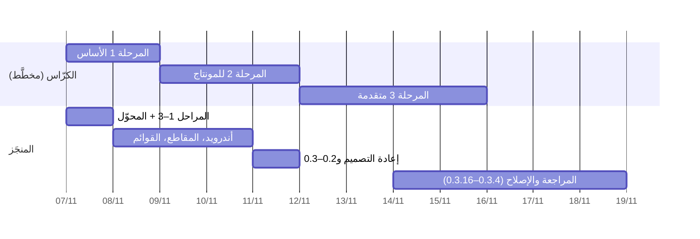

# الفصل 5: الإنجاز

## 5.1 المنهجية كما حدثت

وصف الكرّاس منهجية مراحل متتابعة: الأساس، ثم ميزات المونتاج، ثم المتقدم، مع اختبار كل مرحلة قبل التالية. ما حدث فعلًا مختلف، ويُكتب هنا بصدق (A-41):

- **اليوم الأول (2026-11-07)**: هيكل المشروع، ومحرّك التنزيل، والواجهة بلغتين، وREADME، وإصلاحات بناء Linux في CI، ثم القص، والمحوّل، والمجلدات المراقَبة، وفصل الصوت، والشعار. أي أن المراحل الثلاث بدأت في اليوم نفسه دون اختبار يدوي للمرحلة الأولى على macOS وLinux.
- **2026-11-08 → 11**: نسخة أندرويد، والمقاطع المتعددة، وقوائم التشغيل وSpotify، ثم إعادة تصميم و0.2.0 و0.3.0.
- **2026-11-14 → 18**: مراجعة شاملة (تقنية، وتجربة استعمال، وتصميم، ونصوص، ومنهجية، وأكاديمية) أنتجت أكثر من 400 ملاحظة مرقّمة، وأُصلحت على 12 إصدارًا (0.3.4 → 0.3.16)، كل التزام يذكر رموز الملاحظات التي يغلقها.

الأقرب لوصف ذلك: **تطوير تكراري سريع بنموذج أولي يعمل من طرف إلى طرف، تلته مرحلة مراجعة وتصليب**. نجح في الوصول سريعًا إلى منتج كامل يعمل على خمس منصات، وكلّف التزامات ضخمة يصعب مراجعتها، وميزات خارج الكرّاس دون توثيق مسبق، وغياب اختبار يدوي منهجي. القواعد التي اعتُمدت بعدها في [PROCESS.md](../PROCESS.md): تعريف «مكتمل»، والتزام لكل تغيير، وأولويات MoSCoW، ومراجعة قبل كل إصدار minor.

## 5.2 الجدول الزمني

**الشكل 5.1: المخطَّط مقابل المنجَز** (A-42)



المخطَّط في الشكل تقدير من ترتيب الكرّاس (لم يحدد تواريخ). الانحراف الأساسي: المراحل تداخلت بدل أن تتتابع، والنطاق اتسع (المحوّل، وأندرويد، وSpotify) قبل اختبار الأساس. **[يكتبه الطالب، A-90]** الساعات الفعلية التقريبية لكل مرحلة.

**عدد الالتزامات في اليوم** (من `git log`): 14، 9، 4، 3، 6، 4، 2، 19، 44، 13، 26، 98+ بين 07 و18 نوفمبر. السجلّ يُظهر أيامًا هادئة بين دفعات كبيرة (A-74): **[يكتبه الطالب]** إن كان جزء من العمل خارج git (تجارب، تصميم، نقاشات، تعلّم Rust) فاذكره هنا.

## 5.3 الأدوات المستعملة والتصريح باستعمال الذكاء الاصطناعي

**الجدول 5.1: الأدوات** (A-84)

| الغرض | الأداة |
|---|---|
| المساعد البرمجي | Claude Code (Anthropic): كتابة الكود والاختبارات والتوثيق تحت توجيه الطالب ومراجعته |
| المحرّر | **[يكتبه الطالب]** |
| إدارة الكود | git وGitHub |
| البناء والإصدار | GitHub Actions (فحص في كل دفع، وبناء كل المنصات عند كل إصدار) |
| الواجهة | React 19، TypeScript 6، Vite 8، Vitest، ESLint، Prettier |
| النواة | Rust 2024 (1.88+)، Tauri 2.12، tokio، cargo test، clippy |
| الوسائط | yt-dlp، FFmpeg، Deno، ONNX Runtime |
| أندرويد | Android SDK/NDK، Kotlin، youtubedl-android |
| التصميم | **[يكتبه الطالب]** (أداة الشعار والأيقونات إن وُجدت) |

**التصريح باستعمال الذكاء الاصطناعي** (A-2): أغلب الالتزامات تحمل `Co-Authored-By: Claude`، أي أن الكود كُتب بمساعدة نموذج لغوي. **[يكتبه الطالب]** فقرة تحدد: ما الذي طلبته (الكرّاس، والقرارات، والملاحظات)، وما الذي راجعته وكيف، وما الذي عدّلته أو رفضته، وحدود ما تفهمه من الكود. ما يمكن الاستناد إليه من المستودع: الكرّاس [PROJECT_BRIEF.md](../../PROJECT_BRIEF.md) مكتوب بيدك، والقرارات في [DECISIONS.md](../DECISIONS.md)، والمراجعة ذات الـ 400 ملاحظة وُجّهت وصُنّفت من قبلك.

## 5.4 الإسهام الشخصي وما تعلّمته

**[يكتبه الطالب، A-3 وM-28]** ما الذي صمّمته أنت: المتطلبات والقيود الأخلاقية (الكرّاس)، واختيار الخيارات عند كل قرار، ومراجعة النتائج، والاختبار على جهازك. وما تعلّمته: مثلًا كيف يعمل IPC في Tauri، ولماذا يُلغى بشجرة العمليات، وما STFT ولماذا نافذة Hann (انظر [defense.md](defense.md) للإجابات المكتوبة كنقطة بداية).

## 5.5 المراجعة البشرية للكود

**[يكتبه الطالب، M-42]** دليل على قراءة الكود المولَّد: أمثلة لملاحظات طرحتها أو أخطاء اكتشفتها أو تعديلات طلبتها. المراجعة الشاملة في نوفمبر (§5.1) جزء من هذا الدليل.

## 5.6 المصادر المفتوحة المستعملة

**الجدول 5.2: الاعتماديات المباشرة** (A-85؛ النسخ من `Cargo.lock` و`package-lock.json` في 0.3.16. مع الاعتماديات غير المباشرة 597 حزمة Rust، كلها برخص متساهلة: MIT أو Apache-2.0 أو Zlib أو Unicode-3.0. القائمة الكاملة في SBOM المرفق بكل إصدار)

| الحزمة (Rust) | النسخة | الرخصة | الدور |
|---|---|---|---|
| tauri | 2.12.5 | Apache-2.0 OR MIT | الإطار: النافذة، IPC، التحزيم |
| tokio | 1.54.1 | MIT | تشغيل العمليات والمهام غير المتزامنة |
| serde / serde_json | 1.0 | MIT OR Apache-2.0 | قراءة مخرجات yt-dlp وffprobe وملفات الإعدادات |
| ort | 2.0.0-rc.10 | MIT OR Apache-2.0 | تشغيل نموذج ONNX |
| rustfft | 6.4.1 | MIT OR Apache-2.0 | STFT لفصل الصوت |
| sha2 | 0.10.9 | MIT OR Apache-2.0 | فحص بصمات الأدوات والنموذج |
| base64، log، libc، windows-sys | — | MIT OR Apache-2.0 | مساعدات |
| tauri-plugin-* (dialog، notification، opener، os، log، clipboard-manager، deep-link، process، single-instance، updater) | 2.x | Apache-2.0 OR MIT | قدرات النظام |
| tauri-plugin-drag (CrabNebula) | 2.1.1 | Apache-2.0 OR MIT | سحب الملفات إلى برامج المونتاج |

| الحزمة (npm) | النسخة | الرخصة | الدور |
|---|---|---|---|
| react / react-dom | 19.3.1 | MIT | الواجهة |
| @tauri-apps/api و plugin-* | 2.x | Apache-2.0 OR MIT | الجسر إلى Rust |
| @fontsource/ibm-plex-sans-arabic | 5.3.0 | OFL-1.1 | الخط |

| الأداة المضمّنة | الرخصة | الدور |
|---|---|---|
| yt-dlp | Unlicense (المصدر)؛ الملف المجمّع يضمّ مكوّنات GPLv3+ | التنزيل |
| FFmpeg (بناء GPL) | GPLv3+ | التحويل والدمج والقص |
| Deno | MIT | محرّك JavaScript لـ yt-dlp |
| ONNX Runtime | MIT | تشغيل النموذج |
| UVR-MDX-NET-Voc_FT | انظر §7.3 | نموذج الفصل |

## 5.7 مقتطفات من الكود

ثلاثة مقاطع تلخّص القرارات المهمة، مشروحة سطرًا بسطر (A-67).

**المقتطف 5.1: ترتيب أفضلية الصيغ في yt-dlp** (`download/args.rs`)

```rust
let mut sort = match req.quality.as_str() {
    q @ ("2160" | "1440" | "1080" | "720" | "480" | "360") => format!("res:{q}"),
    _ => "res".to_string(),
};
if req.editor_ready || container == "mov" {
    sort.push_str(",vcodec:h264,acodec:aac");
}
```

- `-S res:1080` لا يعني «1080 بالضبط» بل «أعلى دقة لا تتجاوز 1080»، فإن لم يوجد 1080p أخذ 720p بدل أن يفشل.
- عند «جاهز للمونتاج» يُضاف تفضيل H.264 وAAC **بعد** الدقة: الدقة أولًا، ثم بين الصيغ بنفس الدقة تُختار التي لا تحتاج تحويلًا. هذا هو أساس الفرضية H1.

**المقتطف 5.2: هل الملف جاهز للمونتاج؟** (`download/editready.rs`)

```rust
let cfr = match (r, avg) {
    (Some(r), Some(avg)) if r > 0.0 => ((r - avg) / r).abs() < 0.02,
    _ => true,
};
video_ok = codec == "h264" && (pix == "yuv420p" || pix == "yuvj420p") && cfr;
```

- `r_frame_rate` هو المعدل الاسمي، و`avg_frame_rate` هو المتوسط الفعلي (عدد الإطارات ÷ المدة). في ملف بمعدل ثابت يتساويان؛ في تسجيل هاتف بمعدل متغيّر يختلفان.
- حد 2% يتسامح مع فروق التقريب (29.97 مقابل 30) ولا يتسامح مع VFR الحقيقي (في عيّنة الاختبار: 60 اسميًا مقابل 25.7 فعليًا).
- الملف «جاهز» فقط إن كان H.264 بـ 4:2:0 وبمعدل ثابت؛ غير ذلك يُعاد ترميزه. ملف جاهز لا يُلمس، وهذا يوفّر الزمن والجودة.

**المقتطف 5.3: إلغاء شجرة العمليات على Linux وmacOS** (`download/process.rs`)

```rust
// العملية قائدة مجموعتها (tools::command يضع process_group(0))، فالمجموعة = pid
if let Ok(pgid) = libc::pid_t::try_from(pid) && pgid > 1 {
    unsafe { libc::killpg(pgid, libc::SIGKILL) };
}
```

- yt-dlp يشغّل FFmpeg كعملية ابنة. قتل yt-dlp وحده يترك FFmpeg يكتب في الملف.
- عند الإنشاء توضع كل أداة في مجموعة عمليات جديدة رقمها رقمها، فإرسال الإشارة إلى المجموعة يصل إلى الأبناء والأحفاد.
- `pgid > 1` حماية: `killpg(1)` أو قيمة سالبة تعني «كل عمليات المستخدم»، وهو خطأ حدث فعلًا مع أمر `kill` على Linux وأسقط خادم CI، فاستُبدل بنداء النظام مباشرة.
