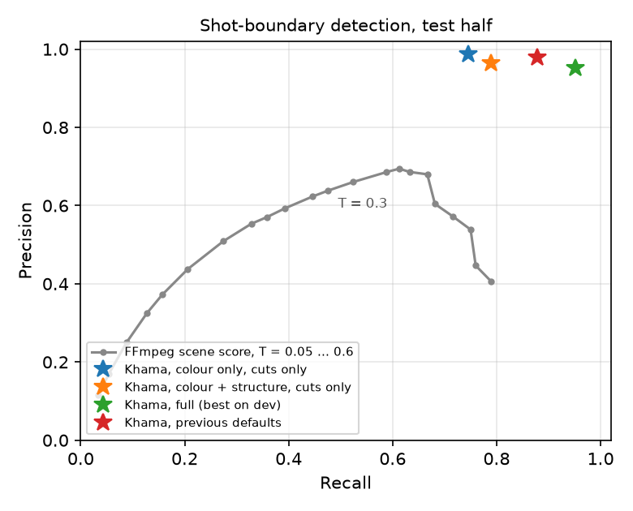
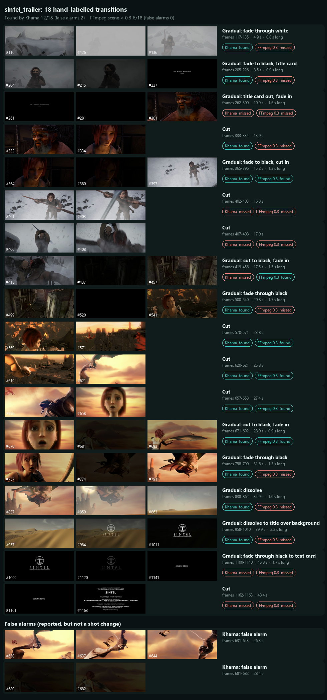
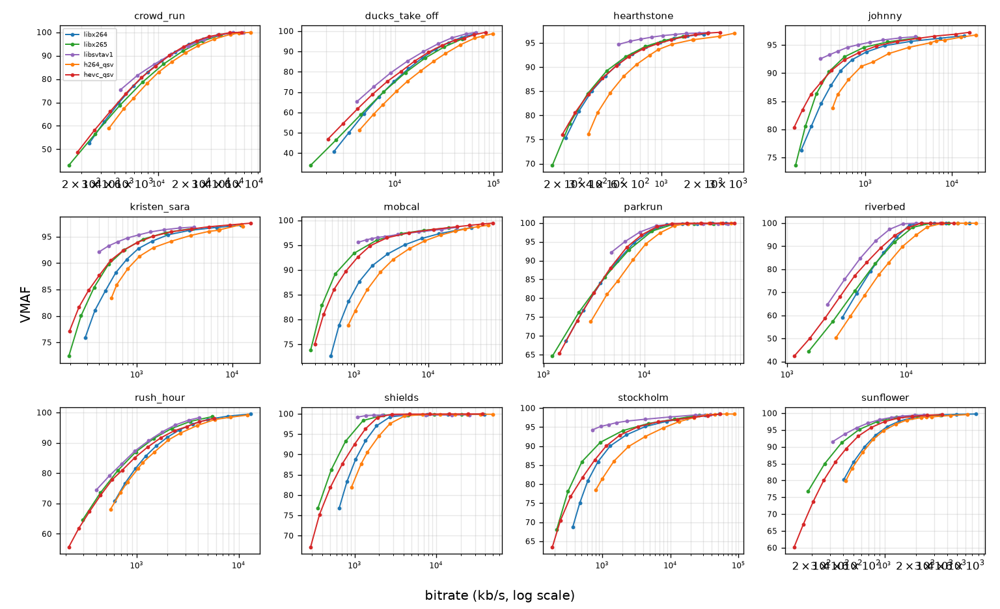
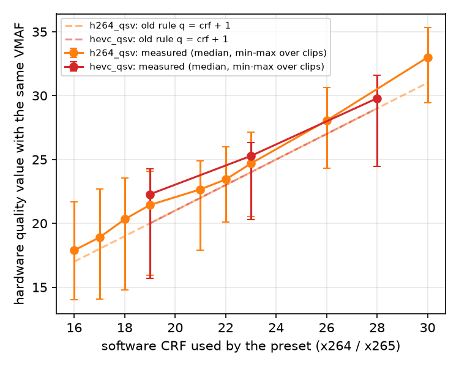
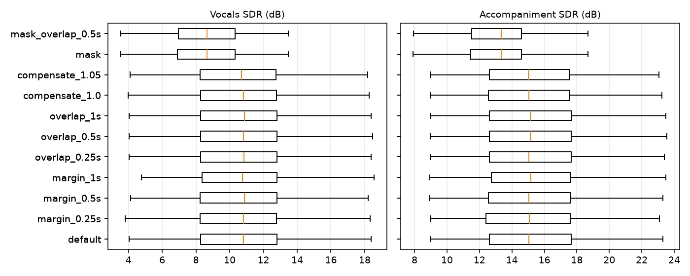

# الفصل 6: التقييم

## 6.0 منهجية القياس

(A-97، A-98) كل القياسات على جهاز واحد: حاسوب محمول بمعالج Intel Core i5-1135G7 (4 أنوية، 8 خيوط)، وذاكرة 16 GB، وWindows 11، دون كرت شاشة منفصل، بالنسخ المثبّتة في [binaries.lock.json](../../scripts/binaries.lock.json). كل قياس زمني يُكرَّر 3 مرات على الأقل ويُعطى المتوسط والانحراف المعياري (± sd)، وتُقاس الأحجام والجودة مرة واحدة لأنها لا تتغيّر بين التكرارات. الشبكة منزلية، فأزمنة التنزيل تتأثر بها وتُقرأ نسبيًا (جزء مقابل كامل في الجلسة نفسها) لا مطلقًا. الأوامر التي تعيد كل قياس مكتوبة بجانبه.

## 6.1 معيار النجاح للمرحلة الأولى

الكرّاس: «ألصق رابط يوتيوب، أختار MP4 بجودة 1080p، أضغط زرًا واحدًا، فيظهر الملف في المجلد وأسحبه إلى Premiere أو DaVinci دون مشاكل» (A-44).

| الخطوة | الدليل |
|---|---|
| زر واحد | الحالة الافتراضية: لصق ← «تنزيل» (نقرة واحدة بعد اللصق) |
| MP4 1080p | `video_1080_editor_ready_prefers_h264`: الأمر المبني يطلب `res:1080,vcodec:h264,acodec:aac` |
| الملف في المجلد | يظهر في السجلّ مع «افتح المجلد» |
| يُسحب إلى البرنامج | السحب من بطاقة التنزيل (`dragOut`) |
| دون مشاكل | «جاهز للمونتاج» يفحص H.264 4:2:0 CFR ويعيد الترميز إن لزم (المقتطف 5.2) |
| على الأنظمة الثلاثة | **[يكتبه الطالب]** لقطة لكل نظام: الملف على تايم لاين Premiere أو Resolve، مع معلومات الملف (ffprobe أو MediaInfo) |

## 6.2 الاختبارات الآلية

(A-43) في 0.3.16:

**الجدول 6.1: الاختبارات**

| المجموعة | العدد | تعمل | النتيجة |
|---|---|---|---|
| Rust (وحدة وتكامل) | 85 | 79 آليًا في كل دفع، و6 يدوية (`#[ignore]`) تحتاج ملفات أو النموذج أو الشبكة | 79/79 ناجحة |
| الواجهة (Vitest) | 79 | 78 آليًا، و1 تقييم يدوي | 78/78 ناجحة |
| CI | — | الأنواع، وESLint (حد 25 تحذيرًا)، وPrettier، وclippy بلا تحذيرات، وcargo audit، وnpm audit، وميزانية حجم الواجهة، وبناء أندرويد | ناجحة |
| الصيغ الحقيقية (`presets_real`) | 26 حالة | يدويًا قبل كل إصدار minor | 26/26 |

التغطية بالأسطر غير مقيسة؛ الاختبارات تغطي المنطق (بناء الأوامر، وقراءة المخرجات، والتصنيف، والترحيل، والتقدير، والتعريب) لا الواجهة الرسومية. الاختبار اليدوي يتبع قائمة [TESTING.md](../TESTING.md).

## 6.3 التنزيل الجزئي

(O3) فيديو عام مدته 10 دقائق (https://www.youtube.com/watch?v=aqz-KE-bpKQ)، بجودة 720p، في الجلسة نفسها:

**الجدول 6.2: تنزيل جزء مقابل الفيديو كاملًا**

| | الزمن | الحجم المنزَّل |
|---|---|---|
| 20 ث من منتصف الفيديو (`--download-sections`) | نحو 49 ث | 5 MB |
| الفيديو كاملًا ثم القص | 80–112 ث | 177 MB |

الجزء وفّر 97% من البيانات، لكن الزمن لم ينخفض بالنسبة نفسها: yt-dlp يطلب من FFmpeg قراءة البث حتى نقطة البداية، وجزء من الزمن ثابت (قراءة الرابط، وتحضير التوقيع بـ Deno) مهما صغر المقطع. **تحفّظان**: القياس أُجري والجهاز مشغول بتقييم آخر، فالأزمنة أعلى من المعتاد ومتباينة؛ وفشلت محاولة واحدة من ثلاث لتنزيل الجزء بخروج FFmpeg بخطأ غير مفسَّر (تنجح عند الإعادة، وزر «أعد المحاولة» يغطيها). **[يكتبه الطالب]** إعادة القياس والجهاز خامل (3 مرات لكل حالة، المتوسط ± sd).

## 6.4 «جاهز للمونتاج» والفرضية H1

H1: «تنزيل H.264 في MP4 من البداية أسرع وأضمن من تنزيل الأفضل ثم التحويل». الدليل:

- **السرعة**: إعادة التغليف دون ترميز أسرع من الوقت الحقيقي بنحو 84 مرة على العيّنة، بينما ترميز H.264 بنحو 2.2 مرة فقط (§6.6)؛ فتنزيل H.264 جاهزًا يوفّر خطوة الترميز كلها في الحالة الغالبة.
- **الضمان**: الفحص بعد التنزيل يلتقط الحالات التي لا يوفّر فيها الموقع H.264 (بعض المقاطع القصيرة لا تتوفر إلا بـ VP9 أو AV1) أو يكون فيها المعدل متغيرًا، فيعيد الترميز. على العيّنة `02-vfr-phone.mp4` (معدل متغير) يقترح المحوّل «H.264 للمونتاج» ويخرج الملف بمعدل ثابت (فُحص بـ ffprobe: `r_frame_rate` = `avg_frame_rate`).
- **الثمن**: H.264 أكبر من AV1 بالجودة نفسها، وأعلى جودة على يوتيوب (فوق 1080p) غالبًا VP9 أو AV1 فقط، فيُعاد ترميزها.

**[يكتبه الطالب]** النسبة الفعلية: من 20 رابطًا متنوّعًا، كم احتاج إعادة ترميز، وكم أخذ.

## 6.5 فصل الصوت

(A-9، O4، H2)

**العيّنة**: صوت كلام مركّب بمحرّك Windows للنطق (46.8 ث، إنجليزي) فوق موسيقى مولّدة (نغمات متعددة مع إيقاع)، مدموجان بـ FFmpeg بلا تطبيع. المرجع هو الكلام الأصلي قبل الدمج، فيمكن حساب الخطأ بدقة.

**المقياس**: نسبة الإشارة إلى الضجيج SNR = 10·log₁₀(Σ ref² / Σ (ref − est)²) للصوت المفصول مقابل الكلام الأصلي، وهو تبسيط لمقياس SDR من BSS Eval [25].

**الجدول 6.4: نتيجة الفصل** (`separates_voice_from_music`)

| | SNR مقابل الكلام الأصلي |
|---|---|
| الخليط قبل الفصل | −2.1 dB |
| الصوت بعد الفصل | **23.6 dB** |
| التحسّن | +25.7 dB |

**الزمن**: 49.7 ث لاستخراج الصوت من 46.8 ث (1.06 ث لكل ثانية صوت)، و49.6 ث لاستخراج الموسيقى، على المعالج (8 خيوط).

**الحجم** (H2): نموذج واحد 66.8 MB؛ نموذج موسيقى ثانٍ كان سيضاعف التنزيل والزمن.

**حدود هذا التقييم**: عيّنة واحدة مركّبة؛ الكلام المركّب أنظف من الكلام الحقيقي، والموسيقى المولّدة أبسط من الموسيقى الحقيقية، فالرقم الحقيقي أقل غالبًا. التقييم المعياري على MUSDB18 [26] في §6.14.3: SDR الصوت 10.8 dB على 50 أغنية، مقابل 8–9 dB منشورة لـ KUIELab-MDX-Net [7]. المقارنة بـ Demucs في الآفاق.

**الهاتف** (A-72): **[يكتبه الطالب]** زمن فصل دقيقة صوت على الهاتف، ونسبة البطارية المستهلكة (من إعدادات البطارية في أندرويد قبل وبعد، والشاشة مطفأة).

## 6.6 جودة الصيغ وتقدير الحجم

(A-30، A-31، H3، O5)

**العيّنة**: 8 مقاطع: 6 حقيقية (8 ث لكل منها، مقطوعة دون إعادة ترميز من ملفات حقيقية: محاضرة، ولقطة هاتف عمودية، وB-roll أفقي وعمودي، ولقطة استوديو، ولعبة)، واثنان مولّدان (`01-cfr-1080p-h264.mp4` و`02-vfr-phone.mp4`، 10 ث). كل مقطع حُوِّل بـ 12 إعدادًا (96 تحويلًا)، و3 مرات للزمن.

**المقاييس**: خطأ التقدير = (التقدير − الفعلي) ÷ الفعلي، حيث التقدير ما يعرضه التطبيق قبل التحويل (`estimateSize`). والجودة بـ SSIM [24] بين الناتج والأصل بعد إرجاعهما إلى الدقة نفسها (1 = مطابق). والسرعة = مدة المقطع ÷ زمن التحويل.

```bash
KHAMA_EVAL_DIR=<مجلد المقاطع> KHAMA_EVAL_OUT=eval.jsonl KHAMA_REPEAT=3 cargo test --release --manifest-path src-tauri/Cargo.toml presets_eval -- --ignored --nocapture
```

```bash
KHAMA_EVAL_OUT=eval.jsonl npx vitest run src/estimate.eval.test.ts --silent=false
```

**الجدول 6.5: الصيغ على 8 مقاطع** (المتوسط ± sd)

| الصيغة | متوسط الخطأ | متوسط الخطأ المطلق | SSIM | السرعة × الزمن الحقيقي |
|---|---|---|---|---|
| H.264 للمونتاج، عالية | +127% | 135% | 0.996 ± 0.003 | 1.1 ± 0.6 |
| H.264 للمونتاج، متوازنة | +89% | 98% | 0.995 ± 0.004 | 1.2 ± 0.5 |
| H.264 للمونتاج، صغيرة | +58% | 65% | 0.992 ± 0.006 | 1.3 ± 0.5 |
| يوتيوب | +123% | 129% | 0.995 ± 0.004 | 1.2 ± 0.6 |
| واتساب | +18% | 34% | 0.978 ± 0.010 | 2.4 ± 1.0 |
| H.265 | +129% | 144% | 0.990 ± 0.007 | 0.7 ± 0.2 |
| AV1 | +55% | 85% | 0.990 ± 0.007 | 1.6 ± 0.4 |
| WebM (VP9) | +72% | 95% | 0.982 ± 0.010 | 0.3 ± 0.1 |
| ProRes Proxy | +15% | 27% | 0.984 ± 0.011 | 0.6 ± 0.3 |
| ProRes 422 | +19% | 29% | 0.996 ± 0.003 | 0.6 ± 0.2 |
| DNxHR SQ | −7% | 7% | 0.991 ± 0.010 | 3.9 ± 2.0 |
| بروكسي (540p) | −35% | 35% | 0.970 ± 0.011 | 3.6 ± 1.4 |

الجدول الكامل لكل مقطع في الملحق د.

**الجودة** (H3): كل الصيغ فوق 0.96، وصيغ المونتاج والنشر الأساسية فوق 0.99، وهو مستوى لا يُميَّز فيه الفرق بالعين عادة. الأدنى البروكسي (0.970) وواتساب (0.978)، وهذا مقصود: البروكسي بدقة أقل للمونتاج الخفيف فقط، وواتساب مضغوط ليمرّ تحت حد الحجم.

**تقدير الحجم**: هذه أهم نتيجة سلبية في التقييم. الصيغ ذات المعدل الثابت تقريبًا قريبة على المقاطع الحقيقية: DNxHR ضمن 2% في المقاطع الستة، وProRes ضمن 12% إلا مقطع اللعبة (+40%). وعلى المقطعين المولّدين ابتعدت: ProRes 422 +138% على نمط الاختبار البسيط (ProRes يضغط الصورة البسيطة أكثر مما يفترض التقدير)، وDNxHR −56% على المقطع المتغيّر المعدل (الناتج يُحوَّل إلى معدل ثابت أعلى من المعدل الاسمي الذي يحسب به التقدير، فعدد الإطارات أكبر). وكان هذا خللًا في التحويل لا في التقدير فقط: ملف هاتف متوسطه 25.7 إطارًا ومعدله الاسمي 60 كان يخرج بـ 60 إطارًا مكرّرة، فيتضاعف حجم ProRes وDNxHR بلا فائدة. أُصلح في 0.3.17: الملف المتغيّر المعدل يخرج بأقرب معدل قياسي لمتوسطه (`vfr_output_uses_average_rate`). أما الصيغ التي تضغط بجودة ثابتة (CRF في H.264 وH.265 وAV1 وVP9) فالتقدير **أكبر من الفعلي** في أغلب المقاطع، بنحو الضعف في المتوسط وحتى 6 أضعاف (مقطع اللعبة بـ H.264 عالية: 32.5 MB مقابل 5.0 MB). السبب أن حجم CRF يتبع تعقيد الصورة: مقطع اللعبة والاستوديو بحركة قليلة يُضغطان كثيرًا، ولقطة الهاتف بحركة وتفاصيل كثيرة جاءت أكبر من التقدير (−36%). التقدير يفترض معدل بتات لكل بكسل ثابتًا لكل صيغة وجودة، فلا يمكنه رؤية هذا الفرق.

**أثرها على المستخدم**: التقدير الزائد آمن (تحذير المساحة الحرة يحتاط أكثر من اللازم، ولا ينفد القرص)، لكنه يضلّل من يختار صيغة بحجمها. **الإصلاح** (0.3.18): للملف الواحد بصيغة فيديو، يحوّل التطبيق بعد اختيار الصيغة ثلاث شرائح بطول 1.5 ث (عند 20% و50% و80% من المقطع) بالإعدادات نفسها، ويضرب حجمها في المدة كلها (`sample_estimate`). يظهر تقدير المعادلة فورًا، ثم يحلّ محلّه الرقم المقيس بعد ثوانٍ. على العيّنة نفسها:

```bash
KHAMA_EVAL_DIR=<المجلد> KHAMA_EVAL_OUT=eval.jsonl cargo test --release --manifest-path src-tauri/Cargo.toml sampled_estimate_eval -- --ignored --nocapture
```

**الجدول 6.6: متوسط الخطأ المطلق قبل الإصلاح وبعده**

| الصيغة | المعادلة | القياس بثلاث شرائح |
|---|---|---|
| H.264 للمونتاج (الجودات الثلاث) | 65–135% | 7% |
| يوتيوب | 129% | 7% |
| واتساب | 34% | 12% |
| H.265 | 144% | 10% |
| AV1 | 85% | 14% |
| WebM (VP9) | 95% | 19% |
| ProRes Proxy / 422 | 27% / 29% | 9% / 9% |
| DNxHR SQ | 7% | 9% |
| بروكسي | 35% | 4% |

**تحفّظات**: المقاطع 8 ث فقط، فالشرائح تغطي أكثر من نصفها؛ على فيديو طويل تتغيّر مشاهده تقلّ الدقة غالبًا. والقياس على المعالج دون كرت الشاشة. ويكلّف ثوانٍ من المعالج (أطولها VP9 وH.265)، ويُلغى إن غيّر المستخدم الصيغة قبل انتهائه، ولا يعمل على الهاتف ولا لعدة ملفات معًا حيث تبقى المعادلة.

**السرعة**: الأرقام هنا أقل من قياس العيّنة المولّدة في [PERFORMANCE.md](../PERFORMANCE.md) لسببين: المقاطع 8 ث فقط فيثقل زمن تشغيل FFmpeg الثابت، وجزء من التشغيلات تزامن مع قياس التنزيل (الانحرافات الكبيرة، مثل WebM على مقطع اللعبة 60 ± 20 ث). الترتيب ثابت مع ذلك: DNxHR والبروكسي أسرع من الزمن الحقيقي بنحو 4 مرات، وH.264 وAV1 حوله، وH.265 وProRes وVP9 أبطأ منه على المعالج.

## 6.7 الأداء والحجم

(A-25، H4)

**الجدول 6.7: حجم المثبّتات في 0.3.16** (من صفحة الإصدار)

| النظام | الملف | الحجم |
|---|---|---|
| Windows | `.exe` (NSIS) | 110 MB |
| macOS Apple Silicon | `.dmg` | 132 MB |
| macOS Intel | `.dmg` | 147 MB |
| Linux | `.AppImage` | 230 MB |
| Linux | `.deb` / `.rpm` | 329 MB |
| أندرويد | `.apk` (arm64) | 62 MB |

أغلب الحجم FFmpeg وyt-dlp وDeno (H4): ثمن أن يعمل أول تشغيل دون أي تنزيل. حزم Linux أكبر لأن FFmpeg فيها بمكتباته المشتركة. للمقارنة، تطبيق Electron فارغ يبلغ نحو 80–100 MB قبل أي أداة لأنه يضمّ Chromium.

**الجدول 6.8: الإقلاع والذاكرة** (0.3.5 المثبّتة، 5 تشغيلات بعد إغلاق كل العمليات)

| القياس | النتيجة |
|---|---|
| إنشاء النافذة، أول تشغيل بعد إقلاع الجهاز (بارد) | 0.75 ث و1.6 ث (تشغيلان في جلستين) |
| إنشاء النافذة، تشغيل دافئ | الوسيط 95 ms (449، 94، 95، 246، 88) |
| ذاكرة عملية خامة نفسها بعد 6 ث | 35 MB (24–45) |
| مع عمليات WebView2 | نحو 430 MB مجموعًا، لكن الذاكرة المشتركة بين العمليات تُحسب أكثر من مرة |

«إنشاء النافذة» هو ظهور النافذة الأصلية، لا انتهاء رسم الواجهة داخلها؛ قياس الثاني يحتاج تسجيل زمن أول رسم في React، وهو تحسين للقياس. ويُقارن بتطبيق Electron مماثل (A-25) إن أمكن.

## 6.8 تصنيف الأخطاء

(A-53) Rust يحوّل مخرجات yt-dlp إلى رمز من 87 بقواعد بمطابقة نصية (19 قاعدة). جُمعت رسائل حقيقية من yt-dlp 2026.10.26 لروابط معروفة النتيجة (الملحق د، والرسائل في [data/ytdlp-errors/](data/ytdlp-errors/))، ثم شُغّل المصنّف عليها (`classify_real_errors`):

**الجدول 6.9: دقة التصنيف**

| | صحيح / المجموع |
|---|---|
| قبل التقييم | 5 / 7 (71%) |
| بعد إضافة عبارتين ظهرتا في الرسائل الحقيقية (`video is unavailable`، `: not found.`) | 7 / 7 |

الخطآن كانا رسالتين لم تتوقعهما القواعد فصُنّفتا «unknown» (رسالة عامة مع زر تحديث yt-dlp)، لا تصنيفًا خاطئًا لرمز آخر. العيّنة صغيرة (7 رسائل خطأ و5 نجاحات)؛ الهدف 100 رسالة من مجموعة الروابط كاملة لحساب الدقة والاستدعاء لكل رمز. وكشف التقييم أن Vimeo صار يطلب تسجيل الدخول لروابط عامة، فأُزيل من الفحص الأسبوعي.

## 6.9 قابلية الاستخدام

(A-10، O8) **[يكتبه الطالب]** بعد تنفيذ البروتوكول في الملحق ج: جدول نجاح كل مهمة لكل مشارك، ومتوسط الزمن، ودرجة SUS (المتوسط ± sd)، وأهم الملاحظات. مع التنبيه إلى أن 5–8 مشاركين يكشفون المشاكل ولا يسمحون بتعميم الأرقام (A-96).

### التقييم الاستدلالي

(A-32) مراجعة الشاشات الأربع بمبادئ Nielsen العشرة [22]، بدرجة خطورة من 0 (لا مشكلة) إلى 4 (كارثية). أجراها المطوّر، فهي أقل موضوعية من مراجعة خبير مستقل.

**الجدول 6.10: التقييم الاستدلالي**

| المبدأ | ما يدعمه | المشكلة المتبقية | الخطورة |
|---|---|---|---|
| 1. ظهور حالة النظام | حالات العملية بنص («قراءة الرابط…»، «الجزء 1 من 2»، «إنهاء الملف…»)، نسبة وسرعة ومتبقٍّ | تقدّم الفصل تقديري في أول ثوانٍ | 1 |
| 2. التطابق مع العالم الحقيقي | مصطلحات الممنتج (تايم لاين، بروكسي، ProRes)، ومسرد في الدليل | بعض أسماء الصيغ تقنية لغير الممنتج | 1 |
| 3. التحكم والحرية | إلغاء كل عملية، وحذف من السجلّ، وEsc يغلق النوافذ | لا تراجع عن «مسح السجلّ» (يطلب تأكيدًا) | 1 |
| 4. الاتساق والمعايير | نظام رموز موحّد، ومصطلحات موحّدة ([STYLE.md](../STYLE.md)) | — | 0 |
| 5. منع الأخطاء | تحذير المساحة الحرة قبل البدء، وتعطيل الصيغ غير المتوافقة مع الملف | — | 0 |
| 6. التعرّف بدل التذكّر | آخر المجلدات، والصيغة المقترحة مع سببها | اختصارات لوحة المفاتيح غير ظاهرة إلا في الدليل | 1 |
| 7. المرونة والكفاءة | اختصارات، ومشاريع بإعداداتها، ودفعات، ومجلدات مراقَبة | — | 0 |
| 8. التصميم الجمالي والبسيط | بطل واحد لكل شاشة، والخيارات المتقدمة مطوية | شاشة المحوّل كثيفة عند فتح كل الخيارات | 2 |
| 9. التعافي من الأخطاء | 87 رسالة، كل واحدة بالسبب والخطوة التالية وزر مناسب | — | 0 |
| 10. المساعدة والتوثيق | دليل داخل التطبيق، وجولة تعريفية، وتلميحات لكل خيار | — | 0 |

## 6.10 الوصول

(A-33، NFR-8) مراجعة في 2026-11-18 ([ACCESSIBILITY.md](../ACCESSIBILITY.md)): كل العناصر التفاعلية لها أسماء، والصور لها نص بديل، والتركيز مرئي بلوحة المفاتيح، والنوافذ تحبس التركيز، والتباين مقيس لكل زوج ألوان مقابل WCAG 2.2 AA [19]. ثلاث مشاكل وُجدت وأُصلحت أثناء المراجعة (حقل بلا اسم، وغياب h1، والتركيز يخرج من النوافذ). لم يُجرَّب قارئ شاشة عربي حقيقي (NVDA أو VoiceOver)، وهو الفحص الأهم المتبقي.

## 6.11 الجودة حسب ISO/IEC 25010

(A-34) **الجدول 6.11: خصائص الجودة** [20]

| الخاصية | الدليل | التقدير |
|---|---|---|
| الملاءمة الوظيفية | مصفوفة التتبّع §3.5، و`presets_real` 26/26 | جيد |
| كفاءة الأداء | §6.5، §6.6، §6.7 | جيد؛ المثبّت كبير بقرار واعٍ |
| التوافق | 5 منصات، وملفات يقرؤها Premiere وResolve وFinal Cut | جيد؛ macOS Intel غير مختبر يدويًا |
| قابلية التفاعل (الاستخدام) | §6.9 الاستدلالي، والواجهة بلغتين | لم يُقَس مع مستخدمين |
| الموثوقية | كتابة ذرّية، وإلغاء بشجرة العمليات، ونسخة احتياطية عند تحديث yt-dlp، وتنزيل قابل للاستئناف | جيد |
| الأمان | §7.1 | جيد؛ مفتاح التحديث مفتوح |
| قابلية الصيانة | 164 اختبارًا، وCI، وتوثيق القرارات؛ دوال طويلة في الواجهة و`build_plan` (§6.12) | متوسط إلى جيد |
| قابلية النقل | البناء الآلي لكل منصة من كود واحد | جيد |
| السلامة | لا يحذف ملفات المستخدم؛ الحذف يقتصر على الملفات الجزئية لخامة | جيد |

## 6.12 مقاييس قابلية الصيانة

(A-73) من `node scripts/code-metrics.mjs`:

| | |
|---|---|
| حجم الكود | نحو 27,600 سطر (TypeScript وCSS وRust)، منها نحو 1,400 سطر للنصوص بلغتين |
| أكبر الملفات | `i18n.ts` (1,404)، `App.tsx` (1,104)، `separate.rs` (984)، `DownloadView.tsx` (922) |
| أطول الدوال (Rust) | `build_plan` (189 سطرًا بعد فصل الدمج والصورة والصوت عنها، كانت 270)، `separate_blocking` (192)، `run_convert` (152 بعد فصل الكشف والفصل وقياس الصوت، كانت 245) |
| أطول المكوّنات (React) | `App` (961)، `DownloadView` (847)، `ConvertView` (542) |
| التحذيرات | clippy: 0؛ ESLint: 23 (حدّ CI 25) |

الدوال الطويلة في Rust تبني أوامر FFmpeg خطوة خطوة (كل خيار فقرة)، فطولها خطّي لا متشعّب، لكنها أول ما يُقسَّم. المكوّنات الطويلة في React تجمع الحالة مع JSX الشاشة؛ تقسيمها إلى مكوّنات أصغر مخطط ([DEVELOPMENT.md](../DEVELOPMENT.md)).

## 6.13 الأثر

(A-62) **[يكتبه الطالب]** مؤشرات قابلة للقياس للأثر على صنّاع المحتوى العرب: عدد تنزيلات الإصدارات من GitHub (`gh api repos/jake750/khama/releases --jq '.[].assets[].download_count'`)، ونسبة من اختاروا العربية في الاستبيان، وتعليقات المستخدمين.

## 6.14 المحاور البحثية: نتائج المساهمة العلمية

(§2.4) كل الأرقام هنا تنتجها سكربتات `bench/` وتُعاد بأمر واحد لكل محور ([bench/README.md](../../bench/README.md)). النتائج الخام في `bench/results/*.csv`، والتفاصيل الرياضية الكاملة في [bench/REPORT.md](../../bench/REPORT.md). الجهاز: i5-1135G7 مع Iris Xe.

### 6.14.1 المحور C: كشف تغيّر اللقطات

**الخلفية.** المسافة بين مدرّجين طبيعيين p وq هي D(p,q) = ½ Σ|p_b − q_b| = 1 − Σ min(p_b, q_b). يجمع الكاشف المسافة العامة ومتوسط مسافات الكتل التسع:

d(t) = α·D(H_t, H_{t−1}) + (1 − α)·(1/9)·Σ_b D(H^b_t, H^b_{t−1})

ويُعلن قطعًا حين d(t) ≥ max(τ_min, med(d) + k·1.4826·MAD(d)) على نافذة منزلقة حول t، وتكون d(t) قمة محلية. الإشارة البنيوية e(t) هي متوسط الفرق المطلق بين صورتي إضاءة مصغّرتين 32×18، ولها عتبة متكيّفة مثلها. الانتقالات التدريجية بالمقارنة المزدوجة [30]: يبدأ مقطع حين تتجاوز d(t) عتبة منخفضة محسوبة من الإطارات **السابقة** فقط، ويُقبل إن طال L_min إطارًا على الأقل وكان التغيّر المتراكم بين أوله وآخره ≥ G_min.

**البيانات.**
- مجموعة اصطناعية بتسميات دقيقة (`bench/scenes/make_dataset.py`)، كما في تدريب TransNet [32]: لقطات من مقاطع Xiph.org المفتوحة [36] تُوصل بقطوع (55%) ومزج (16%) وتلاشٍ عبر الأسود (14%) ومسح (15%). 10% من القطوع بين جزأين من المقطع نفسه، و25% من اللقطات فيها ومضة كاميرا لا يجب الإبلاغ عنها.
- تريلر Sintel [37] بتسميات يدوية (18 انتقالًا).

**البروتوكول.** المعاملات مضبوطة على النصف الأول (dev: بحث شبكي على مرحلتين، 344 إعدادًا للقطوع ثم 27 للتدريجي)، وكل الأرقام من النصف الثاني (test). المطابقة: كشف واحد لكل انتقال، بتداخل ضمن ±2 إطار.

**الجدول 6.12: كشف اللقطات على مجموعة الاختبار** (12 فيديو، 204 انتقالات، 48 ومضة؛ `scenes_test.csv`)

| الطريقة | P | R | F₁ | استرجاع القطوع | استرجاع التدريجي | إنذارات على الومضات |
|---|---|---|---|---|---|---|
| FFmpeg `scene > 0.30` (القديم في اللقطات) | 0.638 | 0.475 | 0.545 | 0.680 | 0.152 | 55 |
| FFmpeg `scene > 0.32` (القديم في كشف المشاهد) | 0.623 | 0.446 | 0.520 | 0.640 | 0.139 | 55 |
| FFmpeg بأفضل عتبة على dev (0.175) | 0.680 | 0.667 | 0.673 | 0.896 | 0.304 | 58 |
| **كاشف خامة (الافتراضي الآن)** | **0.951** | **0.951** | **0.951** | **0.968** | **0.924** | **0** |

حتى بأفضل عتبة مضبوطة على البيانات نفسها لا يتجاوز FFmpeg ‏0.68: عتبة واحدة لا تفصل المزج (تغيّرات صغيرة) عن الومضات والحركة السريعة (تغيّرات كبيرة). الشكل 6.1 يرسم ذلك: كل عتبات FFmpeg من 0.05 إلى 0.6 على منحنى واحد، وكل إعدادات خامة فوقه.



**الشكل 6.1: الدقة مقابل الاسترجاع على نصف الاختبار** (`scenes_pr.png` من `scenes_test.csv`). المنحنى الرمادي عتبة FFmpeg من 0.05 إلى 0.6، والنجوم إعدادات كاشف خامة.

القراءة: أعلى دقة يبلغها FFmpeg نحو 0.69 عند استرجاع 0.61، وخفض العتبة يرفع الاسترجاع إلى 0.79 فقط مقابل دقة 0.40. نقاط خامة كلها فوق 0.95 دقةً. الألوان وحدها مع القطوع فقط تصل إلى استرجاع 0.745، والإشارة البنيوية ترفعه إلى 0.789، والانتقالات التدريجية ترفعه إلى 0.951. فالمكسب يأتي من شيئين: رفض الومضات يرفع الدقة، وكشف التدريجي يرفع الاسترجاع.

**الجدول 6.13: دراسة الإزالة** (يُزال مكوّن واحد من الكاشف النهائي؛ `scenes_ablation.csv`)

| المتغيّر | F₁ | استرجاع القطوع | استرجاع التدريجي | إنذارات الومضات |
|---|---|---|---|---|
| الكاشف كاملًا | 0.951 | 0.968 | 0.924 | 0 |
| دون الإشارة البنيوية | 0.910 | 0.840 | 0.911 | 0 |
| دون رفض الومضات | 0.870 | 0.968 | 0.924 | 38 |
| المتوسط والانحراف بدل الوسيط وMAD | 0.888 | 0.872 | 0.684 | 0 |
| المدرّج العام فقط (α = 1) | 0.943 | 0.968 | 0.861 | 0 |
| عتبات ثابتة (k = 0) | 0.949 | 0.968 | 0.937 | 0 |

القراءة:
- رفض الومضات أكبر مكسب منفرد: دونه تُعَدّ 38 ومضة قطعًا.
- الإشارة البنيوية هي ما يجد القطوع بين جزأين من المقطع نفسه (0.84 ← 0.97).
- الوسيط وMAD يهمّان أكثر للانتقالات التدريجية، لأن القطوع القريبة تضخّم الانحراف المعياري فتضيع حالات المزج.
- **حد صريح**: الجزء المتكيّف من العتبة لا يضيف شيئًا يُذكر على هذه المجموعة (0.951 مقابل 0.949)، لأن الحدود الدنيا مضبوطة على مادة من النوع نفسه. أُبقي لأنه لا يكلّف شيئًا ويحمي من محتوى مختلف، ولا يُدّعى مكسبًا.

**فيلم حقيقي** (تريلر Sintel، 7 قطوع و11 انتقالًا تدريجيًا؛ `scenes_films.csv`): FFmpeg ‏F₁ = 0.50 (6 من 18)، وكاشف خامة F₁ = 0.75 (12 من 18، مع إنذارين كاذبين). على تريلر واحد مدته 52 ث، الفرق مع FFmpeg وحده هو ما يُقرأ دالًّا. الشكل 6.2 يعرض الانتقالات الثمانية عشر واحدًا واحدًا.



**الشكل 6.2: الانتقالات المعلَّمة يدويًا في تريلر Sintel** (`scenes_film_strip.png`). لكل انتقال إطارات قبله وبعده، ونوعه، وهل وجده كاشف خامة وعتبة FFmpeg 0.3. في الأسفل الإنذاران الكاذبان لخامة.

القراءة: وجد FFmpeg ثلاثة قطوع من سبعة وثلاثة انتقالات تدريجية من أحد عشر، ووجد كاشف خامة أربعة قطوع وثمانية انتقالات تدريجية. فوّت كاشف خامة ستة: قطعين سريعين بين لقطتين متشابهتين في مشهد الثلج (الإطارات 402–408)، وقطعًا إلى بطاقة نصية في آخر التريلر، وثلاثة انتقالات تدريجية تمرّ بالأسود أو ببطاقة نصية. والإنذاران الكاذبان في لقطة تنين سريعة الحركة (الإطارات 631–643) وفي إطارين داكنين داخل انتقال قريب (681–682). هذه الأخطاء تبيّن ما لا تقيسه المجموعة الاصطناعية: الحركة السريعة داخل اللقطة، والبطاقات النصية على خلفية سوداء.

**السرعة** (`scenes_speed.csv`، 22 200 إطار): 802 إطار/ث لفك الفيديو وحساب الخصائص، مقابل 977 إطار/ث لفلتر FFmpeg. الكشف نفسه على الخصائص المخزّنة يأخذ 2.2 ms في المتوسط لفيديو من 925 إطارًا.

### 6.14.2 المحور A: دراسة الضغط ومعايرة الترميز بالعتاد

**المقاييس.** PSNR = 10·log₁₀(255²/MSE)، وSSIM [24]، وVMAF [33]، وهو انحدار يجمع خصائص بصرية في درجة من 0 إلى 100 مدرَّبة على تقييمات بشرية (93–95 تُعدّ «شفافة بصريًا»). للمقارنة بين مرمِّزين برقم واحد يُستعمل BD-rate [34]: متوسط الفرق الأفقي بين منحنيي (ln R، الجودة) على مجال الجودة المشترك، باستيفاء PCHIP.

**المعايرة.** لكل CRF يستعمله التطبيق ولكل مقطع: تُحسب VMAF التي يصلها x264 (أو x265)، ثم يُعكس منحنى العتاد لإيجاد القيمة التي تصل VMAF نفسها، ويؤخذ الوسيط على المقاطع. الجدول الناتج في `calibrated_quality()`، وبين النقاط استيفاء خطي.

**الجدول 6.14: BD-rate مقابل x264** (الوسيط على 12 مقطعًا [36]، 636 عملية ترميز؛ القيمة السالبة = بتات أقل للجودة نفسها؛ `codecs_bdrate.csv`)

| المرمِّز | VMAF | PSNR-YUV | SSIM | السرعة (إطار/ث، 720p) |
|---|---|---|---|---|
| x265 (fast) | −22.2% | −26.4% | −20.8% | 27.0 |
| SVT-AV1 (preset 8) | **−41.8%** | −45.2% | −30.6% | 49.8 |
| Quick Sync H.264 | +36.1% | +29.3% | +22.9% | **62.9** |
| Quick Sync HEVC | −21.0% | −27.0% | −16.9% | 51.9 |

**الجدول 6.15: أثر المعايرة** (`codecs_calibration_check.csv`)

| المرمِّز | خطأ VMAF الوسيط، القاعدة القديمة | بعد المعايرة | حجم الملف مقابل البرمجي، قديم | بعد المعايرة |
|---|---|---|---|---|
| Quick Sync H.264 | +0.02 … +3.9 | −0.4 … +0.2 | 1.51× | 1.30× |
| Quick Sync HEVC | +0.4 … +0.8 | −0.2 … +0.2 | 1.15× | 0.95× |

القاعدة القديمة كانت تعطي العتاد جودة **أعلى** مما اختاره المستخدم، خاصة في إعداد «حجم صغير» (+3.9 VMAF عند CRF 30)، فكانت الملفات أكبر من اللازم. القيم المعايرة تصيب الجودة المطلوبة في الوسيط وتصغّر ملفات العتاد 14% و17%. **حد صريح**: متوسط الخطأ المطلق لكل مقطع لم يتغيّر (1.3 و2.2 VMAF) لأنه نابع من المحتوى؛ إزالته تحتاج بحثًا عن الجودة لكل ملف، وهو أبطأ من أن يُستعمل في التطبيق. NVENC لم يُقَس لأن الجهاز لا يدعمه، فيبقى على القاعدة القديمة.

الشكل 6.3 يعرض منحنيات معدل-تشويه التي يُحسب منها BD-rate، والشكل 6.4 يعرض جدول المعايرة مقابل القاعدة القديمة.



**الشكل 6.3: منحنيات معدل-تشويه بـ VMAF للمقاطع الاثني عشر** (`codecs_rd_vmaf.png` من `codecs_raw.csv`). المحور الأفقي معدل البت بمقياس لوغاريتمي، ولكل مرمِّز لون.

القراءة: منحنى Quick Sync H.264 (البرتقالي) على يمين x264 في كل المقاطع، أي بتات أكثر للجودة نفسها، من +7.8% (sunflower) إلى +70.9% (stockholm). ومكسب HEVC وAV1 يتبع المحتوى: كبير في المقاطع الثابتة أو الهادئة (stockholm وmobcal وjohnny وkristen_sara)، وشبه معدوم في الحركة الكثيفة والحبيبات (crowd_run: ‏x265 ‏+8.1% وSVT-AV1 ‏−5.4%). ومنحنى SVT-AV1 يبدأ من جودة عالية لأن أدنى إعداد جُرّب له ما زال يعطي VMAF مرتفعًا، فمجال المقارنة المشترك معه أضيق.



**الشكل 6.4: قيمة الجودة في العتاد التي تعطي VMAF نفسها** (`codecs_calibration.png` من `codecs_calibration.csv`). النقاط الوسيط على المقاطع، والخطوط العمودية من الأدنى إلى الأعلى، والخط المتقطع القاعدة القديمة q = crf + 1.

القراءة: الوسيط المقيس فوق القاعدة القديمة عند كل قيمة CRF، أي أن العتاد يحتاج قيمة أعلى (ضغطًا أكثر) ليصل إلى جودة البرمجي. الفرق في H.264 يكبر مع CRF، من 0.9 عند CRF 16 إلى 2.0 عند CRF 30. والمدى بين المقاطع 6 إلى 9 درجات، وهو سبب بقاء الخطأ لكل مقطع بعد المعايرة.

### 6.14.3 المحور B: تقييم فصل الصوت على MUSDB18

يكمل هذا القسم §6.5 بالتقييم المعياري. الشيفرة نفسها التي في التطبيق (STFT المكتوب في المشروع والنموذج عبر ONNX) تُشغَّل بأداة `khama-bench separate` على مجموعة اختبار MUSDB18 [26] (50 أغنية، مقاطع 7 ث)، وتُقاس بـ BSS Eval v4 [25]، [35]: SDR وSIR وSAR بالوسيط على نوافذ من ثانية واحدة ثم على الأغاني، إضافة إلى SNR حول نقاط الوصل بين القطع.

**الجدول 6.16: فصل الصوت على MUSDB18** (dB، الوسيط على 50 أغنية؛ `separation.csv`)

| الإعداد | SDR صوت | SIR صوت | SDR موسيقى | SNR الوصلات |
|---|---|---|---|---|
| **الافتراضي** (هامش 87 ms، دون تداخل، كسب 1.021، طرح) | **10.80** | 18.39 | **15.05** | 9.61 |
| هامش 0.5 ث | 10.86 | 18.71 | 15.03 | 10.03 |
| هامش 1 ث | 10.76 | 18.74 | 15.16 | 10.71 |
| تداخل 0.5 ث | 10.82 | 18.27 | 15.13 | 9.62 |
| كسب 1.0 | 10.82 | 18.39 | 15.05 | 9.57 |
| قناع ليّن (Wiener) | 8.66 | 15.35 | 13.34 | 7.74 |

الشكل 6.5 يعرض توزيع SDR على الأغاني الخمسين لكل إعداد.



**الشكل 6.5: توزيع SDR على 50 أغنية لكل إعداد** (`separation.png` من `separation_tracks.csv`). الصوت في اللوحة اليسرى والموسيقى في اليمنى؛ الصندوق من الربع الأول إلى الثالث، والخط البرتقالي الوسيط.

القراءة: صناديق الهامش والتداخل والكسب متطابقة تقريبًا مع الافتراضي، فالفرق بينها أصغر بكثير من الفرق بين الأغاني (من نحو 4 إلى 18 dB). والقناع الليّن وحده ينزاح يسارًا بنحو 2 dB في الصوت والموسيقى معًا.

**اختبار Wilcoxon المزدوج** مقابل الافتراضي:
- الهامش والتداخل يغيّران SDR الصوت بأقل من 0.01 dB. أثر التداخل دالّ إحصائيًا (p = 0.003) لكنه جزء من ألف من الديسيبل، بعيد عن السمع، ولا يحسّنان الوصلات بشكل دال.
- القناع الليّن أسوأ بـ 2.03 dB (p = 4×10⁻¹⁵) على كل الأغاني: النموذج مدرَّب على إخراج طيف الصوت مباشرة، وإعادة اشتقاقه بقناع على الخليط تعيد طاقة كان النموذج قد أزالها.

**النتيجة**: SDR الصوت 10.8 dB، فوق مجال 8–9 dB المنشور لـ KUIELab-MDX-Net [7]، مع التنبيه إلى أنه مقيس على مقاطع قصيرة. التطبيق يُبقي إعداداته، والفرق أن القرار صار مقيسًا. الذاكرة القصوى نحو 2.55 GB في كل الإعدادات، يحددها النموذج لا طول الصوت.

## 6.15 المحور D: من المحاضرة الطويلة إلى مقاطع قصيرة مترجمة

(§2.4.4) أُضيف هذا المحور بعد المحاور الثلاثة (الإصدارات 0.3.35–0.3.37). المسألة: يريد الممنتج أن يحوّل محاضرة أو حديثًا طويلًا إلى مقاطع قصيرة (Reels) لكلٍّ منها موضوع واحد وترجمة متزامنة مع الكلام. يتطلب ذلك خمس خطوات، لكل منها قرار تقني كان إمّا غائبًا أو ثابتًا مُخمَّنًا: أين تقع الوقفات، وأين ينتهي الموضوع، ومتى تُنطق كل كلمة، وكيف تُقسَّم الكلمات إلى أسطر، وكيف يُنظَّف الصوت والصورة قبل النشر.

القاعدة في كل خطوة كما في المحاور السابقة، مع شرطين إضافيين: (1) كل نموذج **اختياري**، يُنزَّل عند أول استعمال ويُفحص بـ SHA-256، ويعمل على الجهاز وحده؛ (2) يُقارَن كل مرشّح بما يفعله التطبيق **على ملفات حقيقية** (محاضرات عربية، ورسائل صوتية، ونشيد بمرددين، ومقاطع فيديو من الهاتف)، ولا يُدمج إلا إن تفوّق بقياس. القرارات وأسبابها في [DECISIONS.md](../DECISIONS.md) (D14، D17–D20)، والمقارنة الكاملة بين الخيارات المفتوحة في [PLAN-REELS.md](../PLAN-REELS.md)، وسجل كل تجربة في [TESTING.md](../TESTING.md). الجهاز في هذا المحور حاسوب محمول ببطاقة MX350.

**الجدول 6.17: القرارات قبل المحور D**

| الخطوة | ما كان | المشكلة |
|---|---|---|
| بداية الكلمة في الترجمة | وقت الكلمة كما يعطيه المصدر (يوتيوب أو whisper) | بعد كل وقفة تظهر الكلمة متأخرة: متوسط الخطأ 0.15–0.16 ث |
| أسطر الترجمة | تقسيم بعدد الكلمات وحده | أسطر متداخلة، وأسطر تتجاوز الحد الذي اختاره المستخدم، وفجوات قصيرة تُرى كوميض |
| تحليل رابط دون ترجمة | تنزيل أفضل مسار صوت | يُنزَّل ضعف ما يلزم لقياس الصمت |
| فصل الصوت | نموذج واحد (Voc_FT) | المرددون والأصوات الخلفية في الأناشيد تُعدّ صوتًا وتبقى |
| تحسين الصورة | `hqdn3d` و`nlmeans` بقيم مأخوذة من أمثلة شائعة | لم تُقَس على أي مرجع |

### 6.15.1 الوقفات والمواضيع

**الطريقة.** تُكشف الوقفات بعتبة متكيّفة: يُحسب مستوى الكلام ومستوى الخلفية من توزيع طاقة الإطارات، وتوضع العتبة بينهما (`convert/silence.rs`)، فتتكيّف مع كل تسجيل بدل قيمة ثابتة بالديسيبل. وتُقسَّم المواضيع بخوارزمية TextTiling [38]: تشابه المفردات بين نافذتين من 30 ث على جانبي كل نقطة، والحد حيث ينخفض التشابه أعمق انخفاض، ثم يُزاح إلى أطول وقفة قريبة (`convert/topics.rs`). يُصنَّف كل موضوع: «يناسب» طول المقطع القصير، أو «يناسب بعد التقسيم» (نقاط تقسيم عند الوقفات ونهايات الجمل، بأقل عدد من الأجزاء، ولا يبدأ جزء بأداة ربط مثل «لكن» أو «لأن»)، أو «لا يناسب».

**النتائج.** على محاضرة «مقاصد الحج» (4:03): مستوى الكلام −18.3 dB والخلفية −63.8 dB والعتبة −50.1 dB؛ ثلاثة مواضيع، اثنان يناسبان (69 ث و57 ث بعد حذف الصمت) وواحد من 112 ث قُسِّم إلى ثلاثة أجزاء. وعلى حديث من يوتيوب (26:53، ترجمة تلقائية بصيغة json3): 3402 كلمة بأوقاتها، و17 موضوعًا (هي نفسها بصيغة VTT)، 9 تناسب و8 تُقسَّم إلى جزأين لكلٍّ منها، بعد أن كان التقسيم الأول يصل إلى 8 أجزاء.

**مقارنة بنموذج تضمين (embeddings).** جُرّب multilingual-e5-small [44] (ONNX int8، 118 MB) بدل تداخل المفردات. ولقياس ذلك بُنيت مجموعة حدودها معروفة: خمسة دروس عربية من دورة واحدة (مفرداتها متقاربة عمدًا) موصولة بأطوال 90 و150 و240 ث. وجد TextTiling الحالي الحدود الأربعة في الحالات الثلاث (أبعدها 14 ث عن الحد الحقيقي)، فلم يبقَ للنموذج مجال تحسين يُقاس، ولم يُدمج.

### 6.15.2 توقيت الكلمات وأسطر الترجمة

**مصدر الأوقات.** ترجمة يوتيوب بصيغة json3 تعطي وقت كل كلمة دون تنزيل الصوت، وإلا يُستعمل whisper.cpp [39]، [45] مع محاذاة DTW لأوزان الانتباه (`-dtw small`) بالنموذج الذي ينزّله التطبيق أصلًا. ورُفضت WhisperX وctc-forced-aligner: كلتاهما بـ Python ونماذج فوق 1 GB، ورخصة نموذج MMS غير تجارية.

**شدّ بداية الكلمة إلى نهاية الوقفة.** قِيس خطأ البداية مقابل بداية الصوت الفعلية (أول إطار يتجاوز العتبة) للكلمات التي تأتي بعد وقفة. كلا المصدرين يتأخر: يوتيوب +0.06 ث وwhisper +0.10 ث في المتوسط، لأن النموذج يضع حدود الكلمة على شبكة رموزه لا على الإشارة. الفكرة مأخوذة من stable-ts [46] ومطبَّقة دون نموذج: لتكن s بداية الكلمة وe نهايتها وp نهاية الكلمة السابقة، وe_sil نهاية وقفة مكشوفة. تصبح البداية:

s′ = e_sil إذا كان s − 0.35 ≤ e_sil ≤ s + 0.25 وp ≤ e_sil < e − 0.05، وإلا s′ = s.

وبالمثل تُقطع نهاية الكلمة عند بداية الوقفة، لأن whisper يمدّها إلى بداية الكلمة التالية فيُخفي الوقفة (`trimToSilences` في `src/reels.ts`).

**الجدول 6.18: خطأ بداية الكلمة بعد الوقفات** (حديث يوتيوب، ث، متوسط الخطأ المطلق)

| المصدر | قبل الشدّ | بعد الشدّ |
|---|---|---|
| ترجمة يوتيوب (json3) | 0.154 | **0.106** |
| whisper.cpp small مع DTW | 0.164 | **0.111** |

تحرّكت 38 كلمة من 244 كلمة بعد وقفة؛ الباقي كان قريبًا بما يكفي فلم يُمسّ.

**قواعد الأسطر.** يبدأ السطر بأول كلمة فيه، وينكسر عند نهاية جملة أو وقفة أو فاصلة متى امتلأ نصفه، وعند بلوغ الحد (عدد الكلمات أو الثواني الذي اختاره المستخدم) ينكسر عند أطول وقفة في نصفه الثاني. تُغلق الفجوات الصغيرة (أقل من 0.3 ث من الكلام، أو أقل من 0.12 ث بعد مدة الإبقاء 0.25 ث) ما لم يتجاوز ذلك الحد، ولا يتداخل سطران ولا يتجاوز سطر نهاية المقطع. وتُحذف ملاحظات الصوت من json3 مثل «[موسيقى]»، لأن يوتيوب يوقّتها فوق الكلمات المجاورة فتُحدث التداخل. تُبنى الأسطر في الواجهة، فتغيير الحد لا يحتاج تحليلًا جديدًا.

**الجدول 6.19: جودة الأسطر قبل القواعد وبعدها** (17 موضوعًا × ثلاثة حدود: 7 كلمات/3.5 ث، و4/2، و10/5؛ نحو 2600 سطر)

| المقياس | قبل | بعد |
|---|---|---|
| أسطر متداخلة | 4 | **0** |
| أسطر تتجاوز الحد | 37 | **0** |
| فجوات أقل من 0.12 ث | 96 | **14** |

الفجوات الأربع عشرة الباقية مقصودة: إغلاقها كان سيدفع السطر فوق حد المستخدم.

### 6.15.3 تحليل الرابط قبل التنزيل

حين يكون للفيديو ترجمة على الموقع لا يُنزَّل شيء: تُستخرج الوقفات من الفجوات بين الكلمات في json3. وإلا يُنزَّل الصوت وحده. السؤال: أي مسار صوت يكفي لكشف الصمت؟ على الحديث نفسه قورن أفضل مسار (251، Opus نحو 130 kbps) بأخف مسار حتى 70 kbps دون ضغط المدى (DRC) [1]:

**الجدول 6.20: مسار الصوت للتحليل** (حديث 25 د)

| المسار | الحجم | مستوى الكلام / الخلفية / العتبة | عدد الوقفات |
|---|---|---|---|
| 251 (الأفضل) | 24.8 MB | −16.7 / −37.9 / −31.5 dB | 212 |
| 250 (64 kbps، المختار) | **12.8 MB** | −16.7 / −37.9 / −31.5 dB | 212 |

195 وقفة من 212 تتطابق حدودها في حدود 50 ms. نصف التنزيل بالنتيجة نفسها. والمسارات ذات DRC مستبعدة لأنها تضغط الفرق بين الكلام والخلفية الذي تعتمد عليه العتبة. والتصدير بعد ذلك ينزّل مدى كل مقطع فقط لا الفيديو كاملًا.

### 6.15.4 أطوار فصل الصوت

صار نموذج الفصل جدولًا (`SepModel` في `separate.rs`): لكل نموذج ملفه وبصمته وإعدادات STFT الخاصة به، ويمرّ في خط MDX-Net نفسه [7] دون تغيير. أُضيف UVR_MDXNET_KARA_2 [8] (53 MB): n_fft = 5120 و2048 صندوقًا وكسب 1.065. يتنبأ هذا النموذج بالمصاحبة (الموسيقى والمرددين والأصوات الخلفية)، فالصوت الأساسي = الخليط − التنبؤ.

**الطريقة.** نشيد حقيقي بمرددين (3:24). يُشغَّل Voc_FT وKARA_2 على الملف كله، ثم يُشغَّل الفرق بين ناتجيهما (ما حذفه KARA_2 زيادةً) عبر Voc_FT مرة أخرى لمعرفة كم منه صوت بشري.

**النتيجة.** في مقاطع الكورال (75 و80 و175 ث) حذف KARA_2 فوق Voc_FT جزءًا على بعد 5–8 dB فقط من الصوت الأساسي، ونحو 90% منه أصوات (Voc_FT يراه صوتًا بفارق −0.6 إلى −1 dB)؛ وفي باقي النشيد الفرق بينهما −13 إلى −22 dB، أي أن الصوت المنفرد لم يُمسّ. وهو أسرع: 0.6 من زمن الصوت مقابل 0.94. على الكلام وحده (فيلم، وخليط صوتين) كان مثل Voc_FT أو أضعف قليلًا (الصوت الخلفي −32 إلى −34 dB مقابل −35 إلى −36)، لذلك بقي Voc_FT افتراضيًا وصار KARA_2 خيارًا اسمه «الصوت الأساسي وحده».

**إزالة الصدى.** جُرّب Reverb_HQ_By_FoxJoy في الجدول نفسه على رسالة صوتية فيها صدى غرفة وعلى محاضرة أُضيف إليها صدى معروف بالالتفاف (afir). على الصدى المضاف بقي الناتج مطابقًا للمدخل، وعلى الرسالة ساء الفرق بين الكلام وما بين الكلمات (18 ← 14.6 أو 4.6 dB). النموذج مدرَّب على صدى الاستوديو في الغناء، لا على صدى الغرف في الكلام؛ لم يُدمج.

### 6.15.5 إزالة الضجيج

RNNoise [40] عبر فلتر `arnndn` الموجود في FFmpeg المضمّن، فالتنزيل الوحيد نموذج من 300 KB. على رسالة صوتية حقيقية (60 ث):

**الجدول 6.21: إزالة الضجيج** (dB، مستوى الإطارات بين الكلمات ومستوى الكلام)

| الطريقة | بين الكلمات | الكلام | الزمن |
|---|---|---|---|
| دون معالجة | −39.1 | −18.7 | — |
| `afftdn` (nr 12–30) و`anlmdn` | دون تغيّر | — | — |
| **RNNoise (`arnndn`)** | **−69.2** | −18.4 | 0.8 ث (نحو 70× الزمن الحقيقي) |

الفلتران الطيفيان لم يغيّرا شيئًا لأن ما بين الكلمات صدى غرفة وتنفّس، لا ضجيج ثابت يمكن تقديره من طيفه.

**كاشف الكلام بنموذج.** جُرّب Silero VAD v5 [43] (2.3 MB) بديلًا عن العتبة المتكيّفة. في الرسالة الصوتية لم يرَ كلامًا أصلًا (أعلى احتمال 0.49) فكان سيحذف 40 ث من كلام حقيقي، وفي المحاضرة وجد 8 وقفات مقابل 3 (وقفات تنفّس قصيرة). حذف كلام حقيقي أسوأ من وقفة تنفّس فائتة، فبقيت العتبة.

### 6.15.6 تحسين الصورة

**الطريقة.** مقطعان نظيفان (1280 px، 4 ث) أُفسدا عمدًا بطريقتين: ضغط شديد (x264 CRF 36)، وضجيج كاميرا (`noise=alls=14:allf=t` ثم CRF 20). يُشغَّل كل فلتر على النسخة الفاسدة، ويُقاس SSIM [24] مقابل الأصل النظيف، ويُوقَّت. هذا قياس بمرجع كامل، وهو ممكن لأن الأصل معروف.

**الجدول 6.22: فلاتر إزالة التشويش** (SSIM مقابل الأصل للمقطعين، على ضجيج الكاميرا)

| الإعداد | قبل (القيم الشائعة) | بعد (المقيسة) | أثرها على المقطع المضغوط |
|---|---|---|---|
| خفيف | `hqdn3d=1.5:1.5:6:6`: 0.70 / 0.63 | `fftdnoiz=sigma=8`: **0.85 / 0.85** | −0.002 / −0.004 |
| قوي | `nlmeans s=2.5`: 0.78 / 0.74 | `nlmeans s=4` [41]: **0.91 / 0.94** | −0.001 / −0.003 |

الزمن نفسه في «قوي»، و«خفيف» نحو 0.6–0.85 من الزمن الحقيقي عند 720p على المعالج. واستُبعدت: `nlmeans_vulkan` (على كرت الشاشة، لم يكن أسرع على MX350، وبعض الإعدادات أفسدت مقطعًا مضغوطًا: SSIM من 0.95 إلى 0.63)، و`atadenoise` و`vaguedenoiser` (أثر شبه معدوم)، و`cas` للتوضيح (SSIM أقل من `unsharp` الحالي بعد تكبير 2×).

**التكبير بنموذج.** جُرّب Real-ESRGAN [42] (الإصدار الرسمي ncnn-vulkan) على 30 إطارًا من فيديو هاتف لشاشة. `realesr-animevideov3` ×2: نحو 1.3 ث للإطار (دقيقة بـ 30 إطارًا ≈ 40 دقيقة)، والكتابة الكبيرة أنظف لكن الصغيرة تُمسح. `realesrgan-x4plus`: 34 ث للإطار، ويخترع حروفًا («Contlnuer» بدل «Continuer»). فلاتر FFmpeg: 0.03 ث للإطار، توضيح أقل دون اختراع. لم يُدمج: أبطأ بنحو 40 مرة على هذا الجهاز، والكتابة المخترعة خطر على المحاضرات والترجمة المحروقة في الصورة.

### 6.15.7 خلاصة المحور

**الجدول 6.23: المرشّحات وقرار كلٍّ منها**

| المرشّح | النتيجة المقيسة | القرار |
|---|---|---|
| شدّ بداية الكلمة إلى نهاية الوقفة | خطأ البداية −31% (0.15 ← 0.11 ث) | دُمج |
| قواعد الأسطر | التداخل والتجاوز إلى 0، والفجوات −85% | دُمج |
| مسار صوت ≤ 70 kbps دون DRC | نصف الحجم، والوقفات نفسها | دُمج |
| KARA_2 | يُسقط المرددين، وأسرع 36% | دُمج خيارًا |
| RNNoise | ما بين الكلمات −30 dB، والكلام محفوظ | دُمج |
| fftdnoiz وnlmeans s=4 | SSIM +0.15 إلى +0.22 على ضجيج الكاميرا | دُمج |
| e5-small للمواضيع | TextTiling أصاب الحدود 4/4 | رُفض |
| Silero VAD | فوّت 40 ث من كلام حقيقي | رُفض |
| FoxJoy لإزالة الصدى | دون أثر على صدى الغرف | رُفض |
| Real-ESRGAN | أبطأ 40×، ويخترع حروفًا | رُفض |
| nlmeans على كرت الشاشة | ليس أسرع، ويفسد بعض المقاطع | رُفض |

النتائج السلبية كانت ستضيف إلى التطبيق بين 2 و118 MB لكل نموذج دون فائدة مقيسة على مواد المستخدم. ورفضها مساهمة بالمعنى نفسه الذي في §6.14.3: القرار صار مبنيًا على قياس.

**حدود صريحة.**
- الملفات قليلة وكلها من مواد المستخدم: محاضرتان، ورسالة صوتية، ونشيد واحد، ومقطعان للصورة. لم تُستعمل هنا مجموعة معيارية معلَّمة للعربية المنطوقة.
- قيمتا الشدّ (0.35 و0.25 ث) اختيرتا على الحديث نفسه الذي قيس عليه التحسّن، دون فصل بين بيانات الضبط وبيانات الاختبار كما في §6.14.1؛ فالرقم 0.11 ث متفائل بقدر ما.
- «بداية الصوت الفعلية» مرجع آلي (أول إطار فوق العتبة) لا تعليم يدوي؛ وأثر التحسين على المشاهد لم يُقَس بالأذن ولا بمشاركين.
- KARA_2 قيس على نشيد واحد دون مرجع منفصل للصوت الأساسي، فلا SDR له؛ ونسبة «90% أصوات» تقدير بنموذج آخر.
- SSIM على تشويه مصطنع؛ التشويه الحقيقي في مقاطع الهاتف أعقد، وعليها اكتُفي بالفحص البصري.
- «الصوت الأساسي وحده» و«تحسين الصورة» لم يُشغَّلا داخل التطبيق المنشور بعد؛ شُغّلت النواة نفسها عبر `khama-bench` على الملفات الحقيقية.
