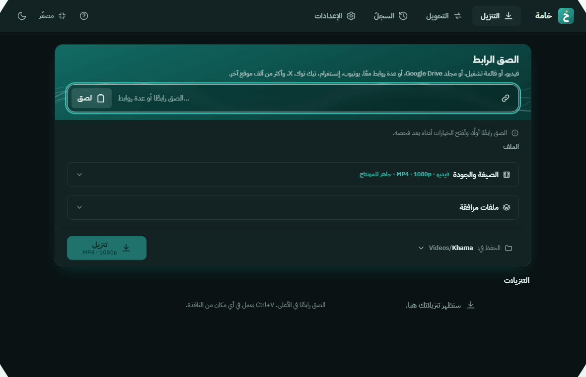
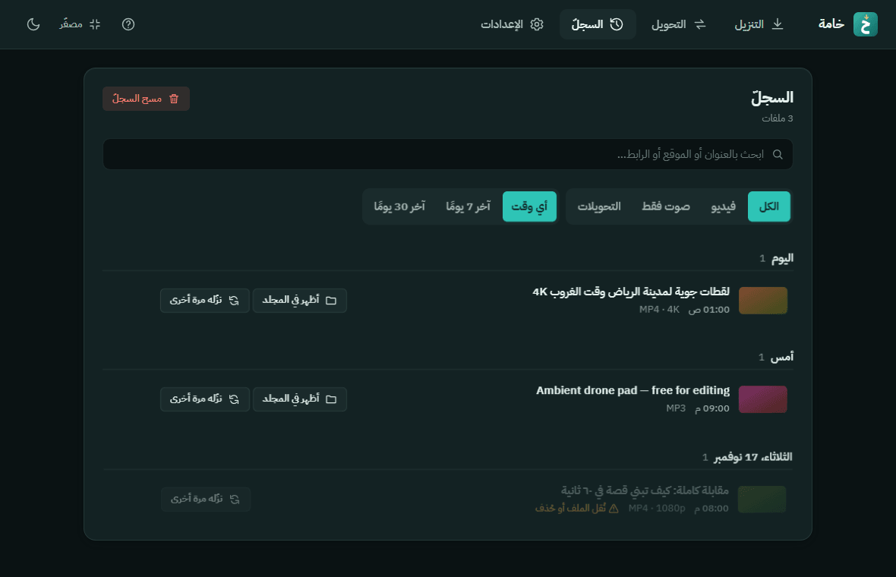
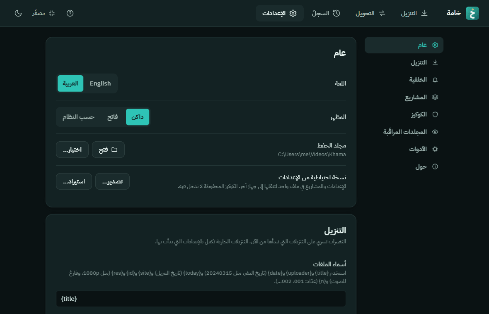
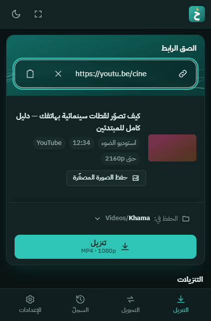

# الملحقات

(A-101)

## الملحق أ: الكرّاس الأصلي

[PROJECT_BRIEF.md](../../PROJECT_BRIEF.md) كما هو، مع سجلّ تغيّر المواصفات في آخره.

## الملحق ب: استبيان الممنتجين (A-70)

يُوزَّع قبل الاستعمال، دون اسم أو بريد. 8 أسئلة، 3 دقائق.

1. ما عملك الأساسي؟ (محرّر فيديو مستقل / في شركة / صانع محتوى / طالب / غير ذلك)
2. ما برنامج المونتاج الأساسي؟ (Premiere / DaVinci Resolve / Final Cut / CapCut / After Effects / غير ذلك)
3. كم مرة في الأسبوع تنزّل مقطعًا من الإنترنت لاستعماله في عملك؟ (0 / 1–5 / 6–20 / أكثر من 20)
4. كم دقيقة تقريبًا يأخذ منك تجهيز مقطع واحد، من إيجاده إلى وضعه على التايم لاين؟ (أقل من 2 / 2–5 / 5–15 / أكثر من 15)
5. ما الأداة التي تستعملها للتنزيل الآن؟ (نص)
6. ما أكثر مشكلة تواجهها؟ (يمكن أكثر من خيار: إعلانات ومواقع مريبة / الجودة / تنزيل الفيديو كاملًا لأخذ جزء / مشاكل تزامن أو صيغة في البرنامج / رسائل خطأ غير مفهومة / الواجهة بالإنجليزية / غير ذلك)
7. هل تحتاج أحيانًا إلى إزالة الموسيقى من مقطع كلام أو العكس؟ (نعم كثيرًا / أحيانًا / لا)
8. هل تفضّل أداة بواجهة عربية؟ (نعم / لا فرق / أفضّل الإنجليزية)

## الملحق ج: بروتوكول اختبار قابلية الاستخدام (A-10، A-99)

**المشاركون**: 5 إلى 8 ممنتجين لم يستعملوا خامة من قبل. 5 مستخدمين يكشفون أغلب مشاكل الاستعمال الكبرى، لكن النتائج الرقمية لا تُعمَّم على كل المستخدمين (A-96).

**الموافقة** (A-99): قبل البدء، يقرأ المشارك ويوقّع: «أوافق على المشاركة في اختبار تطبيق خامة لمدة 20 دقيقة تقريبًا. تُسجَّل الشاشة والزمن وملاحظاتي دون اسمي أو وجهي. أستطيع التوقف في أي وقت. تُستعمل النتائج في تقرير مشروع التخرج فقط، ويُشار إليّ برمز (P1، P2، …).»

**الإعداد**: الجهاز نفسه، والشبكة نفسها، وخامة بالنسخة الموسومة للمناقشة، وبرنامج المونتاج الذي يستعمله المشارك عادة.

**المهام** (يقرؤها المشارك ولا يُساعَد إلا إن علق أكثر من 3 دقائق):

| # | المهمة | النجاح |
|---|---|---|
| T1 | نزّل هذا الفيديو بجودة 1080p وضعه على التايم لاين في برنامجك | الملف على التايم لاين بلا رسالة تحويل |
| T2 | نزّل الثواني من 1:10 إلى 1:30 فقط من هذا الفيديو | ملف بطول 20 ث ±1 |
| T3 | نزّل الصوت فقط من هذا الفيديو بصيغة WAV | ملف WAV |
| T4 | حوّل هذا الملف من الهاتف (`02-vfr-phone.mp4`) إلى صيغة مناسبة لـ Premiere | ملف H.264 CFR أو ProRes |
| T5 | أزل الموسيقى من هذا المقطع وأبقِ الكلام | ملف صوت فقط |
| T6 | ماذا تفعل إن ظهرت هذه الرسالة؟ (رسالة «الفيديو خاص») | يذكر الكوكيز أو أن الفيديو خاص |

**يُسجَّل لكل مهمة**: النجاح (نعم / بمساعدة / لا)، والزمن، وعدد الأخطاء، وتعليق المشارك بصوت عالٍ.

**بعد المهام: استبيان SUS** [23] (1 لا أوافق بشدة ← 5 أوافق بشدة):

1. أظن أنني سأرغب في استعمال هذا التطبيق كثيرًا.
2. وجدت التطبيق معقّدًا دون داعٍ.
3. وجدت التطبيق سهل الاستعمال.
4. أظن أنني سأحتاج مساعدة شخص تقني لأستعمله.
5. وجدت أن وظائف التطبيق متكاملة جيدًا.
6. وجدت تناقضات كثيرة في التطبيق.
7. أتخيّل أن أغلب الناس سيتعلّمون استعماله بسرعة.
8. وجدت التطبيق مرهقًا في الاستعمال.
9. شعرت بالثقة وأنا أستعمله.
10. احتجت أن أتعلّم أشياء كثيرة قبل أن أستطيع استعماله.

**الحساب**: للأسئلة الفردية (الدرجة − 1)، وللزوجية (5 − الدرجة)، ثم المجموع × 2.5 فتكون الدرجة من 100. المتوسط العام في الدراسات المنشورة نحو 68.

## الملحق د: مجموعة روابط التقييم (A-52)

روابط عامة تُستعمل لقياس نسبة النجاح وتصنيف الأخطاء، مع النتيجة المتوقعة. الأسطر الاثنا عشر الأولى جُرّبت فعلًا في 2026-11-18 بـ yt-dlp 2026.10.26 المضمّن، ورسائل الخطأ محفوظة في [data/ytdlp-errors/](data/ytdlp-errors/).

| # | الموقع | الرابط | المتوقع | النتيجة 2026-11-18 |
|---|---|---|---|---|
| 1 | YouTube | https://www.youtube.com/watch?v=jNQXAC9IVRw | نجاح | ✓ |
| 2 | Vimeo | https://vimeo.com/76979871 | نجاح | ✗ `loginRequired`: Vimeo صار يطلب تسجيل الدخول |
| 3 | Dailymotion | https://www.dailymotion.com/video/x5kesuj | نجاح | ✓ |
| 4 | SoundCloud | https://soundcloud.com/ethmusic/lostin-powers-she-so-heavy | نجاح (صوت) | ✓ |
| 5 | archive.org | http://archive.org/details/XD300-23_68HighlightsAResearchCntAugHumanIntellect | نجاح | ✓ |
| 6 | YouTube | https://www.youtube.com/watch?v=aaaaaaaaaaa | `unavailable` | ✓ (بعد إصلاح القاعدة) |
| 7 | Vimeo | https://vimeo.com/1 | `unavailable` | ✓ |
| 8 | Netflix | https://www.netflix.com/watch/80192098 | `drm` أو `unsupportedUrl` | ? أنهى yt-dlp دون خطأ (المستخرج العام)؛ يُفحص ما يحدث عند التنزيل |
| 9 | موقع عادي | https://example.com/ | `unsupportedUrl` | ✓ |
| 10 | نطاق غير موجود | https://this-host-does-not-exist-khama.invalid/video.mp4 | `network` | ✓ |
| 11 | Dailymotion | https://www.dailymotion.com/video/x0000000 | `unavailable` | ✓ (بعد إصلاح القاعدة) |
| 12 | SoundCloud | https://soundcloud.com/this-user-does-not-exist-khama/none | `unavailable` | ✓ |
| 13–50 | **[يكتبه الطالب]** | منشور عام من إنستغرام وتيك توك وX وفيسبوك وGoogle Drive؛ قائمة تشغيل؛ بث مباشر قادم (`live`)؛ فيديو مقيّد بالعمر (`ageRestricted`)؛ فيديو خاص (`privateVideo`)؛ فيديو محجوب جغرافيًا (`geoBlocked`)؛ مقطع قصير جدًا (أقل من 5 ث) وطويل جدًا (أكثر من ساعتين)؛ 4K؛ 60 fps؛ صوت فقط | حسب الحالة | |

**قابلية التكرار** (A-51): كل الأدوات بنسخ مثبّتة. yt-dlp 2026.10.26 وDeno v2.9.8 وبناء FFmpeg بتاريخ 2026-10-31 في [scripts/binaries.lock.json](../../scripts/binaries.lock.json) مع بصماتها، ونسخ المكتبات في `Cargo.lock` و`package-lock.json`. تُعاد كل تجربة في الفصل 6 بأوامر الملحق ط، بنفس النسخ، من الوسم `v1.0-defense` ([defense.md](defense.md)). لكن نتيجة التنزيل نفسها تتغيّر مع الوقت لأن المواقع تتغيّر، كما يُظهر السطر 2.


### نتائج تحويل الصيغ لكل مقطع

من `src/estimate.eval.test.ts` (§6.6). الزمن بالثواني، المتوسط ± sd لثلاث تشغيلات.

| المقطع | الصيغة | الجودة | التقدير MB | الفعلي MB | الخطأ % | SSIM | الزمن ث |
|---|---|---|---|---|---|---|---|
| broll-1080p.mp4 | edit_h264 | high | 13.9 | 10.5 | 32 | 0.991 | 10.91 ± 2.84 |
| broll-1080p.mp4 | edit_h264 | balanced | 9.6 | 7.8 | 23 | 0.990 | 15.37 ± 1.06 |
| broll-1080p.mp4 | edit_h264 | small | 5.4 | 4.2 | 27 | 0.986 | 13.22 ± 1.25 |
| broll-1080p.mp4 | youtube | balanced | 11.3 | 7.8 | 45 | 0.990 | 14.39 ± 2.03 |
| broll-1080p.mp4 | whatsapp | balanced | 1.1 | 1.1 | 3 | 0.965 | 6.71 ± 0.41 |
| broll-1080p.mp4 | h265 | balanced | 4.9 | 3.0 | 64 | 0.985 | 26.58 ± 20.14 |
| broll-1080p.mp4 | av1 | balanced | 3.2 | 2.9 | 10 | 0.985 | 6.31 ± 0.99 |
| broll-1080p.mp4 | webm | balanced | 3.7 | 3.2 | 14 | 0.980 | 28.66 ± 1.91 |
| broll-1080p.mp4 | prores_proxy | balanced | 39.8 | 43.1 | -8 | 0.959 | 24.05 ± 0.57 |
| broll-1080p.mp4 | prores_422 | balanced | 126.5 | 134.2 | -6 | 0.992 | 13.45 ± 0.73 |
| broll-1080p.mp4 | dnxhr_sq | balanced | 124.8 | 125.2 | -0 | 0.992 | 2.74 ± 0.03 |
| broll-1080p.mp4 | proxy | balanced | 0.7 | 2.0 | -64 | 0.948 | 2.40 ± 0.27 |
| broll-vertical.mp4 | edit_h264 | high | 13.5 | 7.4 | 82 | 0.994 | 8.94 ± 0.32 |
| broll-vertical.mp4 | edit_h264 | balanced | 9.3 | 5.9 | 58 | 0.993 | 8.00 ± 0.15 |
| broll-vertical.mp4 | edit_h264 | small | 5.0 | 3.4 | 48 | 0.991 | 6.79 ± 0.46 |
| broll-vertical.mp4 | youtube | balanced | 10.9 | 5.9 | 86 | 0.993 | 7.63 ± 0.46 |
| broll-vertical.mp4 | whatsapp | balanced | 1.0 | 0.7 | 49 | 0.982 | 2.79 ± 0.16 |
| broll-vertical.mp4 | h265 | balanced | 4.6 | 1.3 | 251 | 0.988 | 9.65 ± 0.27 |
| broll-vertical.mp4 | av1 | balanced | 2.9 | 1.1 | 164 | 0.988 | 3.97 ± 0.22 |
| broll-vertical.mp4 | webm | balanced | 3.4 | 1.2 | 170 | 0.986 | 18.66 ± 1.53 |
| broll-vertical.mp4 | prores_proxy | balanced | 37.9 | 33.9 | 12 | 0.991 | 8.13 ± 0.18 |
| broll-vertical.mp4 | prores_422 | balanced | 123.7 | 118.0 | 5 | 0.996 | 9.56 ± 0.43 |
| broll-vertical.mp4 | dnxhr_sq | balanced | 122.0 | 124.3 | -2 | 0.997 | 1.79 ± 0.05 |
| broll-vertical.mp4 | proxy | balanced | 0.5 | 0.7 | -37 | 0.979 | 1.77 ± 0.05 |
| game-1080p.mp4 | edit_h264 | high | 32.5 | 5.0 | 552 | 0.998 | 10.55 ± 0.63 |
| game-1080p.mp4 | edit_h264 | balanced | 22.4 | 4.3 | 426 | 0.998 | 10.39 ± 0.54 |
| game-1080p.mp4 | edit_h264 | small | 12.3 | 3.2 | 286 | 0.997 | 9.53 ± 0.23 |
| game-1080p.mp4 | youtube | balanced | 26.4 | 4.3 | 521 | 0.998 | 11.91 ± 0.40 |
| game-1080p.mp4 | whatsapp | balanced | 2.5 | 1.2 | 113 | 0.989 | 6.20 ± 0.51 |
| game-1080p.mp4 | h265 | balanced | 11.3 | 1.9 | 487 | 0.994 | 21.83 ± 1.36 |
| game-1080p.mp4 | av1 | balanced | 7.3 | 2.3 | 216 | 0.995 | 8.67 ± 0.16 |
| game-1080p.mp4 | webm | balanced | 8.3 | 2.4 | 249 | 0.990 | 59.99 ± 20.27 |
| game-1080p.mp4 | prores_proxy | balanced | 92.2 | 64.0 | 44 | 0.992 | 49.02 ± 13.18 |
| game-1080p.mp4 | prores_422 | balanced | 297.6 | 212.7 | 40 | 0.998 | 38.85 ± 11.03 |
| game-1080p.mp4 | dnxhr_sq | balanced | 293.6 | 294.3 | -0 | 0.999 | 10.74 ± 8.82 |
| game-1080p.mp4 | proxy | balanced | 1.4 | 1.6 | -16 | 0.985 | 11.28 ± 12.92 |
| lecture-1080p.mp4 | edit_h264 | high | 16.3 | 6.8 | 139 | 0.995 | 12.39 ± 5.64 |
| lecture-1080p.mp4 | edit_h264 | balanced | 11.3 | 5.5 | 107 | 0.994 | 9.43 ± 0.94 |
| lecture-1080p.mp4 | edit_h264 | small | 6.3 | 3.5 | 77 | 0.992 | 7.80 ± 0.71 |
| lecture-1080p.mp4 | youtube | balanced | 13.3 | 5.5 | 144 | 0.994 | 9.29 ± 0.30 |
| lecture-1080p.mp4 | whatsapp | balanced | 1.3 | 1.2 | 11 | 0.980 | 5.21 ± 1.83 |
| lecture-1080p.mp4 | h265 | balanced | 5.8 | 2.6 | 122 | 0.991 | 16.15 ± 4.12 |
| lecture-1080p.mp4 | av1 | balanced | 3.8 | 2.8 | 33 | 0.992 | 6.96 ± 0.53 |
| lecture-1080p.mp4 | webm | balanced | 4.3 | 2.8 | 55 | 0.981 | 39.91 ± 4.76 |
| lecture-1080p.mp4 | prores_proxy | balanced | 46.7 | 49.0 | -5 | 0.989 | 16.74 ± 0.98 |
| lecture-1080p.mp4 | prores_422 | balanced | 149.0 | 156.3 | -5 | 0.997 | 19.31 ± 6.72 |
| lecture-1080p.mp4 | dnxhr_sq | balanced | 147.0 | 146.9 | 0 | 0.998 | 3.35 ± 0.74 |
| lecture-1080p.mp4 | proxy | balanced | 0.8 | 1.4 | -44 | 0.976 | 3.17 ± 1.19 |
| phone-vertical-1080x1920.mp4 | edit_h264 | high | 8.4 | 12.4 | -32 | 0.992 | 10.13 ± 1.20 |
| phone-vertical-1080x1920.mp4 | edit_h264 | balanced | 5.9 | 9.2 | -36 | 0.989 | 7.81 ± 0.10 |
| phone-vertical-1080x1920.mp4 | edit_h264 | small | 3.3 | 3.6 | -8 | 0.980 | 6.00 ± 0.18 |
| phone-vertical-1080x1920.mp4 | youtube | balanced | 6.9 | 9.2 | -25 | 0.989 | 7.32 ± 0.59 |
| phone-vertical-1080x1920.mp4 | whatsapp | balanced | 0.7 | 0.5 | 31 | 0.967 | 3.90 ± 0.98 |
| phone-vertical-1080x1920.mp4 | h265 | balanced | 3.1 | 1.6 | 94 | 0.976 | 9.74 ± 1.73 |
| phone-vertical-1080x1920.mp4 | av1 | balanced | 2.0 | 0.9 | 119 | 0.974 | 3.78 ± 0.38 |
| phone-vertical-1080x1920.mp4 | webm | balanced | 2.3 | 0.9 | 149 | 0.962 | 18.90 ± 3.83 |
| phone-vertical-1080x1920.mp4 | prores_proxy | balanced | 24.4 | 23.4 | 4 | 0.977 | 7.40 ± 0.56 |
| phone-vertical-1080x1920.mp4 | prores_422 | balanced | 76.3 | 80.1 | -5 | 0.993 | 8.19 ± 0.50 |
| phone-vertical-1080x1920.mp4 | dnxhr_sq | balanced | 75.3 | 75.4 | -0 | 0.991 | 2.35 ± 0.04 |
| phone-vertical-1080x1920.mp4 | proxy | balanced | 0.5 | 0.6 | -15 | 0.963 | 2.08 ± 0.08 |
| studio-1080p.mp4 | edit_h264 | high | 13.2 | 5.5 | 139 | 0.997 | 6.64 ± 0.88 |
| studio-1080p.mp4 | edit_h264 | balanced | 9.2 | 4.6 | 98 | 0.997 | 5.92 ± 0.24 |
| studio-1080p.mp4 | edit_h264 | small | 5.1 | 3.4 | 50 | 0.996 | 6.16 ± 0.86 |
| studio-1080p.mp4 | youtube | balanced | 10.8 | 4.6 | 133 | 0.997 | 6.18 ± 0.63 |
| studio-1080p.mp4 | whatsapp | balanced | 1.1 | 1.4 | -23 | 0.984 | 2.31 ± 0.06 |
| studio-1080p.mp4 | h265 | balanced | 4.7 | 2.7 | 74 | 0.994 | 10.50 ± 1.68 |
| studio-1080p.mp4 | av1 | balanced | 3.1 | 2.6 | 17 | 0.993 | 5.03 ± 0.42 |
| studio-1080p.mp4 | webm | balanced | 3.5 | 2.6 | 32 | 0.977 | 21.87 ± 3.47 |
| studio-1080p.mp4 | prores_proxy | balanced | 37.9 | 35.7 | 6 | 0.987 | 11.71 ± 0.88 |
| studio-1080p.mp4 | prores_422 | balanced | 120.4 | 111.2 | 8 | 0.998 | 10.80 ± 1.22 |
| studio-1080p.mp4 | dnxhr_sq | balanced | 118.8 | 119.0 | -0 | 0.998 | 1.62 ± 0.08 |
| studio-1080p.mp4 | proxy | balanced | 0.7 | 1.4 | -49 | 0.974 | 1.68 ± 0.07 |
| synthetic-1080p.mp4 | edit_h264 | high | 20.3 | 12.1 | 68 | 0.999 | 5.18 ± 0.13 |
| synthetic-1080p.mp4 | edit_h264 | balanced | 14.1 | 10.8 | 30 | 0.999 | 6.31 ± 1.62 |
| synthetic-1080p.mp4 | edit_h264 | small | 7.8 | 8.2 | -4 | 0.997 | 5.19 ± 0.34 |
| synthetic-1080p.mp4 | youtube | balanced | 16.6 | 10.8 | 53 | 0.999 | 5.02 ± 0.03 |
| synthetic-1080p.mp4 | whatsapp | balanced | 1.6 | 1.6 | 3 | 0.968 | 2.73 ± 0.10 |
| synthetic-1080p.mp4 | h265 | balanced | 7.2 | 10.8 | -33 | 0.995 | 11.59 ± 0.43 |
| synthetic-1080p.mp4 | av1 | balanced | 4.7 | 9.7 | -52 | 0.995 | 5.71 ± 0.08 |
| synthetic-1080p.mp4 | webm | balanced | 5.3 | 9.0 | -41 | 0.981 | 21.56 ± 1.71 |
| synthetic-1080p.mp4 | prores_proxy | balanced | 58.2 | 28.9 | 101 | 0.991 | 16.23 ± 1.26 |
| synthetic-1080p.mp4 | prores_422 | balanced | 185.7 | 78.0 | 138 | 0.998 | 16.52 ± 1.13 |
| synthetic-1080p.mp4 | dnxhr_sq | balanced | 183.2 | 182.8 | 0 | 0.977 | 2.20 ± 0.30 |
| synthetic-1080p.mp4 | proxy | balanced | 1.0 | 1.2 | -15 | 0.965 | 2.21 ± 0.07 |
| synthetic-vfr-720p.mp4 | edit_h264 | high | 7.9 | 5.7 | 39 | 0.999 | 4.79 ± 0.24 |
| synthetic-vfr-720p.mp4 | edit_h264 | balanced | 5.5 | 5.0 | 10 | 0.998 | 4.43 ± 0.41 |
| synthetic-vfr-720p.mp4 | edit_h264 | small | 3.2 | 3.8 | -16 | 0.997 | 4.48 ± 0.46 |
| synthetic-vfr-720p.mp4 | youtube | balanced | 6.5 | 5.0 | 29 | 0.998 | 4.21 ± 0.19 |
| synthetic-vfr-720p.mp4 | whatsapp | balanced | 1.4 | 2.4 | -41 | 0.991 | 3.80 ± 0.49 |
| synthetic-vfr-720p.mp4 | h265 | balanced | 2.9 | 4.0 | -26 | 0.996 | 12.17 ± 1.15 |
| synthetic-vfr-720p.mp4 | av1 | balanced | 2.0 | 5.7 | -66 | 0.996 | 5.60 ± 0.86 |
| synthetic-vfr-720p.mp4 | webm | balanced | 2.2 | 4.5 | -51 | 0.994 | 20.95 ± 2.21 |
| synthetic-vfr-720p.mp4 | prores_proxy | balanced | 23.2 | 36.8 | -37 | 0.988 | 14.27 ± 0.64 |
| synthetic-vfr-720p.mp4 | prores_422 | balanced | 71.5 | 95.8 | -25 | 0.998 | 13.74 ± 0.73 |
| synthetic-vfr-720p.mp4 | dnxhr_sq | balanced | 70.6 | 160.7 | -56 | 0.975 | 1.32 ± 0.01 |

## الملحق هـ: الرخص

[LICENSE](../../LICENSE) (MIT) و[THIRD_PARTY_NOTICES.md](../../THIRD_PARTY_NOTICES.md)، وSBOM المرفق بكل إصدار.

## الملحق و: دليل التثبيت (A-64)

لكل نظام، من [README.md](../../README.md#install):

| النظام | الملف | الخطوات | الحد الأدنى |
|---|---|---|---|
| Windows | `Khama_x.y.z_x64-setup.exe` | افتحه ← (SmartScreen: «مزيد من المعلومات» ← «تشغيل على أي حال») ← تثبيت | Windows 10 64 بت، WebView2 (يُنزَّل تلقائيًا إن غاب) |
| macOS | `Khama_x.y.z_aarch64.dmg` (Apple Silicon) أو `x64.dmg` (Intel) | اسحب إلى Applications ← افتح مرة ← الإعدادات ← الخصوصية والأمان ← «افتح على أي حال» | macOS 10.13 |
| Linux | `.deb` (Ubuntu، Debian، Mint)، `.rpm` (Fedora، openSUSE)، `.AppImage` (أي توزيعة) | `sudo apt install ./Khama….deb` أو `chmod +x` للـ AppImage | WebKitGTK 4.1 (Ubuntu 22.04+) |
| أندرويد | `Khama_x.y.z_android-arm64.apk` | افتحه ← اسمح بالتثبيت من المصدر ← تثبيت | أندرويد 7، arm64 |

## الملحق ز: دليل المستخدم (A-50)

**[يكتبه الطالب]** لقطة لكل خطوة من المسارات الأربعة، بالأرقام على اللقطة:

1. **التنزيل**: الصق الرابط ← المعاينة ← اختر الصيغة والجودة ← (اختياري) حدّد الجزء ← «تنزيل» ← اسحب الملف من البطاقة إلى البرنامج.
2. **المقاطع المتعددة**: في المعاينة «أضف مقطعًا» ← حدّد كل مقطع على الخط الزمني ← «تنزيل» ينتج ملفًا لكل مقطع (أو ملفًا مدمجًا).
3. **التحويل**: تبويب «التحويل» ← أفلت الملفات ← اختر الصيغة (أو المقترحة) ← «حوّل».
4. **التنظيف بالذكاء الاصطناعي**: في التحويل اختر «إزالة الموسيقى» أو «إزالة الصوت» ← أول مرة ينزّل النموذج ← «حوّل».

داخل التطبيق دليل وجولة تعريفية (الإعدادات ← حول ← الدليل)، وهي مصدر جيد للقطات.

اللقطات الموجودة في المستودع (`docs/screenshots/`، بيانات تجريبية، 2026-11-19) تغطي الشاشات دون ترقيم الخطوات، فهي نقطة البداية:



**الشكل ز.1: شاشة التنزيل فارغة.** حقل الرابط هو البطل، وتحته المواقع المدعومة.



**الشكل ز.2: السجلّ.** كل عملية ناجحة مع «أظهر في المجلد» و«نزّله مرة أخرى»، وتصفية بالنوع والتاريخ، والملف المنقول أو المحذوف باهت مع تنبيه.



**الشكل ز.3: الإعدادات.**



**الشكل ز.4: الوضع المصغّر** بعد لصق رابط.

## الملحق ح: دليل المطوّر (A-65)

[docs/DEVELOPMENT.md](../DEVELOPMENT.md) (الإعداد، والبيانات التجريبية، والتصحيح، والسكربتات)، و[docs/TESTING.md](../TESTING.md) (الاختبار)، و[docs/RELEASING.md](../RELEASING.md) (الإصدار)، و[CONTRIBUTING.md](../../CONTRIBUTING.md).

## الملحق ط: إعادة الإنتاج (A-45)

كل رقم في الفصل 6 يعود إلى ملف في المستودع: سكربت يعيد القياس، أو ملف CSV في `bench/results/` تُرسم منه الأشكال وتُحسب منه الإحصاءات، ولا يُكتب رقم في الجداول إلا منهما. الجدول ط.1 يربط كل نتيجة بسكربتها وأمرها وملفها، وتعمل أوامر Python من مجلد `bench/` بعد إعداده مرة واحدة كما في [bench/README.md](../../bench/README.md).

**الجدول ط.1: من النتيجة إلى السكربت والأمر والملف**

| النتيجة | السكربت | الأمر | الملف الناتج |
|---|---|---|---|
| الجدول 6.1 (KLM) | `bench/stats/klm.py` | `python stats/klm.py` | `stats_klm.csv` |
| الجدول 6.2 (الاختبارات) | اختبارات Rust وVitest | `cargo test -q --manifest-path src-tauri/Cargo.toml` و`npx vitest run` | سجلّ CI لكل إصدار |
| الجدولان 6.5 و6.6 (الصيغ وتقدير الحجم بالمعادلة) | `presets_eval` في Rust، و`src/estimate.eval.test.ts` | الأمران 1 و2 أدناه | `eval.jsonl` محليًا، ومنه `estimate_formula.csv` (جدول الملحق د لكل مقطع) |
| الجدول 6.6 (التقدير بثلاث شرائح) | `sampled_estimate_eval` في Rust | الأمر 3 أدناه | `eval.jsonl` |
| الفترات واختبارات الدلالة في §6.6 و§6.14 | `bench/stats/report_stats.py` | `python stats/report_stats.py` | `stats_estimate.csv`، `stats_scenes.csv`، `stats_bdrate.csv`، `stats_separation.csv` |
| الجدول 6.7 (أحجام المثبّتات) | صفحة الإصدار | `gh release view v0.3.46 --json assets` | — |
| الجدول 6.12 (مقاييس الصيانة) والجدولان 5.1 و5.3 | `scripts/code-metrics.mjs`، `bench/stats/repo_counts.mjs` | `node scripts/code-metrics.mjs` و`node bench/stats/repo_counts.mjs 0.3.46` | على الشاشة |
| الجدولان 6.13 و6.14، والشكلان 6.1 و6.2 (الكاشف) | `scenes/make_dataset.py`، `scenes/evaluate.py`، `scenes/film_strip.py` | `python scenes/make_dataset.py --videos 24 --seed 7` ثم `python scenes/evaluate.py` | `scenes_test.csv`، `scenes_ablation.csv`، `scenes_films.csv`، `scenes_speed.csv`، `scenes_grid_dev.csv`، `scenes_ffmpeg_dev.csv`، `scenes_pr.png`، `scenes_film_strip.png` |
| الجدول 6.15 والشكلان 6.3 و6.4 (الترميز والمعايرة) | `codecs/run_bench.py`، `codecs/analyze.py` | `python codecs/run_bench.py` ثم `python codecs/analyze.py` (ساعات) | `codecs_raw.csv`، `codecs_hw.csv`، `codecs_bdrate.csv`، `codecs_calibration.csv`، `codecs_calibration_check.csv`، `codecs_summary.csv`، `codecs_rd_vmaf.png`، `codecs_calibration.png` |
| الجدول 6.16 (المعايرة خارج العيّنة) | `bench/stats/calibration_loco.py` | `python stats/calibration_loco.py` | `stats_calibration_loco.csv` |
| الجدول 6.17 والشكل 6.5 (الفصل) | `separation/evaluate.py` (يشغّل `khama-bench separate`) | `python separation/evaluate.py` | `separation.csv`، `separation_tracks.csv`، `separation.png` |
| §6.15 (المحور D) | `khama-bench topics` و`khama-bench silence` | `khama-bench topics <فيديو> <ترجمة>`، `khama-bench silence <ملف>` | JSON على الشاشة؛ الملفات الحقيقية لا تُنشر (الجدول 7.2)، فالنتائج غير محفوظة |

أوامر §6.6، من جذر المستودع. الأول يحوّل كل مقطع في المجلد بالصيغ الاثنتي عشرة ثلاث مرات ويكتب سطرًا لكل تحويل، والثاني يضيف تقدير الواجهة، والثالث يقيس التقدير بثلاث شرائح:

```bash
KHAMA_EVAL_DIR=<مجلد المقاطع> KHAMA_EVAL_OUT=eval.jsonl KHAMA_REPEAT=3 cargo test --release --manifest-path src-tauri/Cargo.toml presets_eval -- --ignored --nocapture
```

```bash
KHAMA_EVAL_OUT=eval.jsonl npx vitest run src/estimate.eval.test.ts --silent=false
```

```bash
KHAMA_EVAL_DIR=<مجلد المقاطع> KHAMA_EVAL_OUT=eval.jsonl cargo test --release --manifest-path src-tauri/Cargo.toml sampled_estimate_eval -- --ignored --nocapture
```

**الجدول ط.2: النسخ المستعملة في القياس**

| المكوّن | النسخة | المصدر |
|---|---|---|
| الجهاز | Intel Core i5-1135G7، ‏16 GB، Iris Xe (Quick Sync)، GeForce MX350 (بلا NVENC)، Windows 11 | `bench/README.md` |
| FFmpeg (مع libvmaf) | البناء المضمّن في التطبيق: ‏BtbN وyt-dlp FFmpeg-Builds بتاريخ 2026-10-31 | `scripts/binaries.lock.json` |
| yt-dlp وDeno | 2026.10.26 وv2.9.8 | `scripts/binaries.lock.json` |
| ONNX Runtime | 1.22.0 | `src-tauri/src/separate.rs` |
| whisper.cpp | b5907 | `src-tauri/src/convert/topics.rs` |
| حزم Python | numpy 2.5.4، scipy 1.18.1، pandas 3.1.1، matplotlib 3.11.2، musdb 0.4.3، museval 0.4.1 | `bench/requirements.txt` |
| خامة | 0.3.46، وكود الكاشف والمعايرة والفصل كما في الوسم | `git tag` |

**الأرشفة**: **[يكتبه الطالب]** رفع `bench/results/` وسكربتات `bench/` في نسخة المناقشة إلى Zenodo، وكتابة معرّف DOI هنا وفي المراجع، حتى تبقى البيانات متاحة إن تغيّر المستودع.

